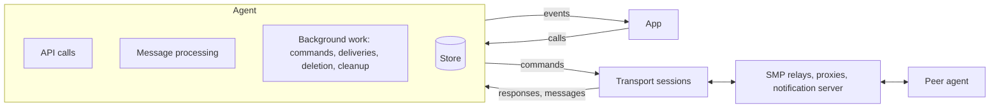

# Transport guarantees of the SMP agent

This specification states how the SMP agent serves the app, how it exchanges messages with the peer agent through relays, and how it uses servers. The message syntax and the protocol steps are in [agent-protocol.md](../protocol/agent-protocol.md), [simplex-messaging.md](../protocol/simplex-messaging.md) and the diagrams in [protocol/diagrams/duplex-messaging](../protocol/diagrams/duplex-messaging).

A design of these components meets this specification in every case of section 3. A decision in section 15 states how a requirement is met where several ways were possible.

## 1. Parts

## 2. Terms

- App: the program that calls the agent, such as the chat.
- Peer: the agent at the other end of a connection.
- Connection: the queues that the agent uses with one peer or for one contact address, with their end-to-end encryption state: a receive queue, a send queue or both, and during rotation more than one queue in a direction.
- Session: one transport connection to one server.
- App command: an asynchronous call identified by the app's corrId.
- Event: a notification from the agent to the app.
- Ratchet synchronization: the connection states RSRequired, RSStarted and RSAgreed.
- Timeout: a configured duration; time between runs of the agent is measured by the wall clock.

## 3. Cases

Each requirement holds in each of these cases:
1. concurrent calls, message processing and background work on one connection;
2. a crash and restart at any step;
3. retries after temporary errors and timeouts;
4. duplicate, late, lost and reordered responses;
5. a session ending and a new one starting;
6. the peer at every supported version, taking its own steps at the same time;
7. relays at every supported version;
8. the app reading no events for any length of time;
9. a call ended by an exception;
10. a store written by a released version;
11. SQLite and PostgreSQL stores;
12. the app and the iOS notification service extension using one store in turns;
13. the wall clock set back.

## 4. Calls and events

1. A synchronous call performs its database work and its own server requests, and returns their result. Each server request ends within its timeout. The call waits for no other operation's server request and for no reading of events by the app, except:
   - the connection attempt of a session it needs, started by another operation, within the connection timeout;
   - a GET, which waits as item 8.1 states;
   - a service request, which waits for the peer's reply until its timeout (item 10.3);
   - a response that arrives behind messages the app has not read yet, within the same timeout.
2. An asynchronous call returns once its command is stored. Each app command ends with one event carrying its corrId: its result or its error. The command is not repeated after that event; when the process ends before the app reads the event, the event is lost (item 4.5). The commands of a deleted connection end with its deletion, without events.
3. Events of one connection reach the app in the order in which their state changes are committed. Examples: INFO before CON; JOINED before CON; DOWN and UP in the order of the subscription changes.
4. Deletion events: DEL_CONNS for connections deleted at once is emitted before the call returns, then DEL_RCVQS, DEL_CONNS and DEL_USER follow in that order.
5. Events are kept in memory. Every event produced while the agent runs reaches the app. Events not yet read when the process ends are lost.
6. While the app reads no events, the agent stops reading messages from the network, and resumes, on the same session or a new one, when the app reads again. Message processing and background work that produce events pause meanwhile, and no call waits for them. Memory for the events they produce, and for unsent commands, stays within configured sizes. Events produced by calls, by session changes and by suspension are queued beyond these sizes, without waiting.
7. After SUSPENDED, no store transaction starts and no background work runs until the app resumes the agent. SUSPENDED is emitted, without waiting, once every operation in progress has ended.

## 5. Connections

1. Connections are established as the fast duplex connection procedure of agent-protocol.md describes. A queue address leaves the agent only after the queue is recorded, except in a prepared link, which is returned before its queue is created; until then the server refuses messages to that address with AUTH.
2. On each send queue of a connection, the agent first secures the queue, then sends the confirmation that gives the recipient its keys, and only then other messages. With a peer below agent version 8, the new send queue of a rotation is secured by the peer with KEY, and QTEST is the first message on it. Invitations to a contact address are sent to its queue, which is not secured.
3. Join attempts of one invitation run one at a time; a second synchronous join while one runs is refused.
4. Every queue whose ID the agent receives from a server is recorded in its connection until item 9.2 removes it. A queue whose creation response is lost stays on the server unused.
5. CON is emitted on each side when the connection carries messages in both directions.

## 6. Messages

Sending:
1. Messages of a connection are encrypted in the order they are stored, and are delivered on each send queue in that order.
2. A message is stored entirely before or after each rotation or ratchet synchronization step, and is delivered to the send queues of the connection at that point.
3. A stored app message ends, for each send queue it was stored for, with SENT or with an error event; each other stored message is delivered or dropped. Each ends at the latest when its timeout has passed while the agent runs. The messages of a deleted connection end with its deletion, without events.
4. After a connection is deleted without waiting for delivery, no more messages are sent to its send queues.

Receiving:
5. The transmissions of one receive queue (messages, END, DELD and errors) are processed one at a time, in the order the server delivers them, including messages that arrive inside responses.
6. Each received transmission has the effect it would have if processed after every step on its connection that committed before it.
7. A received message is acknowledged to the server after its processing is committed, or after it ends with an error event. After a crash before that, the server delivers it again; its effect is applied once, and an app message that the app has not acknowledged is delivered to the app again (item 6.9).
8. The app receives the messages of one receive queue in order, one at a time: after a message that the app must acknowledge, the next message of that queue arrives after the app's acknowledgement.
9. A message the app acknowledged is not delivered to the app again. A message it did not acknowledge is delivered again in a later session, until its redelivery bound is reached, and is then dropped with an error event.
10. A message sent twice by the peer, after a lost response, reaches the app once.

Acknowledgement and receipts:
11. The app's acknowledgement is committed before the server ACK. The receipt it requests is stored after the server ACK, by the step that deletes the message, also when the next message of the queue was processed first.
12. At most one receipt is stored for each app message that the app acknowledged with a receipt request. It is stored unless ratchet synchronization is in progress when it is prepared, and it is delivered as items 6.3 and 6.4 state.
13. A received message is deleted after the server answers its ACK with OK or NO_MSG, or when its queue no longer exists. After NO_MSG, the server can deliver the message again, and item 6.9 applies.
14. An acknowledgement completes in every state of the connection: during ratchet synchronization, and after its queue was removed.

## 7. Queue rotation and ratchet synchronization

1. Rotation steps are applied in the order of the fast queue rotation procedure for a peer at agent version 8, and of the queue rotation procedure for earlier versions, each from the status it expects, read in that step.
2. An abort is accepted until the rotation's QADD is stored; it then cancels the step in progress and deletes the new queue. After QADD is stored, an abort is refused.
3. When the server refuses a rotation message with AUTH, the rotation returns to its state before it started. When a rotation message is not accepted within its timeout, the rotation stays in progress.
4. While a rotation is in progress, messages keep flowing on the current queues, as item 7.7 allows.
5. When SWITCH completed is emitted, the notification subscription change for the new queue has been requested, and it takes effect also after a restart.
6. The old receive queue is deleted after its last messages are received and acknowledged, or once its expiry timeout has passed while the agent runs.
7. During ratchet synchronization, no message that needs the ratchet is sent, and calls that start a rotation or an abort are refused. A background step that needs the ratchet waits until synchronization ends or the connection is deleted.
8. A call that starts a rotation, an abort or a ratchet synchronization commits all its changes, or is refused without changes.

## 8. GET mode (iOS notification service extension)

1. Per queue, GET fetches one message at a time. The next GET of that queue starts once one of these happens: the app acknowledges the message; a GET returns no message or fails; the session of the fetch ends; the acknowledgement fails permanently; a bounded time passes.
2. Within one agent, a queue is either fetched by GET or subscribed: GET is refused for a queue with an active or pending subscription, and SUB is refused for a queue with a fetched message. When the app and the extension use one queue, the server can deliver one message to both, and the second delivery is processed as a redelivered message (item 6.9).
3. A fetched message reaches the app, or is fetched again by a later GET.
4. MSGNTF is emitted after the server answers the ACK of the fetched message and after the wait of item 8.1 ends, following every other event of that message. It carries the message id and its broker timestamp.

## 9. Deletion

1. Asynchronous deletion calls return after their store work, and queues are deleted on their servers afterwards, in the background.
2. When a connection is deleted, DEL is sent for every receive queue of the connection, including queues it no longer uses, until the server confirms the deletion, returns a permanent error, or the configured number of attempts fails; the queue's record is then removed.
3. At most one DEL for a queue is in flight, and DEL is not sent after the queue's deletion is confirmed or given up.
4. A connection deleted with waitDelivery first delivers its pending messages and is then deleted; once its delivery timeout has passed while the agent runs, it is deleted with any messages left.
5. Synchronous deletion, used by tests, deletes the queues on their servers before it returns, and leaves the connection unmarked when that fails, so that a repeated call deletes it.
6. When a user is deleted, every connection of the user is deleted as in item 9.2, and DEL_USER is emitted once, after the last of them.
7. Deleting a connection ends its subscriptions at once, and its notification subscriptions as soon as the notification supervisor runs, also when the deletion happened in background mode or before a restart.

## 10. Links, service requests and notifications

1. The server holds the data of the newest update of each link.
2. Repeated short-link calls on a connection return the same short link.
3. The service request message is sent only while the caller waits for its reply; a reply that arrives after the call has ended is reported with an error event.
4. Notification commands of one connection (create, delete, mute) take effect in the order of the operations that request them.
5. In background mode, calls that change notification subscriptions return without waiting; the changes are applied in the next foreground run.

## 11. Sessions

1. Each session has one transport connection. One connection attempt runs at a time per session; after a failed attempt, requests to that session fail with the same error until the error interval passes.
2. Commands of one session are sent in the order they are issued, across callers and retries.
3. A single command is not sent after its caller has stopped waiting. Batched subscription, notification and deletion commands are sent until the session ends.
4. Each response is passed once: to its waiting caller or, after the caller stopped waiting for any reason, to the agent as a late response. A late response of any age is processed. A request is kept until its response arrives or its session ends.
5. When a session ends, its pending requests fail at once, and later requests to it fail at once.
6. Subscription state, UP and DOWN reflect only the current session of each queue; results from an ended session leave them unchanged. A queue with an active or pending subscription is subscribed again after its session ends, until the subscription succeeds, fails permanently or is removed.
7. SEND, SKEY, LKEY, LGET and RSLV go through a proxy whenever the proxy mode requires it, and directly only when the mode or the fallback setting allows it; other commands go to the relay directly.
8. Requests of different users to SMP relays and XFTP servers never share a session; in entity mode, requests of different connections never share one. Notification server requests share one session per server, because the device token serves all users.
9. A session ends after repeated request timeouts without received data.

## 12. Timing

1. A slow or unreachable server delays only the operations that need its responses, and the operations ordered after them by items 6.1, 6.5, 7.7, 10.4, 11.2 and 13.4.
2. Messages from every server are processed while any server is slow.
3. Every wait in the agent ends: a server request by its timeout; a store operation when it completes; a wait for the app when the app reads, acknowledges or resumes the agent; a wait for ratchet synchronization when it ends or the connection is deleted.
4. No call and no operation in progress waits for the app, except where items 4.1, 4.6, 4.7 and 8.1 state.

## 13. Persistence and recovery

1. After a crash at any step, a state change is present together with every command, message and delivery it starts, or none of them is.
2. After a crash at any step, every started operation completes, is retried, or ends with an error event.
3. A command takes effect only while it is pending and the state it depends on is unchanged. A command made obsolete by an abort, a deletion, a repeated QADD or the cleanup of a service request is dropped and ends as item 4.2 states; an obsolete internal command ends without an error event.
4. The commands of one connection and server run one at a time, in the order they are created, independent of the wall clock. Commands of different servers run at the same time.
5. A request repeated after a crash, a timeout or a lost response has the effect of one request for the app and the peer: a repeated message reaches the peer's app once (item 6.10), and an object created on a server by an earlier attempt, whose ID the agent received, is deleted.
6. Commands, messages and deliveries stored by released versions are processed after an upgrade.

## 14. Cost and compatibility

1. The time and store reads for one received message, acknowledgement, command attempt or deletion step do not grow with the number of stored connections, messages or commands.
2. Released clients, servers and peers at the supported versions keep working: agent versions 6 to 8, SMP client versions 3 and 4, relay versions from 15. A store written by a released version is upgraded with its state kept. Exceptions, by decision: a connection whose establishment needs KEY ends with a version error at the upgrade, and an invitation without a sender-secured queue is refused.

## 15. Decisions

| Date | Decision | Items |
|---|---|---|
| 2026-11-24 | Events are kept in memory; unread events are lost when the process ends. | 4.5 |
| 2026-11-25 | Acknowledgements stay asynchronous and ordered through stored commands; the receipt keeps master's order, after the server ACK. | 6.11, 6.12 |
| 2026-11-24 | A second synchronous join of an invitation is refused instead of waiting. | 5.3 |
| 2026-11-24 | An abort cancels the rotation step in progress and deletes its new queue. | 7.2 |
| 2026-11-24 | The KEY handshake of connection establishment is removed; SMP client version 3, with sender-secured queues, is the minimum. Rotation with peers below agent version 8 keeps KEY. | 5.2, 14.2 |
| 2026-11-25 | Connections in the middle of the KEY handshake at the upgrade end with a version error, and joining an invitation without a sender-secured queue is refused. | 14.2 |
| 2026-11-25 | A rotation refused by the server returns to its state before it started; an abort is refused once QADD is stored. | 7.2, 7.3 |
| 2026-11-25 | The order of link data is met by versioned link data and RKEY support, in a separate change; until then, link requests are sent without waiting for each other. | 10.1 |
