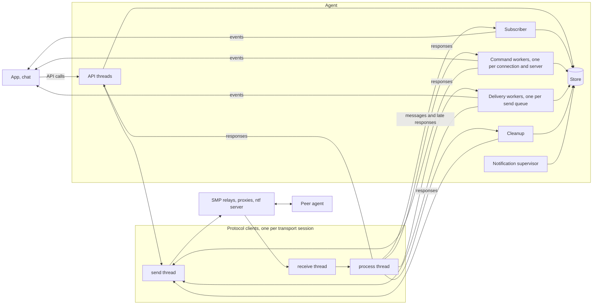

# Transport guarantees of the SMP agent

Required properties of the SMP agent, its protocol clients, and its exchange with the app and the peer agent.

A change to these components is accepted only when every property holds in every case of section 2, or when a decision in section 16 changes how it is met.

The column "Master" states the behaviour of master at 3f57fcdc:
- "holds": the property holds in every case;
- "violated": a known defect that a change in this area must remove;
- "partly": the property holds except in the cases named;
- "unconfirmed": the code read so far does not settle it.

A row marked "instance of" names a case of a more general row that a design must check on its own.

## 1. Parts

The agent and the peer agent are two state machines that exchange messages through relays. A relay can delay, repeat or lose a response, and it delivers the messages of one queue in order.

## 2. Cases

Each property is checked in each of these cases:
1. concurrent API calls, subscriber, workers, deletion and cleanup on one connection;
2. a crash and restart at any step;
3. retries after temporary errors and timeouts;
4. duplicate, late, lost and reordered responses;
5. disconnection and reconnection of a transport session;
6. the peer agent at every supported version, taking its own steps concurrently;
7. relays at every supported version, including those that put MSG into SUB responses;
8. the app reading no events for any length of time;
9. callers ended by an exception, including cancelled workers and sibling threads;
10. databases written by released versions, and a downgrade;
11. SQLite and PostgreSQL stores;
12. foreground app and background mode (iOS notification service extension), alternating on one database;
13. the wall clock set back.

## 3. Goals

| ID | Guarantee | Master |
|---|---|---|
| G1 | A slow or unreachable server delays only work that depends on a response of that server. | violated: requests are sent under connection locks, and the subscriber waits for them |
| G2 | Processing of received messages never waits for a server request. | violated, as G1 |
| G3 | API threads and holders of agent locks never wait for the app to read events, except a GET of a queue whose fetched message the app has not acknowledged (N1), and a network request, bounded by its timeout, whose response waits behind unread messages (G5). | violated: API threads and lock holders write events, response messages and SUSPENDED blocking; service-request calls wait for the subscriber, which waits for the app |
| G4 | Waits form no cycle among agent threads, protocol client threads and the app. | violated: cycles through the message queue, the event queue and connection locks |
| G5 | While the app reads no events, the agent stops reading from the network instead of buffering without bound: the subscriber stops reading messages, the message queue fills, each protocol client stops reading its socket, and requests time out. | partly: a forked event writer is added for each client callback event, and the number grows with each reconnection |
| G6 | Memory held for unread events, unsent blocks, kept requests, locks and workers is bounded by configured sizes and counts. | violated: the number of forked writers, kept requests, lock entries and worker entries is unbounded |
| G7 | Released clients, servers and peer agents at the supported versions keep working, and existing databases are upgraded with their state kept. | partly: R2 |

## 4. Peer protocol

| ID | Guarantee | Master |
|---|---|---|
| P1 | Messages of a connection are encrypted in the order they are stored, and are delivered on each send queue in that order. | holds |
| P2 | Transmissions of one receive queue (messages, END, DELD, errors) are processed one at a time, in the order the server delivers them, with one unacknowledged message at a time. | partly: a message in a SUB, ACK or GET response is processed after later transmissions (C3) |
| P3 | A received message is acknowledged to the server only after its processing is committed or has ended with an error event; after a crash before that, the message is delivered again. | holds |
| P4 | A message the app has acknowledged is never delivered to the app again; a message it has not acknowledged is delivered again after redelivery, until the redelivery bound, after which it is dropped with an error event. | holds |
| P5 | A message is sent on a send queue only after the confirmation that gives the recipient its keys. | partly: between retries of SKEY; on the joining side, between recording the send queue and storing the confirmation |
| P6 | A new send queue of a rotation is secured before data is sent on it. | holds |
| P7 | In the KEY handshake, HELLO is sent before app messages. | partly: an app message can be stored before the first KEY attempt or between retries |
| P8 | Join attempts of one invitation never overlap. | partly: background joins run without the invitation lock |
| P9 | A queue address is given to the peer only after the queue is recorded. | partly: a prepared link gives the address before the queue exists; the chat publishes it after creation |
| P10 | A message is stored entirely before or after each ratchet synchronization or rotation step, and its deliveries go to the send queues present at that point. | holds |
| P11 | The processing of one received transmission is atomic with respect to other operations on its connection, and decides from state read inside that atomic step. | partly: state is read before the connection lock; deletion, notification toggles, acknowledgements and GET are not serialized with processing |
| P12 | After a connection is deleted without waiting for delivery, no further message is sent on its queues. | partly: pending deliveries are read without the deleted filter until the row is removed |

## 5. Queue rotation and ratchet synchronization

| ID | Guarantee | Master |
|---|---|---|
| R1 | Rotation steps of one connection are applied in protocol order, each only from its expected status, read inside the step. | partly: several steps write the next status without checking the current one, and one check uses state read before the lock |
| R2 | An abort is applied only in states where the peer has not committed to the new queue. | violated: with agreed version 7 and version 8 software, the abort is applied after the peer rotated fast, and the queue the peer uses is deleted |
| R3 | Every rotation ends completed or in a state from which it can be aborted. | violated: after a lost QADD or QUSE, the rotation can be neither aborted nor replaced |
| R4 | The old receive queue is deleted only after its messages are received and acknowledged, or by the expiry bound. | partly: below agent version 8, the old queue is deleted at the first message on the new queue |
| R5 | While ratchet synchronization is in progress (states RSRequired, RSStarted, RSAgreed), no message that needs the ratchet is sent, and a step that needs it is deferred, never lost. | violated: rotation steps end with an error and the rotation stays stuck; checks use state read before the lock, so a step can be stored after the ratchet key message |
| R6 | A switch, abort or ratchet synchronization started by the app is refused or applied, never left half-applied. | partly: crash windows between transactions |

## 6. Acknowledgement and receipts

| ID | Guarantee | Master |
|---|---|---|
| A1 | The app's acknowledgement of a message is committed before the server ACK. | holds |
| A2 | A received message row is deleted only after the server confirms the ACK with OK or NO_MSG, or when its queue no longer exists. | holds |
| A3 | A receipt is sent only for an app message that the app acknowledged with a receipt request, after the app processed it. | holds |
| A4 | A requested receipt is sent once; it is skipped only when the ratchet does not allow sending at the acknowledgement. | violated: lost after an ACK timeout followed by QEND, sent twice after a crash |
| A5 | An acknowledgement completes also when the message's queue was removed before it. | violated: the acknowledgement fails, and the row is kept |
| A6 | The app's acknowledgement and its receipt are committed before the next message of the same queue is processed. | partly: after an ACK timeout, the late response is processed first |
| A7 | An acknowledgement during ratchet synchronization completes: the message row is deleted and MSGNTF is emitted. | partly: with a receipt request, an error is emitted, the row is kept and MSGNTF is lost |
| A8 | Every received message ends in one outcome: acknowledged after processing, waiting for the app's acknowledgement, or an error event followed by its acknowledgement. | partly: when the queue or connection cannot be read, an error is emitted and no ACK follows |

## 7. GET mode (iOS notification service extension)

| ID | Guarantee | Master |
|---|---|---|
| N1 | In one agent, at most one GET-fetched message per queue is outstanding. The next GET of the queue waits until one of: the message is acknowledged; a GET returns no message or fails; the session that fetched the message disconnects; its acknowledgement fails permanently; a bounded time passes without the app's acknowledgement. | violated: a stale ACK row can release the wait early, and the wait never ends in the last three cases |
| N2 | A queue fetched by GET is not subscribed by the same agent, and a queue with an active or pending subscription is not fetched by GET. | partly: a pending subscription does not refuse GET |
| N3 | MSGNTF, the marker of the notification service extension, is emitted after the server confirms the ACK, after the GET wait is released, and after every event of that message. | partly: it can be emitted before subscriber events when the event queue is full |
| N4 | MSGNTF carries the message id and its broker timestamp, read before the message row is deleted. | holds |
| N5 | A message fetched by GET is delivered to the app, or is fetched again. | partly: lost when the requesting thread is cancelled after the response, or when its queue or connection cannot be read |

## 8. Events to the app

| ID | Guarantee | Master |
|---|---|---|
| E1 | Events of one connection are delivered to the app in the order in which their state changes are committed. | partly: deferred events can be overtaken, and forked writers race, when the event queue is full |
| E2 | Each producing thread emits its events in program order. | partly, as E1 |
| E3 | Instance of E1: INFO is emitted before CON for one confirmation. | partly, as E1 |
| E4 | Instance of E1: JOINED is emitted before CON of the same connection. | partly: the order rests on network timing, and is lost when the event queue is full |
| E5 | Instance of E1: DOWN and UP of one subscription are emitted in the order of the subscription state changes. | violated: unordered when the event queue is full, and UP is emitted after a session change |
| E6 | DEL_CONNS of connections deleted at once is emitted before the call returns; then DEL_RCVQS, DEL_CONNS and DEL_USER are emitted in that order. | holds |
| E7 | In a rotation, the notification subscription command is issued before SWITCH SPCompleted is emitted. | holds |
| E8 | An event produced while the agent runs is delivered to the app; unread events are lost only when the process ends. | violated: deferred events are lost when processing throws |
| E9 | SUSPENDED is emitted atomically with the suspended state, without waiting. | violated: the event is written blocking inside the state transaction |
| E10 | Each command that the app enqueues ends with exactly one event carrying its corrId, a result or an error. | holds |

## 9. Waits, locks and suspension

| ID | Guarantee | Master |
|---|---|---|
| W1 | A thread that waits for the app holds no lock, and no API call waits for that thread. | violated: lock holders and API threads write events blocking |
| W2 | Inside a database transaction, no thread waits for a queue or the network. | holds |
| W3 | No thread in the backpressure chain of G5 holds a lock while it waits. | violated: an ACK requester waits on the message queue under the connection lock, and a GET requester under the GET lock |
| W4 | Every network wait is bounded by its timeout, and a client is dropped after repeated timeouts without received data. | partly: a file request waits for space in the HTTP2 request queue before its timeout starts |
| W5 | Worker wake-ups are never lost. | holds |
| W6 | A synchronous network API waits only for its own requests and the replies they solicit, each bounded, for the GET wait of N1, and for database work. | violated: it can wait for a connection lock held across another request |
| W7 | A lock holder waits only for database work and for further locks taken in a fixed order. | violated: lock holders wait for servers, the message queue and the event queue |
| W8 | Every lock, claim and waiter is released when its holder ends, an exception included. | partly: the GET wait and service-request waiters are released only when the error is returned as a value |
| W9 | After SUSPENDED, no database transaction starts and no worker, subscriber or supervisor operation runs until the agent is resumed; SUSPENDED is emitted after every operation in progress ends. | holds |

## 10. Protocol client

| ID | Guarantee | Master |
|---|---|---|
| C1 | Each response is routed once: to its waiting caller or, after the wait ends, to the agent as a late response (clients with a message queue) or to the log. | partly: the response of a wait ended by an exception is lost |
| C2 | A late response of any age is delivered; a request is kept until its response or the disconnection of its client. | holds |
| C3 | A message carried in a SUB, ACK or GET response is processed in reception order with the other transmissions of its session. | violated: the requester writes it after its wait, behind later transmissions |
| C4 | A single command whose caller's wait has ended is not sent. | partly: the commands of callers ended by an exception are sent |
| C5 | A batch block is sent also after its callers' waits have ended, until the client disconnects. | holds |
| C6 | Callers never wait for send-queue space. | holds |
| C7 | Blocks of one session are sent to the server in the order they are submitted, across callers and retries. | violated: when the send queue is full, forked writers send in any order, so a retry can be sent before its earlier attempt |
| C8 | On disconnection, every pending request fails at once, and later requests to the disconnected client fail at once. | partly: later requests wait for their timeout |
| C9 | One client per transport session; one connection attempt at a time; a failed attempt is cached for the error interval. | holds |
| C10 | The process thread never waits for a caller. | holds |
| C11 | A subscription result is applied only for the transport session that is current. | holds |
| C12 | A message sent twice through a proxy after a lost response is delivered to the recipient's app once. | holds |
| C13 | A queue with an active or pending subscription is subscribed again after its session ends, until the subscription succeeds, fails permanently or is removed. | holds in the foreground; unconfirmed in full |
| C14 | Each stored message ends with SENT, or with an error event, within its timeout. | holds |

## 11. Privacy

| ID | Guarantee | Master |
|---|---|---|
| V1 | A command to a destination relay goes through a proxy whenever the proxy mode requires it, and directly only when the mode or the fallback setting allows it. | holds |
| V2 | Requests of different users never share a transport session; in entity mode, requests of different connections never share one. | holds |

## 12. Persistence and crash safety

| ID | Guarantee | Master |
|---|---|---|
| D1 | Each state transition is committed in one transaction together with the persisted record of the work it starts: command rows, stored messages and all their deliveries. | partly: deliveries to further queues, the handshake command after a confirmation, message handlers after decryption, rotation handlers and queue deletion are written in separate transactions |
| D2 | After a crash at any step, every started operation completes, is retried, or is undone. | partly, as D1: a redelivered message is only acknowledged, so the handler's remaining writes are lost |
| D3 | A command's effect is committed only while the command is current: its row exists and the state it depends on is unchanged. When an operation makes it obsolete (abort, deletion, a repeated QADD, cleanup of a service request, a newer link update), the commit is refused; an app command then ends with one outcome event, and an internal command ends without an error event. | violated: SWCH and ICQSecure after an abort, and NEW after a deletion, end with an error, and the queue created by NEW stays on the server |
| D4 | Async commands of one connection and server are executed one at a time, in creation order; commands of different servers run concurrently. | partly: creation order is taken from the wall clock |
| D5 | A request repeated after a crash, a timeout or a lost response has the effect of one request. | partly: a repeated NEW creates a second queue; a repeated contact-address join sends a second invitation |
| D6 | Rows written by released versions are processed: old command tags, receipt requests in ACK rows, rows of removed protocol steps. | holds |

## 13. Queue lifecycle and deletion

| ID | Guarantee | Master |
|---|---|---|
| L1 | A queue created on a server is recorded before its address leaves the agent, or deleted from the server. | violated: the queue stays on the server when its recording fails, when the connection record is deleted after a later failure, or when a repeated NEW drops the first queue |
| L2 | Every queue of a deleted connection is deleted from its server, including queues already marked deleted; deletion retries are bounded, and a record is removed only after the server confirms the deletion, returns a permanent error, or the bound is reached. | violated: queues marked deleted, queues recorded on a connection waiting for delivery, and rows with pending retries, are removed without deletion on the server |
| L3 | Deletion APIs never wait for a server request of another operation. | holds |
| L4 | A connection deleted with waitDelivery delivers its pending messages and is then deleted, or is deleted after the delivery timeout. | partly: a send-only connection waiting for delivery is never deleted |
| L5 | Synchronous deletion, used by tests, leaves a connection unmarked when deletion on the server fails, so a repeated call retries it. | holds |
| L6 | When a user is deleted, every connection of the user is deleted as in L2, and DEL_USER is emitted once, after the last of them. | partly: after a crash between marking the user and its connections, the connections are never deleted; once per user is unconfirmed on PostgreSQL |
| L7 | Two deleters never send DEL for one queue, and DEL is never sent after the queue's record is removed. | violated: cleanup and the deletion thread can both send it |
| L8 | The in-memory subscriptions and the notification subscriptions of a deleted connection are removed, also when the deletion happens in background mode or the process ends right after it. | partly: the notification deletion is held only in memory, is discarded by a flush, is never read in background mode, and a late notification command can recreate the subscription |

## 14. Links, service requests and notifications

| ID | Guarantee | Master |
|---|---|---|
| K1 | The server ends with the data of the newest link update of each link; link credentials are created once. | partly: an older background update can be sent after a newer synchronous update or deletion |
| K2 | A service request is sent only while its request is pending, and its reply is passed to the waiting caller. | holds |
| K3 | Notification subscription commands of one connection (create, delete, mute) are applied in the order of the operations that request them. | partly: a subscription is recreated after mute by a rotation, or by subscription code that read the setting before SUB |
| K4 | In background mode, notification commands never block their writer and take effect when the supervisor next runs. | violated: they are written to a queue that is not read in background mode, the writer blocks once it is full, and they are lost when the process ends |

## 15. Cost

| ID | Guarantee | Master |
|---|---|---|
| X1 | Per received message, per command attempt, and under the connection lock or deleteLock, every query reads only rows found through an index by its key (SEARCH, never SCAN), and no more of them than it needs. | partly: some acknowledgement and command queries read every row of a connection or server, and cleanup scans whole tables under deleteLock |

Each query added or changed by a design is checked with EXPLAIN QUERY PLAN on SQLite and PostgreSQL.

## 16. Decisions

Decisions on how properties are met, agreed in principle.

| Date | Decision | Properties |
|---|---|---|
| 2026-11-24 | Events stay in memory; unread events are lost when the process ends. | E8 |
| 2026-11-24 | The receipt is stored before the server ACK and skipped while the ratchet does not allow sending. | A4, A6 |
| 2026-11-24 | A concurrent synchronous join of the same invitation is refused instead of waiting. | P8 |
| 2026-11-24 | An abort cancels an in-flight rotation step and deletes its new queue. | R1, R2, D3 |
| 2026-11-24 | The KEY handshake is removed; SMP client version 3, with sender-secured queues, becomes the minimum. | P7, G7 |

## 17. Open conflicts

| Rows | Conflict |
|---|---|
| C2, G6 | Requests kept for late responses grow without bound while a session stays up and responses never arrive; each retry adds an entry. |
