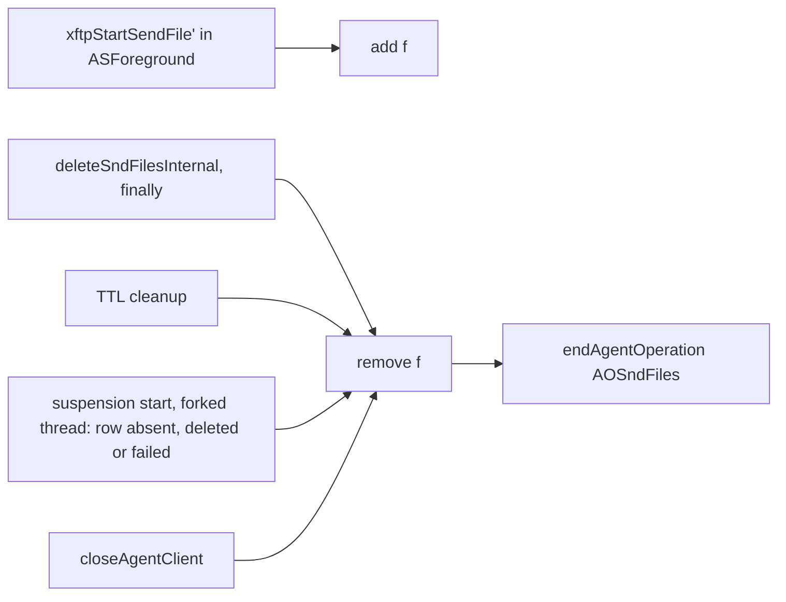

# XFTP uploads while the agent is suspending

On iOS, a file sent shortly before the app left the foreground was delivered only after the app was opened again. Once the agent began to suspend, the next chunk was not started, and the result of the chunk in flight was recorded only in foreground.
While the agent is suspending, it continues the uploads that it started in foreground. Their files are counted by a new operation, `AOSndFiles`, with its own count and set, in a stage between `AORcvNetwork` and `AOMsgDelivery`. The next stage is entered after these files are deleted by the chat, removed by TTL cleanup or `closeAgentClient`, or removed at the start of the suspension when their rows are absent or flagged deleted or failed. At the suspend timeout, the stage of `AOSndNetwork` is entered if the agent is still suspending.

Chat side: https://github.com/simplex-chat/simplex-chat/pull/7966

## Decisions

- Stages of `suspendAgent` with a timeout above 0:

  | Order | Operation | Count | At count 0 |
  |---|---|---|---|
  | 1 | `AORcvNetwork` | received transmission batches in processing by the subscriber | `AOSndFiles` suspended |
  | 2 | `AOSndFiles` | counted files | `AOMsgDelivery` suspended |
  | 3 | `AOMsgDelivery` | submitted messages not yet taken by delivery workers | `AOSndNetwork` suspended |
  | 4 | `AOSndNetwork` | delivery workers and async command workers processing work | `AODatabase` suspended |
  | 5 | `AODatabase` | database transactions | `SUSPENDED` sent; agent state `ASSuspended` |

  - The actions of "At count 0" are taken only while the agent state is `ASSuspending`.
  - `AONtfNetwork` is suspended at the start; the stages are entered independently of its count.
  - After the timeout, if the agent is still suspending, stage 4 is entered whatever stage is in progress; stage 5 is entered when the count of stage 4 is 0, as in the table.

  ```mermaid
  stateDiagram-v2
    [*] --> RcvNetwork: suspendAgent, timeout above 0
    RcvNetwork --> SndFiles: AORcvNetwork count 0
    SndFiles --> MsgDelivery: AOSndFiles count 0
    MsgDelivery --> SndNetwork: AOMsgDelivery count 0
    SndNetwork --> Database: AOSndNetwork count 0
    Database --> Suspended: AODatabase count 0, SUSPENDED sent
    RcvNetwork --> SndNetwork: timeout
    SndFiles --> SndNetwork: timeout
    MsgDelivery --> SndNetwork: timeout
    Suspended --> [*]
  ```

- Counted files, the set `sndFilesInProgress`:
  - inserted: files started by `xftpStartSendFile'` while the agent state is `ASForeground`;
  - removed:
    - files deleted by `deleteSndFilesInternal`, after its database work, also when an exception is thrown;
    - files expired by TTL cleanup, before their prefix path and row are deleted;
    - at the start of a suspension with a timeout above 0, in a thread forked by `suspendAgent`, while `AODatabase` is not suspended: files whose rows are absent or flagged `deleted = 1` or `failed = 1`, found by one query; the suspended flag of `AODatabase` is checked and the operation is begun in one STM transaction; `suspendAgent` returns, and the suspend timeout starts, before this query;
    - every file, by `closeAgentClient`.
  - kept until the chat deletes them: files with complete or error rows; the file descriptions are sent while these files are counted.
  - kept until TTL cleanup, `closeAgentClient` or process exit: counted files completed, or set to an error status, by another process; each suspension in between waits for the suspend timeout.
  - kept until they are uploaded or removed: counted files that cannot be uploaded, for example offline; TTL cleanup removes such a file at its first pass after `sndFilesTTL` (1 day) from creation, at most `cleanupInterval` (5 min) later; each suspension in between waits in the files stage until the suspend timeout.
- `deleteSndFilesInternal` is run by `xftpDeleteSndFileInternal`, which is called by the chat after `SFDONE` and `SFERR`.
- Uncounted files:
  - files resumed at worker start;
  - files started while suspending or suspended;
  - among them, the redirect upload of a standalone file, started by the chat on `SFDONE` of its source file (chat `Subscriber.hs:269`, `Internal.hs:497`): its upload stops when the source file is deleted, unless other counted files remain.
- Condition of the send prepare and upload workers, `uploadsAllowed`:

  | Agent state | Counted files | `AOSndNetwork` suspended | Condition |
  |---|---|---|---|
  | `ASForeground` | any | any | true |
  | `ASSuspending` | above 0 | no | true |
  | `ASSuspending` | 0 | any | false |
  | `ASSuspending` | any | yes | false |
  | `ASSuspended` | any | any | false |

  - While the condition is false, the send prepare and upload workers wait until the agent state is `ASForeground`.
  - While the condition is true, uncounted files are uploaded too.
- Receive and delete workers: unchanged.
- `foregroundAgent`: suspended flags cleared; counted files kept.

```
xftpStartSendFile' f           ASForeground -> add f
deleteSndFilesInternal fs      rows deleted or marked deleted; finally: remove each f
deleteSndFilesExpired f        remove f; prefix path and row deleted
suspendAgent, timeout > 0      forked thread: AODatabase not suspended -> begin AODatabase; remove each f whose row is absent, deleted or failed; end AODatabase
closeAgentClient               remove each f
add f                          f not in set -> insert f; count + 1
remove f                       f in set -> delete f; endAgentOperation AOSndFiles
```



## Mechanics

- `src/Simplex/Messaging/Agent/Client.hs`:
  - `AgentClient` (:379-380), fields created in `newAgentClient` (:550-551):
    - `sndFilesOp :: TVar AgentOpState`;
    - `sndFilesInProgress :: TVar (Set SndFileId)`.
  - `AgentOperation`: `AOSndFiles` (:476).
  - `sndFilesOp` added to:
    - `agentOpSel` (:483);
    - `agentOperations` (:489).
  - `closeAgentClient` (:1024): every counted file removed by `removeSndFileInProgress`.
  - `endAgentOperation` (:2363-2377): at the end of `AORcvNetwork`, `AOSndFiles` is suspended; at the end of `AOSndFiles`, `suspendMsgDelivery` is called.
  - `suspendMsgDelivery` (:2379-2382): `AOMsgDelivery` is suspended; `suspendSendingAndDatabase` is called when its count is 0.
  - new:
    - `addSndFileInProgress` (:2414-2417);
    - `removeSndFileInProgress` (:2419-2422);
    - `removeDeletedOrFailedSndFilesInProgress` (:2424-2435): when the set is not empty and `AODatabase` is begun by `tryBeginAgentOperation`, the counted files missing from `getNotDeletedOrFailedSndFileIds` are removed; on a query error, the error is logged and the set is unchanged; under `E.mask`, the begun operation is ended by `E.finally`;
    - `tryBeginAgentOperation` (:2446-2447): `beginAgentOperation`, or `False` by `orElse` while the operation is suspended; `True` when begun;
    - `waitUntilUploadsAllowed` (:2472-2482), with the condition `uploadsAllowed`.
- `src/Simplex/Messaging/Agent/Store/AgentStore.hs`, new: `getNotDeletedOrFailedSndFileIds` (:3898-3900), the entity IDs of `snd_files` rows with `deleted = 0` and `failed = 0`.
- `src/Simplex/Messaging/Agent.hs`:
  - `suspendAgent`:
    - stages (:3446-3448): `AORcvNetwork`, `AOSndFiles`, then `suspendMsgDelivery`;
    - `removeDeletedOrFailedSndFilesInProgress` (:3451), in a thread forked while the agent is suspending, separate from the timeout thread (:3452-3457); a removal that ends after the timeout holds the `AODatabase` count until it ends, and `SUSPENDED` is sent then.
  - `deleteSndFilesExpired` (:3548), local to `cleanupManager`: `removeSndFileInProgress`.
- `src/Simplex/FileTransfer/Agent.hs`:
  - `xftpStartSendFile'` (:407): `addSndFileInProgress` when `ASForeground`.
  - `assertUploadsAllowed` in place of `assertAgentForeground`:
    - `runXFTPSndPrepareWorker` (:424, :487, :507);
    - `runXFTPSndWorker` (:528, :549, :560).
  - `uploadFileChunk` (:562): `waitUntilUploadsAllowed` in place of `waitUntilForeground`.
  - `deleteSndFilesInternal` (:663): `removeSndFileInProgress` in `E.finally`.
  - `assertUploadsAllowed` (:749-752): `throwWhenInactive`, then `waitUntilUploadsAllowed`.

## Tests

`tests/XFTPAgent.hs`, "agent XFTP API":
- Helpers:
  - `withSndFile` (:822): file of 128 KB; agent 1 with the test's configuration; workers started; the file sent to 1 recipient;
  - `shouldSuspend` (:831): `SUSPENDED` within 5 s; events of the file before it are skipped.
- "should complete sending file while agent is suspending" (:644):
  - suspend timeout 60 s;
  - all `SFPROG` within 30 s, then `SFDONE`;
  - events absent for 300 ms;
  - after `xftpDeleteSndFileInternal`, `SUSPENDED` within 5 s.
- "should suspend on timeout when file is not sent" (:659):
  - XFTP server down, suspend timeout 0.5 s: events absent for 300 ms, then `SUSPENDED` within 5 s;
  - server started: events absent for 1 s;
  - after `foregroundAgent`, `SFDONE`.
- "should not wait for file started while agent is suspending" (:676):
  - file 1 started, suspend timeout 60 s, file 2 started;
  - `SFDONE` of file 1 within 30 s;
  - after `xftpDeleteSndFileInternal` of file 1, `shouldSuspend` for file 2.
- "should continue sending file when another file is deleted twice while agent is suspending" (:690):
  - file 1 of 128 KB and file 2 of 17 MB started, suspend timeout 60 s;
  - `xftpDeleteSndFileInternal` of file 1, twice;
  - `SFDONE` of file 2 within 30 s; `SUSPENDED` before it: test failure;
  - after `xftpDeleteSndFileInternal` of file 2, `shouldSuspend` for file 1.
- "should wait for complete file until it is deleted while agent is suspending" (:706):
  - `withSndFile`; `SFDONE` within 30 s;
  - suspend timeout 60 s; events absent for 300 ms;
  - after `xftpDeleteSndFileInternal`, `SUSPENDED` within 5 s.
- `testXFTPAgentSuspendAfter` (:715), for the next four tests:
  - XFTP server down; `withSndFile`;
  - the test's step;
  - suspend timeout 60 s; `shouldSuspend`.
- "should not wait for file deleted from database while agent is suspending" (:102): `DELETE FROM snd_files` through the agent's store.
- "should not wait for file marked deleted while agent is suspending" (:104): `UPDATE snd_files SET deleted = 1` through the agent's store.
- "should not wait for file marked failed while agent is suspending" (:106): `UPDATE snd_files SET failed = 1` through the agent's store.
- "should not wait for file after agent client is closed" (:108): `disconnectAgentClient`, then `resumeAgentClient`.
- "should not access database when suspending while database is suspended" (:722):
  - XFTP server down; `withSndFile`;
  - suspend timeout 0; the file row deleted by the test;
  - suspend timeout 60 s: after 1 s, the set still contains the file.
- "should not wait for database when suspending" (:731):
  - XFTP server down; `withSndFile`;
  - while the test holds the agent store connection: `suspendAgent` with timeout 0.5 s returns within 1 s; `AOSndNetwork` is suspended by the timeout within 5 s;
  - after the test releases the connection, `shouldSuspend`.
- "should not wait for file removed by TTL cleanup while agent is suspending" (:739):
  - cleanup after 1 s and every 1 s; `sndFilesTTL` 1 s;
  - XFTP server down; `withSndFile`;
  - suspend timeout 60 s: `SUSPENDED` within 10 s, after the cleanup removes the expired file; events of the file before it are skipped.
- "should not wait for file resumed at worker start" (:746):
  - XFTP server down; file of 128 KB started by agent 1;
  - agent 2 on the same database resumes it at `xftpStartWorkers`;
  - after 0.5 s, suspend timeout 60 s; `shouldSuspend`.
- "should stop uploads when sending network is suspended while agent is suspending" (:758):
  - `withSndFile`; `AOSndNetwork` begun by the test;
  - suspend timeout 1 µs: `SFDONE` absent for 3 s;
  - after the test ends `AOSndNetwork`, `shouldSuspend`.
- "should retry creating file chunks while agent is suspending" (:767):
  - XFTP server down; `withSndFile`; suspend timeout 60 s;
  - server started after 3 s: `SFDONE` within 30 s;
  - after `xftpDeleteSndFileInternal`, `shouldSuspend`.
- "should retry uploading file chunks while agent is suspending" (:777):
  - file of 17 MB started; the server is stopped after the first `SFPROG`;
  - suspend timeout 60 s; server started after 1 s: `SFDONE` within 30 s;
  - after `xftpDeleteSndFileInternal`, `shouldSuspend`.
- "should remove counted file when its deletion fails" (:794):
  - XFTP server down; `withSndFile`;
  - agent store closed: `xftpDeleteSndFileInternal` throws, and the set is empty.
- "should keep counted files when database query fails at suspension start" (:801):
  - XFTP server down; `withSndFile`;
  - agent store closed; suspend timeout 60 s;
  - after 1 s, the set still contains the file; `foregroundAgent` before the comparison.
- The two tests above are excluded from builds with `client_postgres` (`#if !defined(dbPostgres)`, :117-120): a closed PostgreSQL store has no pool connections, and its `withTransaction` waits for one.
- "should wait for counted file again after agent is in foreground" (:811):
  - XFTP server down; `withSndFile`;
  - suspend timeout 0.5 s; `shouldSuspend`;
  - `foregroundAgent`; suspend timeout 60 s: `SUSPENDED` absent for 1 s;
  - after `xftpDeleteSndFileInternal`, `shouldSuspend`.

`tests/AgentTests/FunctionalAPITests.hs`, "Suspending agent":
- "should send messages queued after file is sent before agent is suspended" (:3177):
  - b starts a file, suspend timeout 60 s;
  - once `sndFilesOp` is suspended, the `opSuspended` flags of `rcvNetworkOp`, `sndFilesOp`, `msgDeliveryOp`: `[True, True, False]`;
  - after `SFDONE`, `sendMessage` and `xftpDeleteSndFileInternal`: `[True, True, True]`;
  - `SENT`, then `SUSPENDED` within 5 s;
  - a receives the message.
