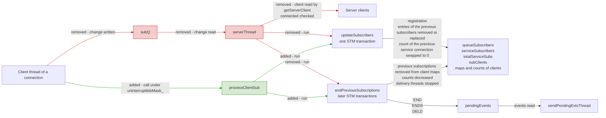
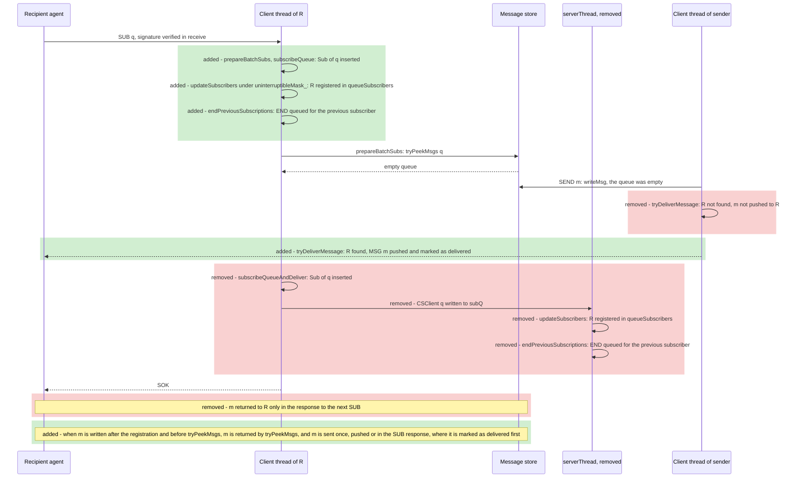
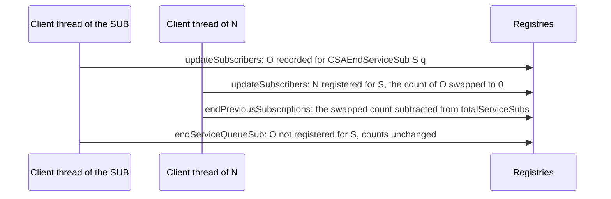

# Subscription changes processed in the client thread

## Decisions

- Each subscription change is processed by `processClientSub` under `uninterruptibleMask_`, in the client thread of the command.
- `serverThread` and `subQ` are removed.
- The branch for a disconnected client is removed from `processClientSub`.
- SUB, from clients with and without a service certificate: the subscriber is registered in `prepareBatchSubs`, after the queue associations and before `tryPeekMsgs`.
- Duplicate SUB: `delivered` of the subscription is reset in `prepareBatchSubs`, before `tryPeekMsgs`.
- SUB of a blocked queue, or of a queue with a failed association: the subscriber is registered only by a later successful SUB.
- The first message of a subscription is marked as delivered once, and it is sent only where it is marked:
  - in the MSG pushed after SEND
  - in the SUB response
  - in the MSG sent by `deliverServiceMessages` after SUBS
- `qSub` is counted for a new subscription when `tryPeekMsgs` returns a message, except for two SUBs of one queue in one block.
- The service counts of a previous service subscriber are decreased for one queue only while it is registered for the service.
- Changes of these commands are processed while the command is processed:
  - SUBS
  - NSUB
  - NSUBS
  - NEW with subscription
  - NKEY
  - NDEL
  - DEL

## Composition

Processing of one subscription change. Green: added by this change. Red: removed by it.

## Sequence

SUB of an empty queue and a SEND to it right after `tryPeekMsgs`. Green: added by this change. Red: removed by it.

## Service counts

A SUB by which the association of queue q with service S is removed, and SUBS from a new connection N of S. O is the previous connection of S.

## Mechanics

- `Server.hs`:
  - `processClientSub`: top level; the registration code of `serverThread`, for the client of the calling thread, under `uninterruptibleMask_`.
  - `CSAEndServiceSub`: the service ID added.
  - `endServiceQueueSub`: the counts decreased only while the previous client is registered for the service.
  - `smpServer`: `serverThread` removed.
  - `client`: `processSub` and `processNtfSub` are `processClientSub` for message and notification subscribers.
  - `prepareBatchSubs`: one `runExceptT` block:
    - queue associations
    - `subscribeQueue` for each SUB of a queue that is not blocked and has no failed association
    - `tryPeekMsgs`
    - the `subscribeQueue` results returned as the fourth map of the batch result
  - `subscribeQueue`: the first part of the former `subscribeQueueAndDeliver`.
  - `deliverSubMsg`: the second part of the former `subscribeQueueAndDeliver`; the `subscribeQueue` result passed to `deliver`.
  - `sharedSubscribeQueue`: moved from `processCommand` to `client`; `processSub` or `processNtfSub` passed in place of the server subscribers.
  - `processSub` or `processNtfSub` in place of the entry written to `subQ`:
    - `sharedSubscribeService`
    - `subscribeNewQueue`
    - `addQueueNotifier_`
    - `deleteQueueNotifier_`
    - `delQueueAndMsgs`
  - `deliver`: `qSub` counted before `trySetDelivered`; the first message included only when it is marked by `trySetDelivered`.
  - `deliverServiceMessages`: MSG sent only when the message is marked by `trySetDelivered`.
- `Env/STM.hs`: `subQ` removed from `ServerSubscribers`.
- `tests/ServerTests.hs`:
  - `should deliver message sent in the same block as SUB`
  - `should deliver message once for two SUBs in the same block`
  - `should deliver message sent in the same block as service SUB`
  - `should deliver message after SUB while delivery waits for full send queue`: the message recorded before or after SOK.
