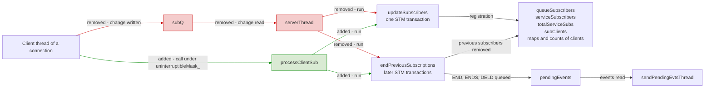
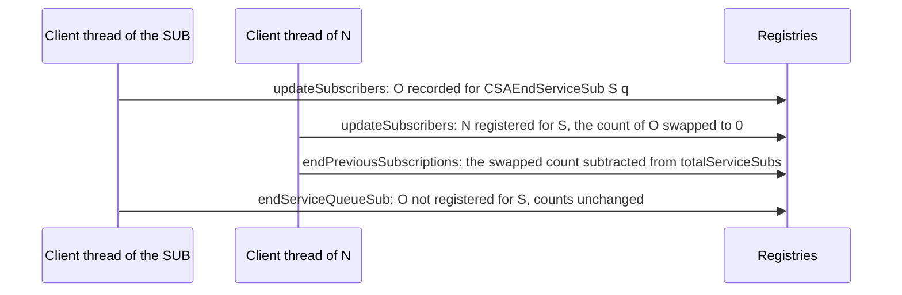

# Subscription changes processed in the client thread

## Decisions

- Each subscription change is processed by `processClientSub` under `uninterruptibleMask_`, in the client thread of the command.
- `serverThread` and `subQ` are removed.
- SUB, from clients with and without a service certificate: the subscriber is registered in `prepareBatchSubs`, after the queue associations and before the first-message read.
- SUB of a blocked queue, or of a queue with a failed association: the subscriber is registered only by a later successful SUB.
- The first message of a subscription is marked as delivered once, and is sent by the path that marks it:
  - the SUB response
  - the read of SUBS
  - a SEND push
- `qSub` is counted for a new subscription when the first-message read returns a message.
- The service counts of a previous service subscriber are decreased for one queue only while it is registered for the service.
- Changes of these commands are processed while the command is processed:
  - SUBS
  - NSUB
  - NSUBS
  - NEW with subscription
  - NKEY
  - NDEL
  - DEL

## Composition

Processing of one subscription change. Green: added by this change. Red: removed by it.



## Sequence

SUB of an empty queue and a SEND to it right after the first-message read. Green: added by this change. Red: removed by it.

```mermaid
sequenceDiagram
    participant R as Recipient agent
    participant C as Client thread of R
    participant Q as Message store
    participant T as serverThread, removed
    participant S as Client thread of sender
    R->>C: SUB q, signature verified in receive
    rect rgba(0, 160, 0, 0.18)
        C->>C: added - prepareBatchSubs, subscribeQueue: Sub of q inserted
        C->>C: added - processClientSub under uninterruptibleMask_: R registered in queueSubscribers, END to the previous subscriber
    end
    C->>Q: prepareBatchSubs: tryPeekMsgs q
    Q-->>C: empty queue
    S->>Q: SEND m: writeMsg, the queue was empty
    rect rgba(220, 0, 0, 0.18)
        S->>S: removed - tryDeliverMessage: R not found, m not pushed to R
    end
    rect rgba(0, 160, 0, 0.18)
        S-->>R: added - tryDeliverMessage: R found, MSG m pushed and marked as delivered
    end
    rect rgba(220, 0, 0, 0.18)
        C->>C: removed - subscribeQueueAndDeliver: Sub of q inserted
        C->>T: removed - CSClient q written to subQ
        T->>T: removed - updateSubscribers: R registered in queueSubscribers, END to the previous subscriber
    end
    C-->>R: SOK
    rect rgba(220, 0, 0, 0.18)
        Note over R,Q: removed - m returned to R only in the response to the next SUB
    end
    rect rgba(0, 160, 0, 0.18)
        Note over R,Q: added - when m is written after the registration and before the read, the read returns m; m is sent once, by the push or in the SUB response, whichever marks it as delivered first
    end
```

## Service counts

A SUB that removes the association of queue q with service S, and SUBS from a new connection N of S. O is the previous connection of S.



## Mechanics

- `Server.hs`:
  - `processClientSub`: top level; the registration code of `serverThread`, for the client of the calling thread, under `uninterruptibleMask_`.
  - `CSAEndServiceSub`: the service ID added.
  - `endServiceQueueSub`: the counts decreased only while the previous client is registered for the service.
  - `smpServer`: `serverThread` removed.
  - `client`: `processSub` and `processNtfSub` are `processClientSub` for message and notification subscribers.
  - `prepareBatchSubs`: one `runExceptT` block:
    - queue associations
    - `subscribeQueue` for each SUB of a queue that is not blocked and has no failed association
    - `tryPeekMsgs`
    - the `subscribeQueue` results returned as the fourth map of the batch result
  - `subscribeQueue`: the first part of the former `subscribeQueueAndDeliver`.
  - `deliverSubMsg`: the second part of the former `subscribeQueueAndDeliver`; the `subscribeQueue` result passed to `deliver`.
  - `sharedSubscribeQueue`: moved from `processCommand` to `client`; `processSub` or `processNtfSub` passed in place of the server subscribers.
  - `processSub` or `processNtfSub` in place of the `subQ` write:
    - `sharedSubscribeService`
    - `subscribeNewQueue`
    - `addQueueNotifier_`
    - `deleteQueueNotifier_`
    - `delQueueAndMsgs`
  - `deliver`: `qSub` counted before the mark; the first message included only when `trySetDelivered` marks it.
  - `deliverServiceMessages`: MSG sent only when `trySetDelivered` marks the message.
- `Env/STM.hs`: `subQ` removed from `ServerSubscribers`.
- `tests/ServerTests.hs`:
  - `should deliver message sent in the same block as SUB`
  - `should deliver message once for two SUBs in the same block`
  - `should deliver message sent in the same block as service SUB`
  - `should deliver message after SUB while delivery waits for full send queue`: the message recorded before or after SOK.
