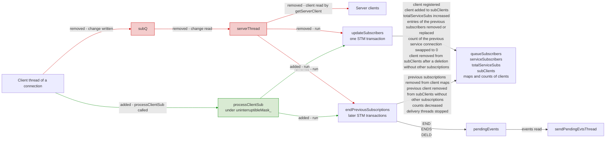
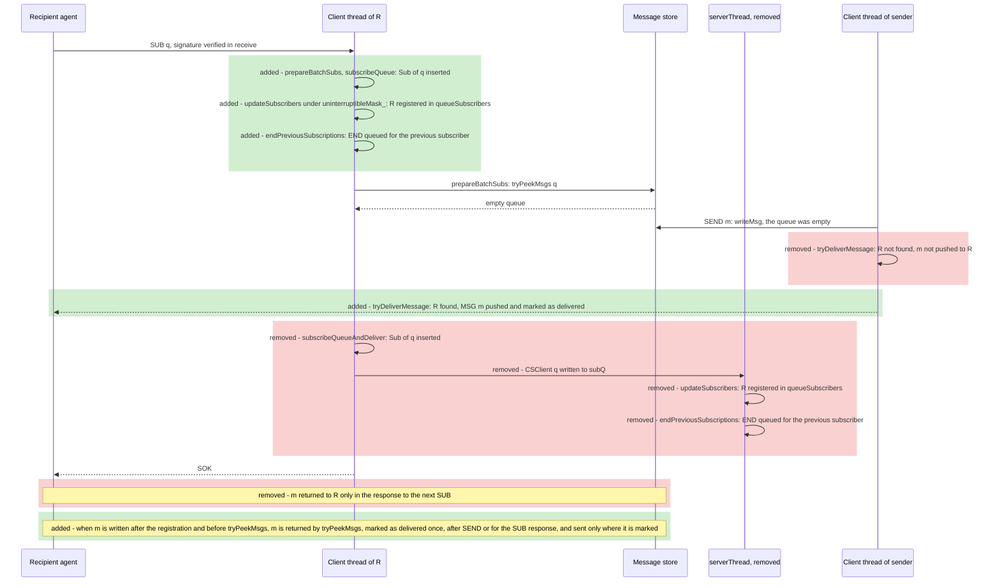
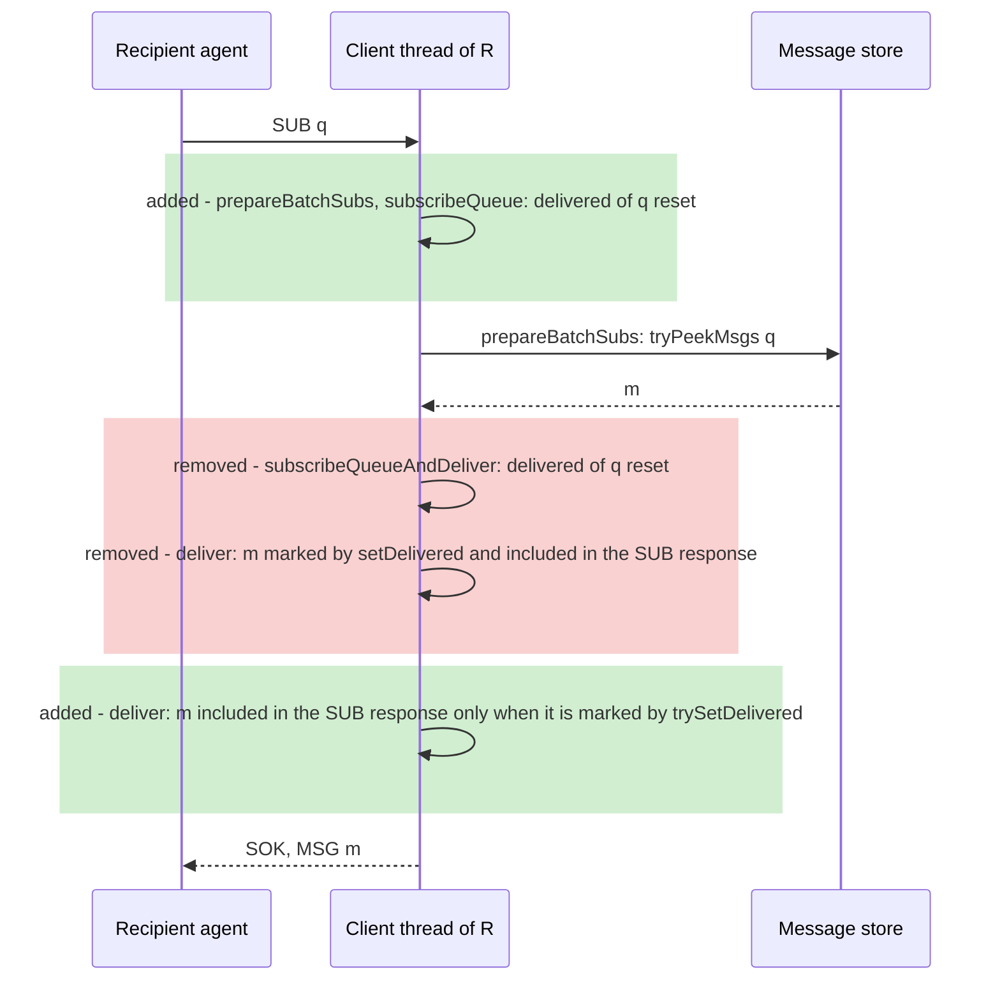
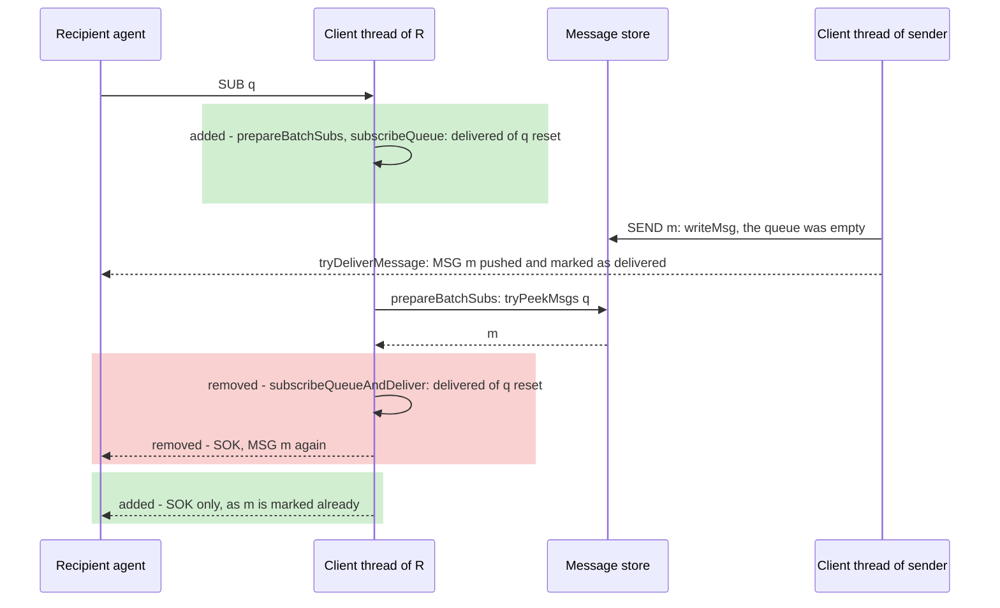
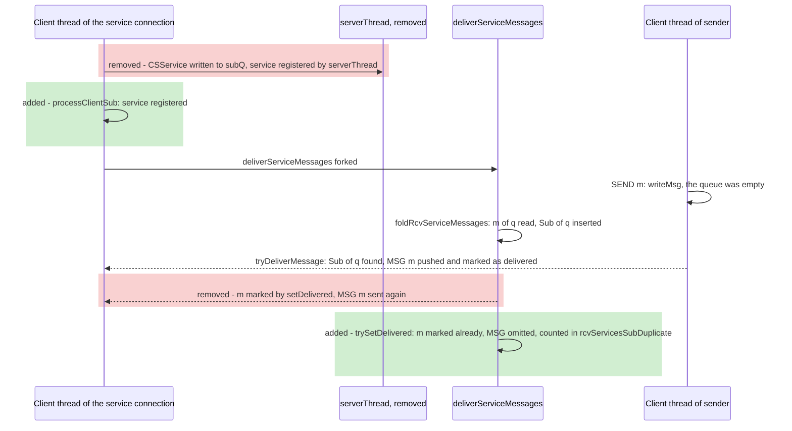
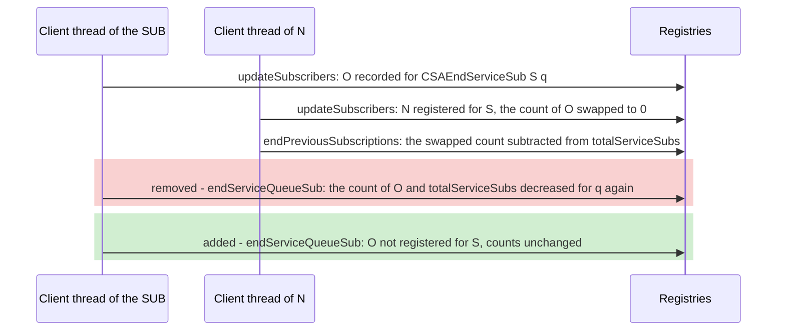

# Subscription changes processed in the client thread

## Decisions

- Each subscription change is processed by `processClientSub` under `uninterruptibleMask_`, in the client thread of the connection.
- `serverThread` and `subQ` are removed.
- `processClientSub` takes the place of `serverThread` in `smpServer`; its branch for a disconnected client is removed.
- SUB, from clients with and without a service certificate: the subscriber is registered in `prepareBatchSubs`, after the queue associations and before `tryPeekMsgs`, except for a service client when the queue is associated with its service and the connection has a service count, as on master.
- Duplicate SUB: `delivered` of the subscription is reset in `prepareBatchSubs`, before `tryPeekMsgs`.
- SUB of a blocked queue, or of a queue with a failed association: the subscriber is registered only by a later successful SUB.
- For a new subscription, the first message is marked as delivered once, and it is sent only where it is marked, in one of these:
  - the MSG pushed after SEND
  - the SUB response
  - the MSG sent by `deliverServiceMessages` after SUBS
- After a duplicate SUB, a message pushed before `delivered` is reset is marked and sent again, as on master.
- `qSub` is counted for a new subscription when a message is returned by `tryPeekMsgs`, with these exceptions:
  - two SUBs of one queue in one block
  - an `updateQueueTime` error after the registration
- The service counts of a previous service subscriber are decreased for one queue only while it is registered for the service.
- The subscription changes of each of these commands are processed during that command, in the client thread:
  - SUBS
  - NSUB
  - NSUBS
  - NEW with subscription
  - NKEY
  - NDEL
  - DEL
- The SMP server design diagram and its README section are removed.

## Composition

Processing of one subscription change. Green: added by this pull request. Red: removed by it.

## SUB and SEND

SUB of an empty queue and a SEND to it right after `tryPeekMsgs`. Green: added by this pull request. Red: removed by it.

## Duplicate SUB

SUB of a queue that is subscribed in this connection, with message m delivered and not acknowledged. Green: added by this pull request. Red: removed by it.

## Duplicate SUB and SEND

Duplicate SUB of an empty queue, with nothing marked as delivered, and a SEND of m to it before `tryPeekMsgs`. Green: added by this pull request. Red: removed by it.

## SUBS

SUBS of a service connection, and a SEND of m to an empty queue q of the service while its messages are read. Green: added by this pull request. Red: removed by it.

## Service counts

A SUB by which the association of queue q with service S is removed, and SUBS from a new connection N of S. O is the previous connection of S. Green: added by this pull request. Red: removed by it.

## Mechanics

- `Server.hs`:
  - `processClientSub`: `serverThread` in its place, for one change of the client of the calling thread, under `uninterruptibleMask_`.
  - `CSAEndServiceSub`: the service ID added.
  - `endServiceQueueSub`: the counts decreased only while the previous client is registered for the service.
  - `smpServer`: the two `serverThread` threads removed.
  - `runClient`: `processSubs`, the pair of `processClientSub` for message and notification subscribers, passed through `runClientTransport` to `client`.
  - `client`: `processSub` and `processNtfSub` from the pair.
  - `prepareBatchSubs`: one `runExceptT` block:
    - queue associations
    - `subscribeQueue` for each SUB of a queue that is not blocked, when its association is unchanged or changed successfully
    - `tryPeekMsgs`
    - the `subscribeQueue` results returned as the fourth map of the batch result
  - `subscribeQueue`: the first part of the former `subscribeQueueAndDeliver`.
  - `deliverSubMsg`: the second part of the former `subscribeQueueAndDeliver`; the `subscribeQueue` result passed to `deliver`.
  - `sharedSubscribeQueue`: moved from `processCommand` to `client`; the service ID of the client and the queue ID added as parameters; `processSub` or `processNtfSub` passed in place of the server subscribers.
  - `processSub` or `processNtfSub` called with the client and the subscription change where the change was written to `subQ`:
    - `sharedSubscribeService`
    - `subscribeNewQueue`
    - `addQueueNotifier_`
    - `deleteQueueNotifier_`
    - `delQueueAndMsgs`
  - `deliver`: `qSub` counted before `trySetDelivered`; the first message included only when it is marked by `trySetDelivered`.
  - `deliverServiceMessages`: MSG sent only when the message is marked by `trySetDelivered`.
- `Env/STM.hs`: `subQ` removed from `ServerSubscribers`.
- `README.md`: the section "SMP server design" removed.
- `design/server.gv`, `design/server.svg`: removed.
- `tests/ServerTests.hs`:
  - `should deliver message sent in the same block as SUB`
  - `should deliver message sent in the same block as SUB to the new connection`
  - `should deliver message once for two SUBs in the same block`
  - `should deliver message sent in the same block as service SUB`
  - `should deliver message after SUB while delivery waits for full send queue`: the message recorded before or after SOK.
