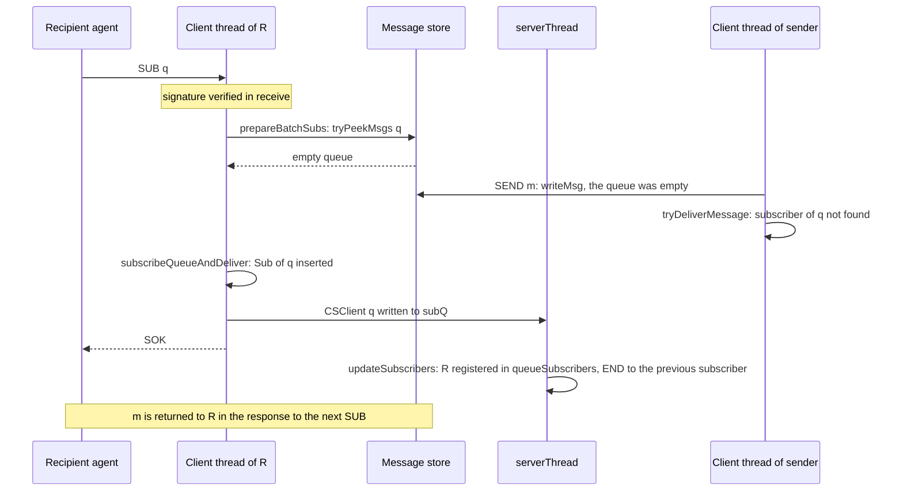
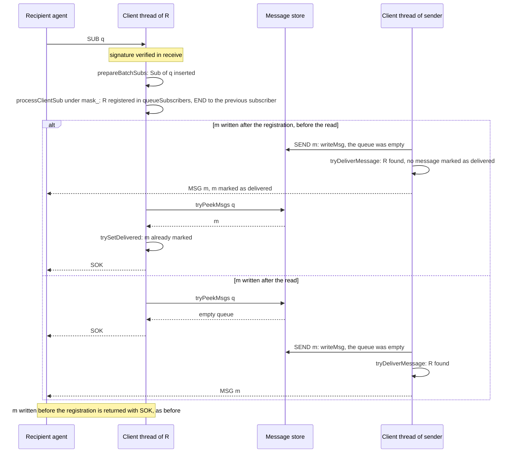

# Subscriber registration before the first-message read

## Decisions

- SUB from a client without a service certificate to an active queue not associated with a service: the subscriber is registered in the client thread, before the first message of the queue is read.
- NEW with subscription from such a client: the subscriber is registered in the client thread.
- The registration is `processClientSub`, the code of `serverThread` for one subscription change, called under `mask_`.
- The SUB response includes the first message only when no message of the subscription is marked as delivered.
- Other subscription changes are registered by `serverThread` from `subQ`, as before.

## Before

## After

## Mechanics

- `Server.hs`:
  - `processClientSub`: the per-change code of `serverThread`, beside it in `smpServer`; `serverThread` calls it for each `subQ` entry.
  - `runClient`, `runClientTransport`, `client`: `processClientSub` for message subscribers passed to the client thread.
  - `prepareBatchSubs`: selected SUBs inserted with `TM.lookupOrInsertIO`; `processClientSub` for each inserted subscription, before `tryPeekMsgs`; the inserted subscriptions returned as the fourth map of the batch result.
  - `subscribeQueueAndDeliver`: an inserted subscription passed to `deliver` as new.
  - `subscribeNewQueue`: `processClientSub` for a client without a service certificate.
  - `deliver`, `trySetDelivered`: the first message marked as delivered and included only when no message is marked.
- `tests/ServerTests.hs`: `SUB and SEND in one block`.
