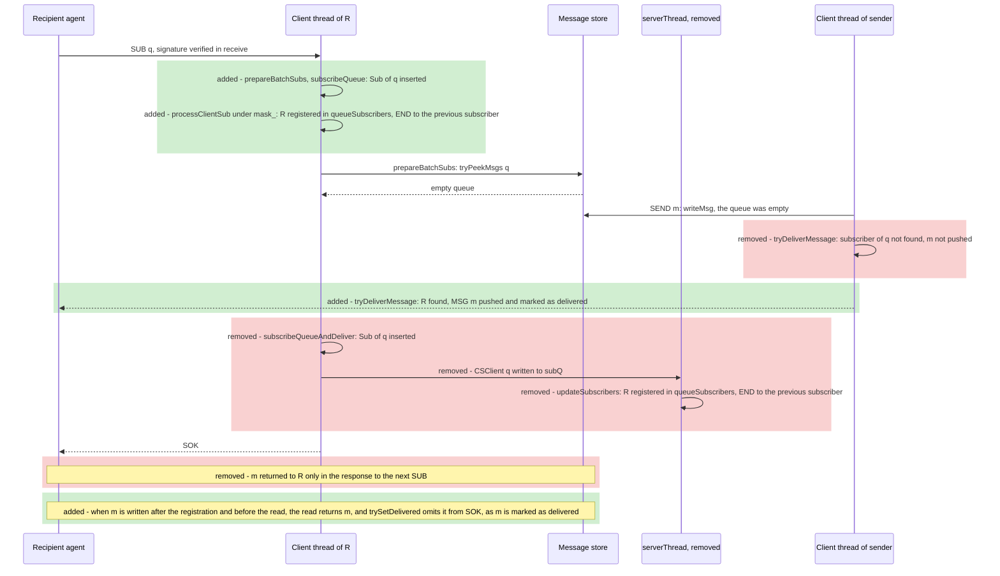

# Subscription changes processed in the client thread

## Decisions

- Each subscription change is processed by `processClientSub` under `mask_`, in the client thread of the command.
- `serverThread` and `subQ` are removed.
- SUB, from clients with and without a service certificate: the subscriber is registered in `prepareBatchSubs`, after the queue associations and before the first-message read.
- SUB of a blocked queue, or of a queue with a failed association: the subscriber is registered only by a later successful SUB.
- The SUB response includes the first message only when no message of the subscription is marked as delivered.
- SUBS, NSUB, NSUBS, NEW with subscription, NKEY, NDEL, DEL: the change is processed while the command is processed.

## Sequence

SUB of an empty queue and a SEND to it right after the first-message read. Green: added by this change. Red: removed by it.

## Mechanics

- `Server.hs`:
  - `processClientSub`: top level; the code of `serverThread` for one change of the current client.
  - `smpServer`: `serverThread` removed.
  - `client`: `processSub` and `processNtfSub` are `processClientSub` for message and notification subscribers.
  - `prepareBatchSubs`: queue associations; `subscribeQueue` for each SUB of a queue that is not blocked and has no failed association; `tryPeekMsgs`; the `subscribeQueue` results returned as the fourth map of the batch result.
  - `subscribeQueue`: the first part of the former `subscribeQueueAndDeliver`.
  - `deliverSubMsg`: the second part of the former `subscribeQueueAndDeliver`; the `subscribeQueue` result passed to `deliver`.
  - `sharedSubscribeQueue`: moved from `processCommand` to `client`; `processSub` or `processNtfSub` passed in place of the server subscribers.
  - `sharedSubscribeService`, `subscribeNewQueue`, `addQueueNotifier_`, `deleteQueueNotifier_`, `delQueueAndMsgs`: `processSub` or `processNtfSub` in place of the `subQ` write.
  - `deliver`, `trySetDelivered`: the first message marked as delivered and included only when no message is marked.
- `Env/STM.hs`: `subQ` removed from `ServerSubscribers`.
- `tests/ServerTests.hs`:
  - `SUB and SEND in one block`
  - `should deliver message sent in the same block as service SUB`
