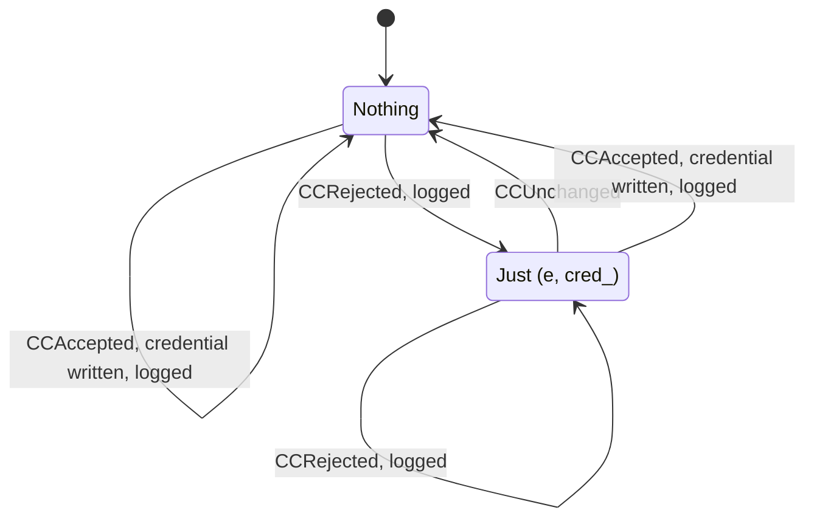
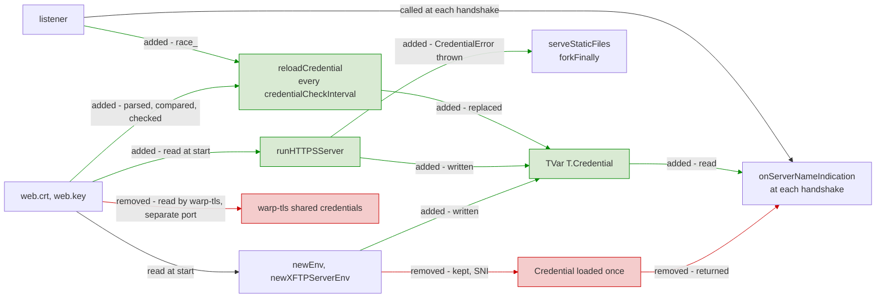
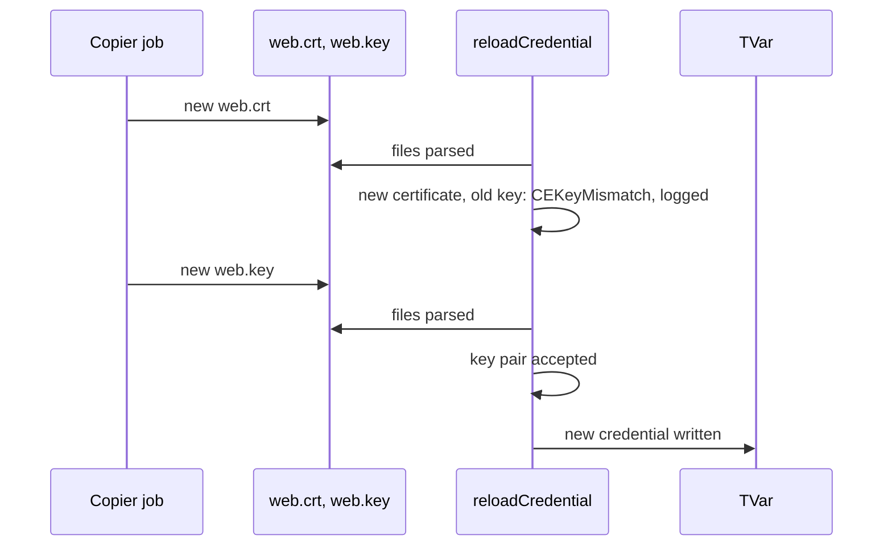

# Web certificates reloaded when their files are replaced

## Problem

smp-server and xftp-server read the web certificate (`[WEB] cert` and `key`) once, at start. Places of the reading:

- `newEnv` (`Server/Env/STM.hs`);
- `newXFTPServerEnv` (`FileTransfer/Server/Env.hs`);
- warp-tls, started in `serveStaticFiles` (`Server/Web.hs`).

A renewed Let's Encrypt certificate is served only after a restart. A server that runs longer than 60 days after the last restart serves an expiring, then an expired certificate to browsers and web clients.

## Decisions

- Scope: the web credential of smp-server and xftp-server, on these paths:
  - SNI on the protocol port (`TLSServerCredential.sniCredential`);
  - the separate HTTPS port of the static site (`runHTTPSServer`).
- The protocol credential (`server.crt`, `server.key`) is read at start only, as before.
- The fields of `ReloadableCredential`:
  - `credentialFiles`: the files of the web credential;
  - `checkCredential`: the check of the server type;
  - `currentCredential :: TVar T.Credential`: the credential in use.
- `ReloadableCredential` is stored in `TLSServerCredential.sniCredential` and in `httpServerCreds` of both Env types.
- The `TVar` is read in `onServerNameIndication` at each handshake. Places of the hook:
  - protocol port: `supportedTLSServerParams`;
  - separate port: `tlsServerHooks` of warp-tls, with empty `tlsCredentials`.
- Checks of the server type:
  - smp-server: `checkHTTPSCredentials`, an RSA key of at least 4096 bits, as at start;
  - xftp-server: `acceptCredential`.
- In `checkKeyPair`, the public key of the leaf certificate is compared with a public key obtained from the private key file. Sources of that key:
  - RSA: the public fields stored with the private key;
  - Ed25519, Ed448: `toPublic` of the private key;
  - ECDSA on named curves: `pointBaseMul` of the private scalar, after the certificate point is decoded and validated and the curve names are found equal.
- Other key types are rejected.
- xftp-server accepts any key type at start; on reload, only the key types of `checkKeyPair` are accepted.
- Errors are values of `CredentialError`:
  - `CEReadError`: an `IOException` from reading a file;
  - `CEPEMError`: the message of a `PEMError` from parsing a file;
  - `CENoPrivateKey`: a key file without a private key;
  - `CENoCertificate`: a certificate file without a certificate;
  - `CEKeyMismatch`: a private key of another certificate, also of another key type;
  - `CEUnsupportedKeyType`: a certificate and a private key of one key type outside those of `checkKeyPair`;
  - `CEInvalidECPoint`: an EC point other than an uncompressed point on its curve;
  - `CEUnsupportedHTTPSKey`: on smp-server, a key other than RSA of at least `minHTTPSRSAKeyBits` (4096).
- The reload thread is run by `withCredentialReload`, in `race_` with the listener in which its `TVar` is read; both threads are ended by an exception in either one. `withCredentialReload` is called in:
  - `runTransportServerSocketState`, for an SNI credential;
  - `runHTTPSServer`.
- xftp-server with `[WEB] https` and `[WEB] static_path` builds two `ReloadableCredential` values from the same files, one for SNI and one for the separate port; each one is reloaded and logged by its own thread.
- On the separate port, `CENoPrivateKey` and the other errors of a credential that cannot be loaded at start are thrown as `CredentialError` and logged in `serveStaticFiles` with their reason.
- The interval is `credentialCheckInterval`, 60 seconds by default. Places of the setting:
  - SNI: `TransportServerConfig`;
  - separate port: `WebHttpsParams`.
- The key-pair check is listed in `protocol/crypto-registry.md` as a restricted use.

## Reload thread

State: the last rejection, `Maybe (CredentialError, Maybe T.Credential)`, initially `Nothing`. The decision is made in the pure function `checkLoadedCredential`; its results are values of `CredentialCheck`.

```
checkFiles rejected:
  wait credentialCheckInterval
  current <- read currentCredential
  loaded <- loadCredential credentialFiles
  case checkLoadedCredential checkCredential current rejected loaded of
    CCUnchanged -> checkFiles Nothing
    CCAccepted cred -> write cred to currentCredential; log "reloaded credential"; checkFiles Nothing
    CCRejected rejection -> log "rejected credential" with the reason; checkFiles (Just rejection)
    CCRejectedAgain -> checkFiles rejected

checkLoadedCredential checkCredential current rejected loaded:
  Right cred, cred == current -> CCUnchanged
  Right cred -> CCAccepted cred, if checkKeyPair cred >> checkCredential cred is Right ()
                else reject (error, Just cred)
  Left error -> reject (error, Nothing)
  reject rejection -> CCRejectedAgain if Just rejection == rejected, else CCRejected rejection
```



## Threat model

- The certificate and key files are written by the renewal job of the operator and are trusted as at start.
- Unreadable or unparsable files and a mismatched pair are rejected, and the previous credential is kept in use.
- A certificate file read while it is being copied, cut at a PEM boundary, is parsed as a shorter chain; with a reused key, that chain is served until the whole file is read at the next check.
- `IOException` and `PEMError` from reading the files are caught and logged as rejections; the checks are total functions; the reload thread is ended only together with its listener.
- A malformed file is read lazily by crypton-x509-store; its handle is closed by the garbage collector, once per interval while the file stays malformed.
- Contents of log lines:
  - fixed text;
  - file paths;
  - messages of the PEM parser and of `IOException`;
  - the key algorithm of a certificate.
- `pointBaseMul` is computed in variable time on the private scalar, once per interval while the files differ from the credential in use; network responses are independent of its time.

## Composition

Green: added. Red: removed.



## A renewed certificate copied into place

For a copier that writes `web.crt` before `web.key`:



The reverse order is handled the same way.

## Tests

Fixture files are copied into the test directory and replaced there for the reload tests, and read in place for the credential check tests.

- Transport: on a TLS server with an SNI `ReloadableCredential`, `web.crt` is served to a client with SNI, then `web2.crt` after the files are replaced.
- Key pair: the new certificate with the old key is not served; after the new key is written, the new certificate is served.
- smp-server with the shared HTTPS port, and xftp-server with SNI: the served certificate is changed after the files are replaced, without a restart.
- Static site on a separate HTTPS port: the same.
- Static site at start: `CENoPrivateKey` is thrown for an empty key file.
- Key types:
  - smp-server rejects an RSA 2048 and an ECDSA P-256 certificate and keeps the current one;
  - xftp-server serves the ECDSA P-256 certificate.
- A deleted key file and an empty certificate file: the current certificate is still served.
- Start, in the sequential "Server CLIs" tests, with the output captured, exit code 1 and no other exception:
  - smp-server started with an RSA 2048 web certificate: `Error: unsupported HTTPS credentials, required 4096-bit RSA`;
  - an empty key file: `invalid credential: no private key`.
- Credential check, with the expected error:
  - RSA, ECDSA, Ed448 and Ed25519 pairs: accepted when matching, `CEKeyMismatch` with another key of the same type;
  - a key of another type: `CEKeyMismatch`;
  - DSA certificate: `CEUnsupportedKeyType`;
  - empty certificate file: `CENoCertificate`;
  - missing key file: `CEReadError`;
  - malformed certificate file: `CEPEMError`;
  - EC point off its curve: `CEInvalidECPoint`.
- Reload decision (`checkLoadedCredential`), with the expected result:
  - files equal to the credential in use: `CCUnchanged`;
  - a mismatched pair: `CCRejected`, then `CCRejectedAgain` for the same pair;
  - another error after it: `CCRejected`;
  - a renewed pair: `CCAccepted`;
  - an RSA 2048 pair: `CCRejected` with `checkHTTPSCredentials`, `CCAccepted` with `acceptCredential`.
- Fixtures, generated by the commands in `tests/fixtures/README.md`. Certificates signed by `web_ca`:
  - `web2`: RSA 4096;
  - `web_rsa2048`: RSA 2048;
  - `web_ecdsa`: P-256;
  - `web_dsa`: DSA.
- A second P-256 key, without a certificate: `web_ecdsa2.key`.
