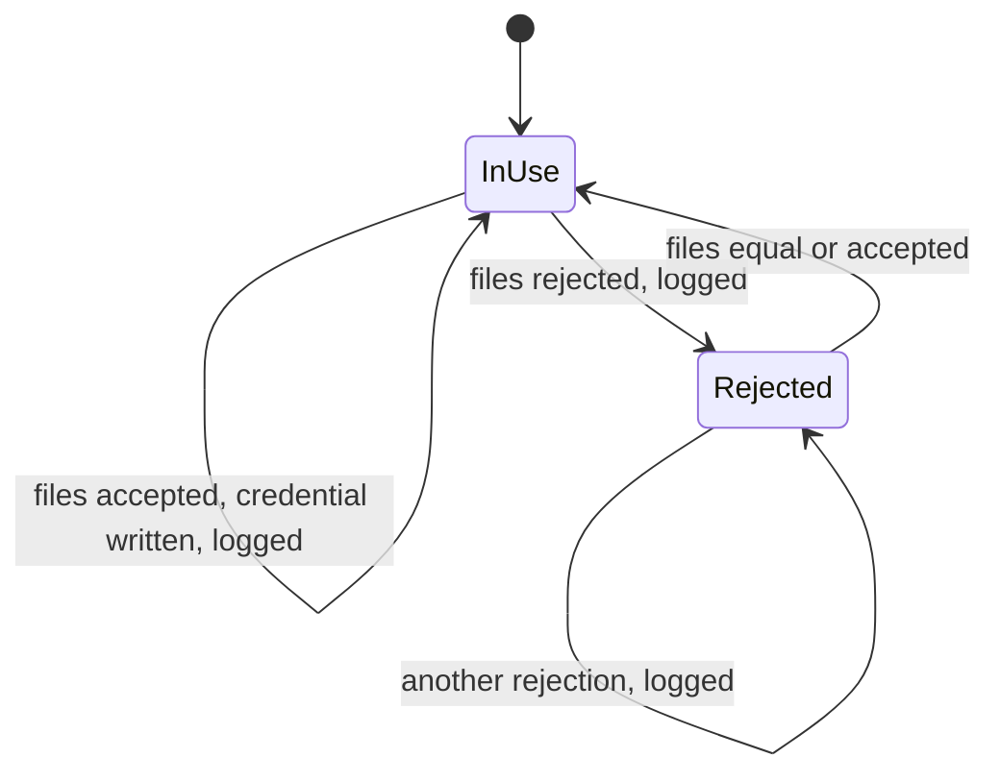
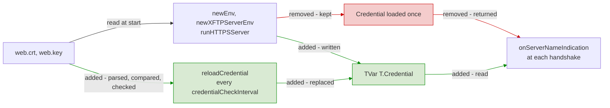
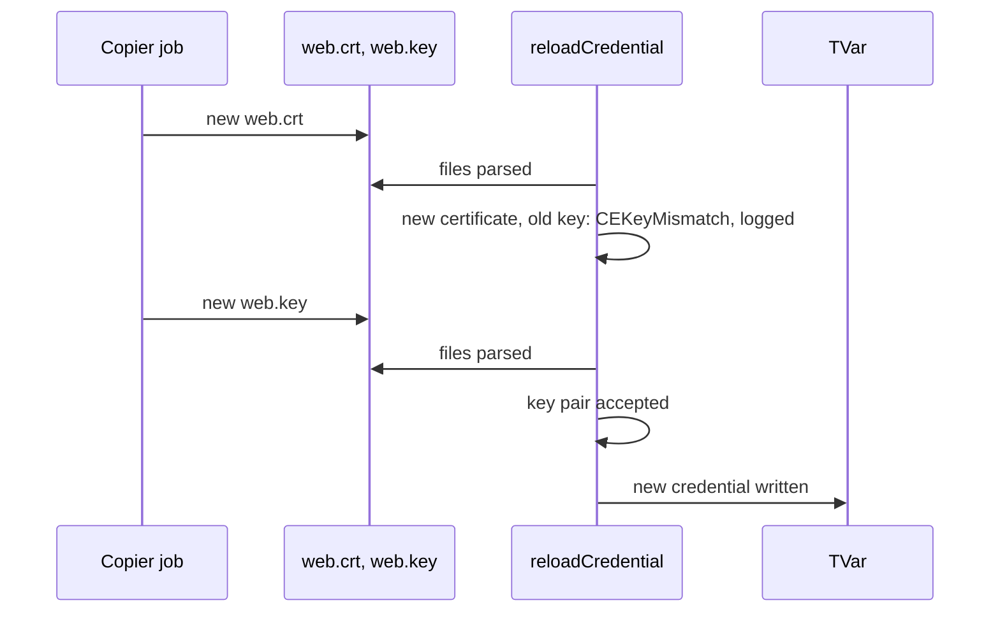

# Web certificates reloaded when their files change

## Problem

smp-server and xftp-server read the web certificate (`[WEB] cert` and `key`) once, at start: in `newEnv` (`Server/Env/STM.hs`), in `newXFTPServerEnv` (`FileTransfer/Server/Env.hs`) and by warp-tls in `serveStaticFiles` (`Server/Web.hs`). A renewed Let's Encrypt certificate is served only after a restart. A server that runs longer than 60 days after the last renewal serves an expiring, then an expired certificate to browsers and web clients.

## Decisions

- Scope: the web credential of smp-server and xftp-server, on these paths:
  - SNI on the protocol port (`TLSServerCredential.sniCredential`);
  - the separate HTTPS port of the static site (`runHTTPSServer`).
- The protocol credential (`server.crt`, `server.key`) is read at start only, as before.
- `ReloadableCredential` contains:
  - `credentialFiles`: the files of the web credential;
  - `checkCredential`: the check of the server type;
  - `currentCredential :: TVar T.Credential`: the credential in use.
- `ReloadableCredential` is stored in `TLSServerCredential.sniCredential` and in `httpServerCreds` of both Env types.
- The `TVar` is read in `onServerNameIndication` at each handshake:
  - on the protocol port, in `supportedTLSServerParams`;
  - on the separate port, in `tlsServerHooks` of warp-tls, with empty `tlsCredentials`; in tls 1.9, the credentials of the hook are used before the shared ones.
- Checks of the server type:
  - smp-server: `checkHTTPSCredentials`, an RSA key of at least 4096 bits, as at start;
  - xftp-server: `acceptCredential`.
- `checkKeyPair` requires the private key of the leaf certificate:
  - RSA: the public fields stored with the private key are compared with the key of the certificate;
  - Ed25519, Ed448 and ECDSA on named curves: the public key computed from the private key is compared with the key of the certificate;
  - other key types are rejected.
- xftp-server accepts any key type at start; on reload, only the key types of `checkKeyPair` are accepted.
- Errors are values of `CredentialError`:
  - `CEReadError`: an `IOException` from reading a file;
  - `CEPEMError`: a `PEMError` from parsing a file;
  - `CENoPrivateKey`;
  - `CENoCertificate`;
  - `CEKeyMismatch`;
  - `CEUnsupportedKeyType`;
  - `CEUnsupportedECPoint`;
  - `CEUnsupportedHTTPSKey`.
- The reload thread is started with `race_` against the listener that reads its `TVar`:
  - by `runTransportServerSocketState`, for an SNI credential;
  - by `runHTTPSServer`.
- The interval is `credentialCheckInterval`, 60 seconds by default:
  - in `TransportServerConfig`, for SNI;
  - in `WebHttpsParams`, for the separate port.
- The key pair check is listed in `protocol/crypto-registry.md` as a restricted use.

## Reload thread

State: the last rejection, `Maybe (CredentialError, Maybe T.Credential)`, initially `Nothing`.

```
checkFiles rejected:
  wait credentialCheckInterval
  case loadCredential credentialFiles of
    Left e -> reject rejected (e, Nothing)
    Right cred
      | cred == currentCredential -> checkFiles Nothing
      | otherwise -> case checkKeyPair cred >> checkCredential cred of
          Right () -> write cred to currentCredential; log "reloaded credential"; checkFiles Nothing
          Left e -> reject rejected (e, Just cred)

reject rejected rejection:
  log "rejected credential" with the reason, unless rejection == rejected
  checkFiles (Just rejection)
```



## Threat model

- The certificate and key files are written by the renewal job of the operator and are trusted as at start.
- A partly written, unreadable or mismatched file is rejected, and the previous credential is kept in use.
- `IOException` and `PEMError` from reading the files are caught and logged as rejections; the checks are total functions; the reload thread ends only with its listener.
- Log lines contain fixed text, file paths and parser messages; key material is excluded.
- `pointBaseMul` is computed in variable time on the private scalar, only for changed files; network responses are independent of its time.

## Composition

Green: added. Red: removed.



## Copy of a renewed certificate

The certificate copier writes `web.crt` before `web.key`.



## Tests

In the reload tests, the fixture files are copied into the test directory and replaced there; in the credential check tests, the fixtures are read directly.

- Transport: on a TLS server with an SNI `ReloadableCredential`, `web.crt` is served to a client with SNI, then `web2.crt` after the files are replaced.
- Key pair: the new certificate with the old key is not served; after the new key is written, the new certificate is served.
- smp-server with the shared HTTPS port, and xftp-server with SNI: the served certificate is changed after the files are replaced, without a restart.
- Static site on a separate HTTPS port: the same.
- Key types:
  - smp-server rejects an RSA 2048 and an ECDSA P-256 certificate and keeps the current one;
  - xftp-server serves the ECDSA P-256 certificate.
- A deleted key file and an empty certificate file: the current certificate is still served.
- Start:
  - smp-server with an RSA 2048 web certificate exits with `Error: unsupported HTTPS credentials, required 4096-bit RSA`;
  - an empty key file is reported as `invalid credential: no private key`, with exit code 1.
- Credential check:
  - RSA, ECDSA, Ed448 and Ed25519: a matching pair is accepted; a pair of the same type with another key is rejected with `CEKeyMismatch`;
  - a DSA certificate is rejected with `CEUnsupportedKeyType`;
  - an empty certificate file is rejected with `CENoCertificate`;
  - a missing key file is rejected with `CEReadError`;
  - a malformed certificate file is rejected with `CEPEMError`.
- Fixtures, signed by `web_ca` and generated as `tests/fixtures/README.md` states:
  - `web2`: RSA 4096;
  - `web_rsa2048`;
  - `web_ecdsa` and `web_ecdsa2.key`: P-256;
  - `web_dsa`.
