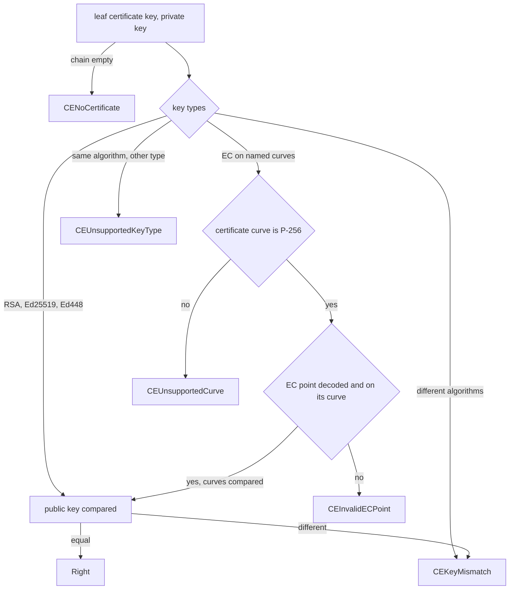
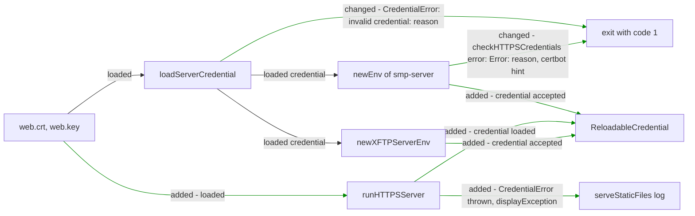
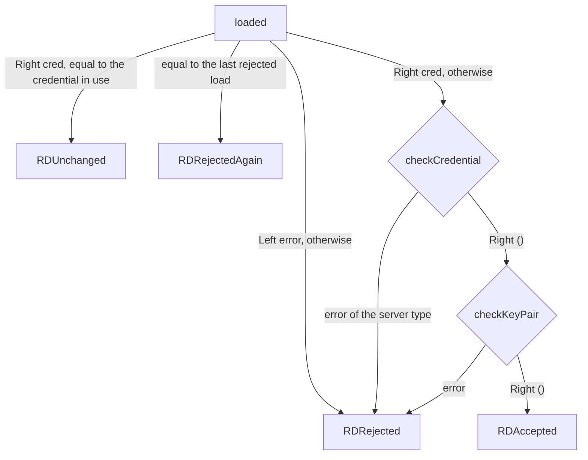
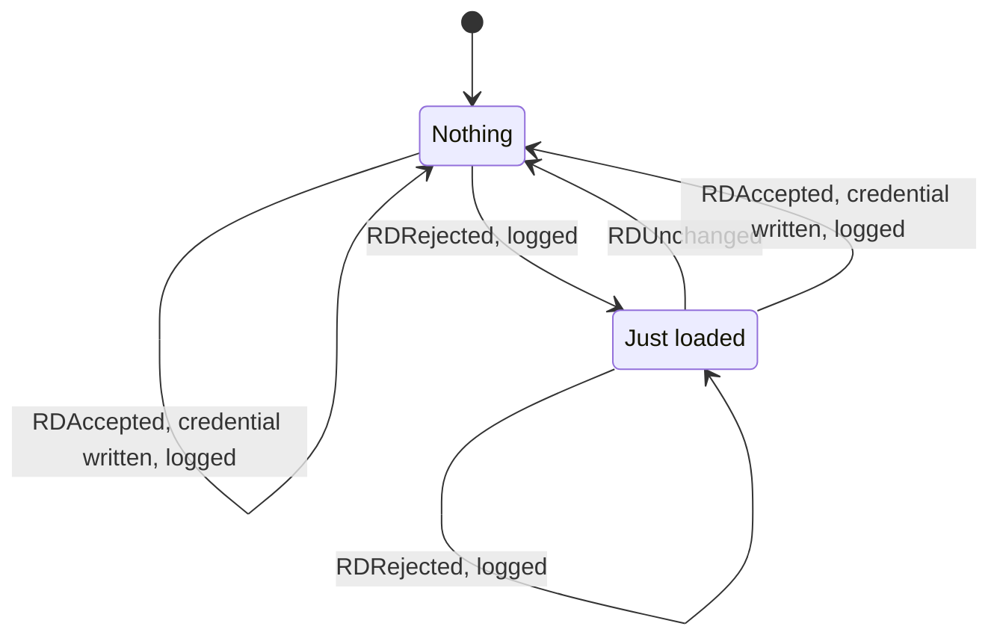
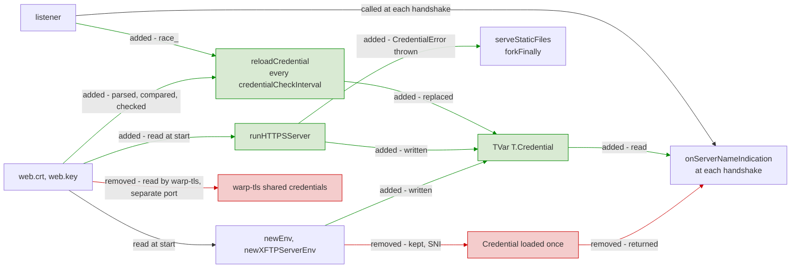
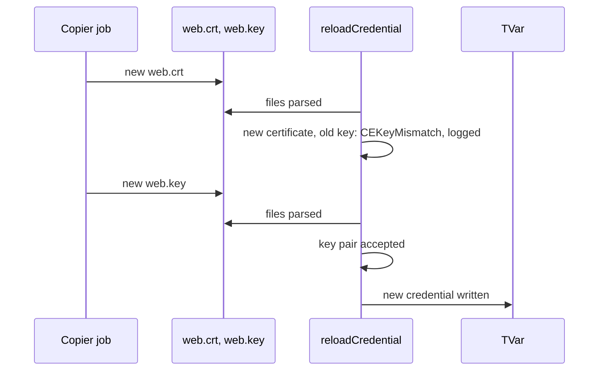

# Web certificates reloaded when their files are replaced

## Problem

smp-server and xftp-server read the web certificate (`[WEB] cert` and `key`) once, at start. The certificate is read in:

- `newEnv` (`Server/Env/STM.hs`);
- `newXFTPServerEnv` (`FileTransfer/Server/Env.hs`);
- warp-tls, started in `serveStaticFiles` (`Server/Web.hs`).

A renewed Let's Encrypt certificate is served only after a restart. A server that runs longer than 60 days after the last restart serves an expiring, then an expired certificate to browsers and web clients.

## Decisions

- Scope: the web credential of smp-server and xftp-server, on these paths:
  - SNI on the protocol port (`TLSServerCredential.sniCredential`);
  - the separate HTTPS port of the static site (`runHTTPSServer`).
- The protocol credential (`server.crt`, `server.key`) is read at start only, as before.
- The fields of `ReloadableCredential`:
  - `credentialFiles`: the files of the web credential;
  - `checkCredential :: CredentialCheck`: the check of the server type, `T.Credential -> Either CredentialError ()`;
  - `currentCredential :: TVar T.Credential`: the credential in use.
- `ReloadableCredential` is stored in `TLSServerCredential.sniCredential` and in `httpServerCreds` of both Env types.
- The `TVar` is read in `onServerNameIndication` at these handshakes:
  - protocol port (`supportedTLSServerParams`): handshakes with SNI;
  - separate port (`tlsServerHooks` of warp-tls, empty `tlsCredentials`): all handshakes.
- Checks of the server type:
  - smp-server: `checkHTTPSCredentials`, an RSA key of at least 4096 bits, as at start;
  - xftp-server: `acceptCredential`.
- In `checkKeyPair`, the public key of the leaf certificate is compared with a public key obtained from the private key file, as shown in the section "Key-pair check".
- xftp-server accepts any key type at start, and only the key types of `checkKeyPair` after a change of the files.
- EC keys are accepted on reload only on `tlsSigningCurve` (P-256).
- In `checkHTTPSCredentials`, an empty certificate chain is rejected with `CENoCertificate`, at start and on reload.
- The check of the server type is applied before `checkKeyPair`; on smp-server, a reloaded certificate of another key type is rejected with the error given at start.
- Errors are values of `CredentialError`:
  - `CEReadError`: an `IOException` from reading a file;
  - `CEPEMError`: the message of a `PEMError` from parsing a file;
  - `CENoPrivateKey`: a key file without a private key;
  - `CENoCertificate`: a certificate file without a certificate;
  - `CEKeyMismatch`: a private key of another certificate, also of another key type;
  - `CEUnsupportedKeyType`: a certificate and a private key of one algorithm outside the cases of `checkKeyPair`, also EC keys with explicit curve parameters;
  - `CEUnsupportedCurve`: a certificate key on a curve other than `tlsSigningCurve`;
  - `CEInvalidECPoint`: an EC point other than an uncompressed point on its curve;
  - `CEUnsupportedHTTPSKey`: on smp-server, a key other than RSA of at least `minHTTPSRSAKeyBits` (4096).
- The reload thread is run by `withCredentialReload`, in `race_` with the listener in which its `TVar` is read; both threads are ended by an exception in either one. `withCredentialReload` is called in:
  - `runTransportServerSocketState`, for an SNI credential;
  - `runHTTPSServer`.
- xftp-server with `[WEB] https` and `[WEB] static_path` builds two `ReloadableCredential` values from the same files, used by the SNI listener and the separate port; each event is logged twice, by their two reload threads.
- On the separate port, `CENoPrivateKey` and the other errors of a credential that cannot be loaded at start are thrown as `CredentialError` and logged in `serveStaticFiles` with their reason.
- The interval, `credentialCheckInterval` (60 seconds by default), is set in:
  - SNI: `TransportServerConfig`;
  - separate port: `WebHttpsParams`.
- The key-pair check is listed in `protocol/crypto-registry.md` as a restricted use.

## Key-pair check

```
checkKeyPair (chain, privateKey):
  chain empty -> CENoCertificate
  (RSA k, RSA pk) -> CEKeyMismatch unless private_pub pk == k
  (Ed25519 k, Ed25519 pk) -> CEKeyMismatch unless toPublic pk == k
  (Ed448 k, Ed448 pk) -> CEKeyMismatch unless toPublic pk == k
  (EC named curve point, EC named curve' d) ->
    CEUnsupportedCurve curve unless curve == tlsSigningCurve
    publicPoint <- unserializePoint curve point, else CEInvalidECPoint
    CEKeyMismatch unless curve == curve' && publicPoint == pointBaseMul curve d
  same algorithm -> CEUnsupportedKeyType algorithm
  other algorithms -> CEKeyMismatch
```



## Start

Green: added or changed.



## Reload thread

State: the result of the last rejected load, `Maybe (Either CredentialError T.Credential)`, initially `Nothing`. The decision is made in the pure function `checkLoadedCredential`; its results are values of `ReloadDecision`.

```
checkFiles rejected:
  wait credentialCheckInterval
  current <- read currentCredential
  loaded <- loadCredential credentialFiles
  case checkLoadedCredential checkCredential current rejected loaded of
    RDUnchanged -> checkFiles Nothing
    RDAccepted cred -> write cred to currentCredential; log "reloaded credential"; checkFiles Nothing
    RDRejected error -> log "rejected credential" with the error; checkFiles (Just loaded)
    RDRejectedAgain -> checkFiles rejected

checkLoadedCredential checkCredential current rejected loaded:
  Right cred, cred == current -> RDUnchanged
  rejected == Just loaded -> RDRejectedAgain
  Right cred -> RDAccepted cred if checkCredential cred >> checkKeyPair cred is Right (), else RDRejected error
  Left error -> RDRejected error
```





## Threat model

- The certificate and key files are written by the renewal job of the operator and are trusted as at start.
- Unreadable or unparsable files and a mismatched pair are rejected, and the previous credential is kept in use.
- A certificate file read while it is being copied, cut at a PEM boundary, is parsed as a shorter chain; with the key of the new certificate already in place (a reused key, or a key copied first), that chain is served until the whole file is read at the next check.
- `IOException` and `PEMError` from reading the files are caught and logged as rejections; the checks are total functions; the reload thread is ended only together with its listener.
- A malformed file is read lazily by crypton-x509-store; when parsing stops before the end of the file, its handle is closed by the garbage collector.
- Contents of log lines:
  - fixed text;
  - file paths;
  - messages of the PEM parser and of `IOException`;
  - the key algorithm of a certificate;
  - the EC curve name of a certificate.
- `pointBaseMul` is computed in variable time on the private scalar, once per change of the files in each reload thread.

## Composition

Green: added. Red: removed.



## A renewed certificate copied into place

For a copier that writes `web.crt` before `web.key`:



The reverse order is handled the same way.

## Tests

Fixture files are copied into the test directory for the reload tests, the static site start test and the start test of a rejected certificate. In the other tests, the fixtures are read in place, and empty and malformed files are written in the test directory.

- Transport: on a TLS server with an SNI `ReloadableCredential`, `web.crt` is served to a client with SNI, then `web2.crt` after the files are replaced.
- Key pair: the new certificate is served only after its key is written.
- smp-server with the shared HTTPS port, and xftp-server with SNI: the served certificate is changed after the files are replaced, without a restart.
- Static site on a separate HTTPS port: the same.
- Static site at start: `CENoPrivateKey` is thrown for an empty key file.
- Key types:
  - smp-server rejects an RSA 2048 and an ECDSA P-256 certificate and keeps the current one;
  - xftp-server serves the ECDSA P-256 certificate, then rejects an ECDSA P-384 certificate and keeps the P-256 one;
  - on the separate HTTPS port with `checkHTTPSCredentials`, an RSA 2048 certificate is rejected and the current one is kept.
- A deleted key file and an empty certificate file: the current certificate is still served.
- Start, in the sequential "Server CLIs" tests, with the output captured, exit code 1 and `prException` equal to `Nothing`:
  - smp-server started with an RSA 2048 web certificate: `Error: unsupported HTTPS credentials, required 4096-bit RSA`;
  - an empty key file: `invalid credential: no private key`.
- Credential check, with the expected error:
  - RSA, ECDSA, Ed448 and Ed25519 pairs: accepted when matching, `CEKeyMismatch` with another key of the same type;
  - a key of another type: `CEKeyMismatch`;
  - DSA certificate: `CEUnsupportedKeyType`;
  - empty certificate file: `CENoCertificate`;
  - missing key file: `CEReadError`;
  - malformed certificate file: `CEPEMError`;
  - EC point off its curve: `CEInvalidECPoint`;
  - ECDSA P-384 pair: `CEUnsupportedCurve`;
  - P-256 certificate with its scalar under a P-384 curve name: `CEKeyMismatch`.
- Reload decision (`checkLoadedCredential`), with the expected result:
  - files equal to the credential in use: `RDUnchanged`;
  - a mismatched pair: `RDRejected`, then `RDRejectedAgain` for the same pair;
  - after it, another mismatched pair and a load error: `RDRejected`;
  - a load error repeated: `RDRejectedAgain`;
  - a renewed pair: `RDAccepted`;
  - an RSA 2048 pair: `RDRejected` with `checkHTTPSCredentials`, `RDAccepted` with `acceptCredential`;
  - an ECDSA P-384 pair: `RDRejected CEUnsupportedHTTPSKey` with `checkHTTPSCredentials`, `RDRejected (CEUnsupportedCurve SEC_p384r1)` with `acceptCredential`.
- `checkHTTPSCredentials` with an empty certificate chain: `CENoCertificate`.
- Fixtures, generated by the commands in `tests/fixtures/README.md`. Certificates signed by `web_ca`:
  - `web2`: RSA 4096;
  - `web_rsa2048`: RSA 2048;
  - `web_ecdsa`: P-256;
  - `web_ecdsa384`: P-384;
  - `web_dsa`: DSA.
- A second P-256 key, without a certificate: `web_ecdsa2.key`.
