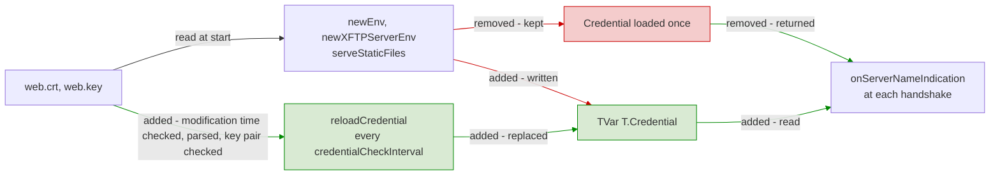
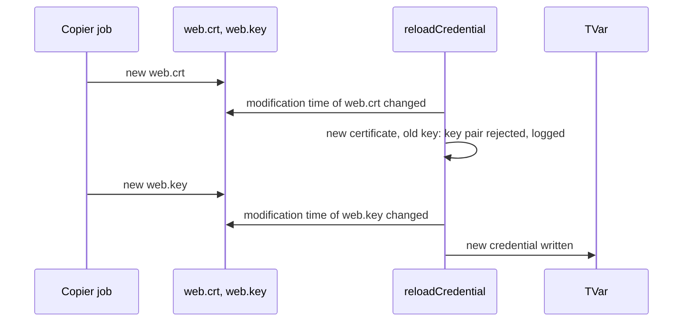

# Web certificates reloaded when their files change

## Problem

smp-server and xftp-server read the web certificate (`[WEB] cert` and `key`) once, at start: `newEnv` (`Server/Env/STM.hs`), `newXFTPServerEnv` (`FileTransfer/Server/Env.hs`) and warp-tls in `serveStaticFiles` (`Server/Web.hs`). A renewed Let's Encrypt certificate is served only after a restart, so a server that runs longer than 60 days after the last renewal serves an expiring and then expired certificate to browsers and web clients.

## Decisions

- Scope: the web credential of smp-server and xftp-server, on both paths that serve it:
  - SNI on the protocol port (`TLSServerCredential.sniCredential`);
  - the separate HTTPS port of the static site (warp-tls in `serveStaticFiles`).
- The protocol credential (`server.crt`, `server.key`) is unchanged: it is read at start only.
- `TLSServerCredential.sniCredential` holds `TVar T.Credential`; `onServerNameIndication` reads it at each handshake.
- warp-tls takes the credential from `tlsServerHooks.onServerNameIndication`, which reads the same kind of `TVar`; tls tries the hook's credentials before the shared ones.
- `reloadCredential` replaces the credential in its `TVar` when the modification time of the certificate, key or CA file changes:
  - the files are parsed with `T.credentialLoadX509Chain`;
  - the private key must match the public key of the leaf certificate (RSA, Ed25519 and Ed448; other key types are rejected);
  - smp-server also requires the RSA key of at least 4096 bits that it requires at start;
  - a rejected change is logged once and the previous credential stays in use; the next change of a file is checked again.
- The check interval is `credentialCheckInterval` in `TransportServerConfig`, 60 seconds by default, and in `EmbeddedWebParams` for the separate HTTPS port.
- The reload threads are part of the server's thread set (`raceAny_`) for SNI, and forked with the HTTPS listener for the separate port, so they stop with the server.

## Composition

Green: added. Red: removed.

## Copy of a renewed certificate

The certificate copier writes `web.crt` before `web.key`.

## Tests

Each test copies the fixture files into its test directory and replaces them there.

- Transport: a TLS server with an SNI credential `TVar` and `reloadCredential`; a client with SNI receives `web.crt`, then, after the files are replaced, `web2.crt`.
- Key pair: the new certificate with the old key is not served; after the new key is written, the new certificate is served.
- smp-server with the shared HTTPS port, and xftp-server with SNI: the served certificate changes after the files are replaced, without a restart.
- Static site on a separate HTTPS port: the same.
- Fixtures: `web2.crt` and `web2.key`, a second RSA 4096 certificate signed by `web_ca`, generated as `tests/fixtures/README.md` states.
