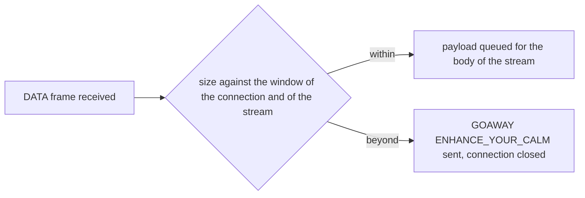
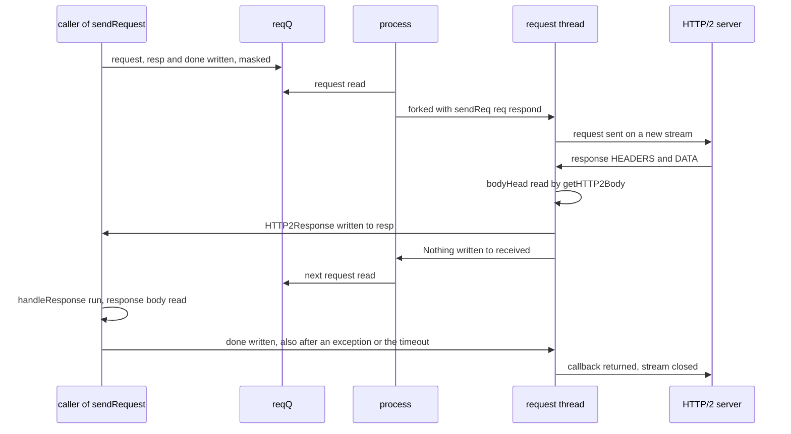
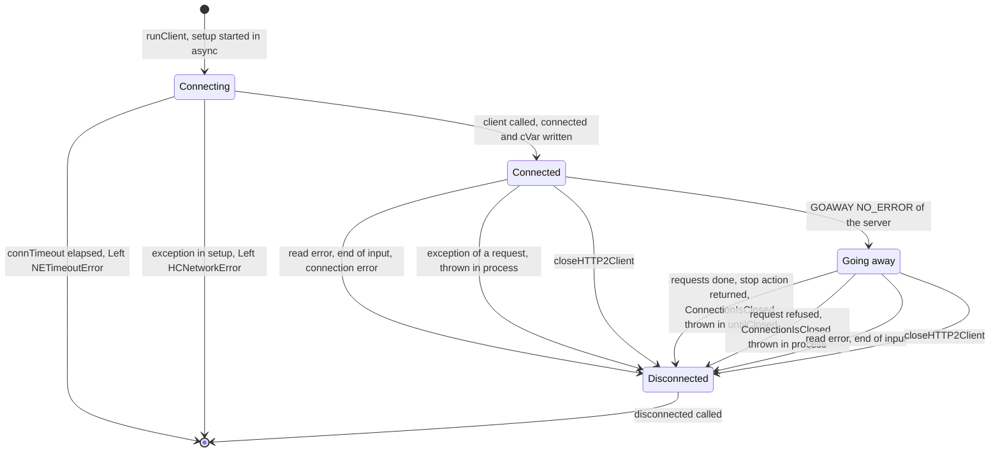
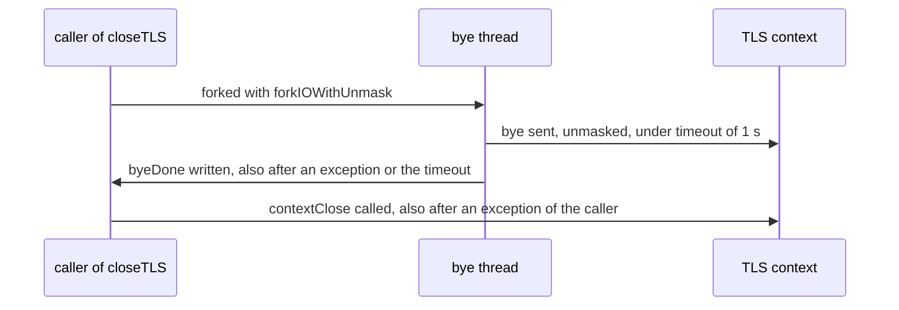
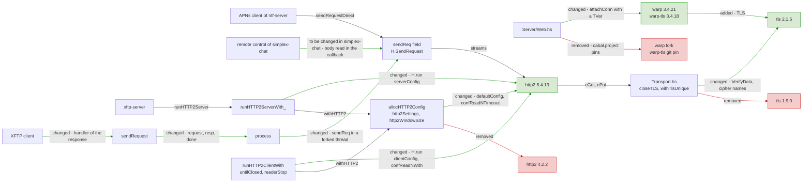

# Received HTTP/2 data limited to the advertised window

## Problem

HTTP/2 data received on a connection is to be limited to the flow-control window advertised for the connection and for each stream. A peer that sends more is to be disconnected with GOAWAY `ENHANCE_YOUR_CALM`. The limit applies to the HTTP/2 servers and clients of simplexmq:

- xftp-server;
- XFTP clients;
- the APNs client of ntf-server;
- remote control of simplex-chat.

For it, http2 is upgraded from 4.2.2 to 5.4.13. The libraries upgraded with it are listed in the section "Dependencies".

## Decisions

- Limits advertised by the HTTP/2 server and client, in `Simplex.Messaging.Transport.HTTP2`:
  - `http2MaxConcurrentStreams`: 100, SETTINGS_MAX_CONCURRENT_STREAMS;
  - `http2WindowSize`: 1048575 bytes, SETTINGS_INITIAL_WINDOW_SIZE and the window of the connection;
  - the other settings: `defaultSettings` of http2 5.4.13, with SETTINGS_MAX_FRAME_SIZE 16384.
- DATA beyond the window of the connection or of a stream is answered with GOAWAY `ENHANCE_YOUR_CALM`, and the connection is closed.
- `confReadNTimeout = True` is set for the server and the client.
- `sendRequest` takes a handler of the response, and the response body is read in it (section "Requests").
- The `sendReq` field of `HTTP2Client` has the rank-N type `H.SendRequest`, `forall r. Request -> (Response -> IO r) -> IO r`.
- The signature of `sendRequestDirect` is unchanged. Its response body is read in the callback of `sendReq` up to `bodyHeadSize`, into `bodyHead`, which the APNs client reads.
- An HTTP/2 client is disconnected, and its `disconnected` action is called, when its connection is closed or lost (section "Client lifecycle").
- The client is ended by an exception of a request in `process`, also of a request refused after GOAWAY of the server.
- `closeTLS` is limited to 1 s (section "Closing TLS connections"). Its implementation is the same in #2058; the pull request merged second is updated by merging master.
- `Simplex.Messaging.Transport` is compiled with the module-wide `{-# OPTIONS_GHC -Wno-deprecations #-}`.

## Dependencies

`simplexmq.cabal`:

- `http2 >=5.4.13 && <5.5`
- `network >=3.2.12 && <3.3`
- `time-manager ==0.5.*`
- `tls ==2.1.6.*`, in the library and in the test suite
- `warp ==3.4.21`
- `warp-tls ==3.4.18`
- `websockets ==0.13.*`

`cabal.project`:

- `index-state: 2026-11-10T06:00:00Z`;
- the git pins of warp (simplex-chat/wai) and warp-tls (yesodweb/wai) are removed, and both packages are taken from Hackage.

Versions in the CI build plans of GHC 9.6.3 and GHC 8.10.7:

- http2 5.4.13
- http-semantics 0.4.2, added
- network-control 0.1.7, added
- network 3.2.12.0
- time-manager 0.5.2
- tls 2.1.6
- tls-session-manager 0.0.9
- crypton-connection 0.4.5
- auto-update 0.2.8
- warp 3.4.21
- warp-tls 3.4.18
- websockets 0.13.0.0
- crypton-x509 1.7.7
- crypton-x509-validation 1.6.14
- cryptostore 0.3.1.0

Other packages are resolved at the new `index-state`, among them:

- postgresql-libpq 0.11.0.0
- zlib 0.7.1.1
- hspec 2.11.18
- http-client 0.7.19

## HTTP/2 configuration

`allocHTTP2Config`, used by the server and the client through `withHTTP2`, is `defaultConfig` of http2 5.4.13 with these fields:

- `confWriteBuffer`: a buffer of `bufferSize` bytes
- `confBufferSize`: `bufferSize`
- `confSendAll`: `cPut` of the TLS connection
- `confReadN`: `cGet` of the TLS connection
- `confTimeoutManager`: a time manager of 30 s
- `confReadNTimeout`: `True`

The other fields are the defaults of `defaultConfig`.

```
http2Settings = defaultSettings {maxConcurrentStreams = Just http2MaxConcurrentStreams, initialWindowSize = http2WindowSize}

server, in runHTTP2ServerWith_:
  H.run defaultServerConfig {connectionWindowSize = http2WindowSize, settings = http2Settings} cfg handler

client, in runHTTP2ClientWith:
  H.run defaultClientConfig {scheme = "https", authority = host, cacheLimit = 20, connectionWindowSize = http2WindowSize, settings = http2Settings} cfg {confReadNWith = Just readNWith} untilClosed
```



## Requests

State of one request:

- `resp :: TMVar HTTP2Response`: written in `respond`, taken in `sendRequest`
- `done :: TMVar ()`: written in `sendRequest`, read in `respond`
- `received :: TMVar (Maybe SomeException)`: written in `respond` or in the exception handler of the request thread, taken in `process`

```
sendRequest client req reqTimeout_ handleResponse:
  resp <- newEmptyTMVar
  done <- newEmptyTMVar
  mask:
    write (req, resp, done) to reqQ
    r <- restore (timeout (http2RequestTimeout config reqTimeout_) (take resp) >>= mapM handleResponse)
           `finally` put done ()
  Nothing -> Left HCResponseTimeout
  Just a -> Right a

process sendReq, repeated:
  (req, resp, done) <- read reqQ
  received <- newEmptyTMVar
  forkIO:
    sendReq req respond, on an exception e: tryPut received (Just e)
  respond r:
    respBody <- getHTTP2Body r bodyHeadSize
    put resp HTTP2Response {response = r, respBody}
    put received Nothing
    read done
  take received:
    Just e -> throw e
    Nothing -> next request
```

- The request is written to `reqQ` in a masked section, and `done` is put in its `finally`, also when the caller of `sendRequest` is interrupted.
- The wait for space in `reqQ` is interruptible.
- The wait for `resp` is bounded by `http2RequestTimeout`: `connTimeout`, plus the timeout of the request when it is given. `handleResponse` is run after this wait.
- The callback of `sendReq` returns after `done` is put. The stream is then closed by http2; a response still being received is reset with RST_STREAM `CANCEL`.
- The next request is read from `reqQ` after `bodyHead` of the previous response is read.
- XFTP client:
  - `sendXFTPCommand` and `sendXFTPTransmission` take a handler `(FileResponse, HTTP2Body) -> ExceptT XFTPClientError IO a`;
  - the response block is checked and decoded in `processResponse`, in the handler of `sendRequest`;
  - in `downloadXFTPChunk`, the file chunk is received with `receiveEncFile` in the handler, within `chunkTimeout`;
  - in the handshake requests, `pure` is passed, and `bodyHead` is read after `sendRequest` returns.
- `sendRequestDirect`: `getHTTP2Body` is called in the callback of `sendReq`, under `http2RequestTimeout`.



## Client lifecycle

State of one HTTP/2 client:

- `cVar :: TMVar (Either HTTP2ClientError HTTP2Client)`: the connected client or the error, taken in `runClient` within `connTimeout`
- `connected :: TVar Bool`: set to `True` in `client`
- `readerStop :: TVar (Maybe (STM ()))`: the stop action of the connection reader, written at its first read
- the GOAWAY of the server: its last stream identifier, in the context of http2
- `action :: Maybe (Async HTTP2Response)`: the thread of the connection, cancelled in `closeHTTP2Client`

```
runHTTP2ClientWith tls cfg:
  readerStop <- newTVar Nothing
  readNWith stopped n:
    readerStop is Nothing -> write Just stopped to readerStop
    confReadN cfg n
  untilClosed sendReq aux:
    race (wait for Just stop in readerStop, then stop) (client tls sendReq aux)
    Left () -> throw ConnectionIsClosed
    Right a -> a
  H.run clientConfig cfg {confReadNWith = Just readNWith} untilClosed

client sendReq aux:
  write True to connected
  put (Right client) to cVar
  process sendReq `finally` disconnected

Connecting:
  client called -> Connected
  connTimeout elapsed -> Left (HCNetworkError NETimeoutError), action cancelled
  exception in setup -> Left (HCNetworkError (toNetworkError e))
Connected:
  GOAWAY(NO_ERROR) of the server -> Going away
  read error, end of input or connection error -> Disconnected
  exception of a request in process -> Disconnected
  closeHTTP2Client -> Disconnected
Going away:
  requests up to the last stream identifier done, stop action returned, ConnectionIsClosed thrown in untilClosed -> Disconnected
  request refused with ConnectionIsClosed, thrown in process -> Disconnected
  read error or end of input -> Disconnected
  closeHTTP2Client -> Disconnected
Disconnected:
  disconnected called in the finally of process
```

- `readNWith` is passed to http2 as `confReadNWith`. The stop action is stored in `readerStop`, and the bytes are read with `confReadN`.
- The stop action is an STM action. It returns after GOAWAY(NO_ERROR) of the server, once the requests up to its last stream identifier are done, their callbacks included.
- In `race`, `client` is cancelled when the stop action returns, and `disconnected` is called in the `finally` of `process`.
- After a read error or a connection error, and at the end of input in the state Connected, an exception is thrown from `H.run`; `untilClosed` is cancelled, and `disconnected` is called in the `finally` of `process`.
- At the end of input in the state Going away, the streams are closed with `ConnectionIsClosed`; then the stop action returns, or the exception of a request is thrown in `process`.



## Closing TLS connections

```
closeTLSTimeout = 1000000

closeTLS ctx:
  byeDone <- newEmptyTMVar
  forkIOWithUnmask:
    (unmask (timeout closeTLSTimeout (bye ctx)), exceptions caught) `finally` put byeDone ()
  take byeDone `finally` (contextClose ctx, exceptions caught)
```

- On an exception of the caller while `byeDone` is awaited, `contextClose` is called at once, and the bye thread is ended by `timeout` within 1 s.



## TLS 2.1

- `withTlsUnique`: `Maybe VerifyData` is returned by `getPeerFinished` on the server and by `getFinished` on the client.
  - `Just (VerifyData d)`: `d` is passed to `f`, with `VerifyData` imported from `Network.TLS.Internal`.
  - `Nothing`: `closeTLS`, then `ioe_EOF`.
- `getFinished` and `getPeerFinished` are deprecated in tls 2.1.6; `-Wno-deprecations` is set for `Simplex.Messaging.Transport`.
- Ciphers of `defaultSupportedParams`, by their tls 2.1 names:
  - `cipher13_CHACHA20_POLY1305_SHA256`: 0x1303, TLS 1.3;
  - `cipher_ECDHE_ECDSA_WITH_CHACHA20_POLY1305_SHA256`: 0xCCA9, TLS 1.2.
- Extended main secret: `supportedExtendedMainSecret` is the default of tls 2.1.6, `RequireEMS`, in `defaultSupportedParams`, `defaultSupportedParamsHTTPS` and `http2TLSParams`. It is required in TLS 1.2 handshakes of clients and servers; tls 1.9 peers offer it (`AllowEMS`).

## Build

- network 3.2: `getAddrInfo` returns `t AddrInfo` for `GetAddrInfo t`. In `startTCPServer`, `t` is fixed to the list by the signature `select :: [AddrInfo] -> AddrInfo`.
- mtl 2.3.2, in the plan of GHC 8.10.7, exports `onError` from `Control.Monad.Except`. The local function of `safeDecodeUtf8` is renamed from `onError` to `replaceInvalid`.

## Web server

- warp 3.4.21 and warp-tls 3.4.18 are used by `runHTTPSServer` and `attachStaticFiles` (`Server/Web.hs`).
- In `attachStaticFiles`, `attachConn` of warp-tls 3.4.18 takes a `TVar Int`; a new `TVar` with 0 is created for each connection.

## Docs

- `protocol/crypto-registry.md`:
  - tls 2.1 in two rows: "TLS 1.3 / 1.2" and the key-pair check of reloaded web credentials;
  - versions in the table of sources:
    - tls 2.1.6
    - crypton-x509 1.7.7
    - crypton-x509-validation 1.6.14
    - cryptostore 0.3.1.0
- `tests/fixtures/README.md`: tls 2.1 in the line of the ECDSA P-384 fixture.
- `contributing/CODE.md`: warp and warp-tls are removed from the list of forks.

## Composition

Green: added or changed. Red: removed.



## For simplex-chat

- `src/Simplex/Chat/Remote/Protocol.hs`, `sendRemoteCommand`: the response body is read after `sendRequestDirect` returns. It is to be read in a callback of `sendReq`.
- `simplex-chat.cabal`: these bounds are raised to the versions of the section "Dependencies":
  - http2 `>=4.2.2 && <4.3`;
  - network `>=3.1.2.7 && <3.2`;
  - network `==3.1.*`;
  - tls `>=1.9.0 && <1.10`;
  - websockets `==0.12.*`;
  - warp `==3.3.*`.
- `cabal.project`: the same `index-state`; the git pins of warp (simplex-chat/wai) and warp-tls (yesodweb/wai) are removed.
- `flake.nix`: the same `index-state`; the `hackage` input in `flake.lock` is updated to a revision that includes 2026-11-10.
- `scripts/nix/sha256map.nix`: the entries of the removed wai pins are deleted.
- Builds of simplex-chat with this simplexmq are pending:
  - desktop;
  - CLI;
  - Android and iOS, with network 3.2.12.

## Tests

- "should close connection when DATA exceeds the HTTP/2 flow-control window" (`testHTTP2FlowControl`): raw HTTP/2 frames are sent over TLS to an HTTP/2 server started with `runHTTP2Server` and the XFTP server configuration (`withStallingXFTPServer`). Checked:
  - SETTINGS of the server: SETTINGS_MAX_CONCURRENT_STREAMS 100 and SETTINGS_INITIAL_WINDOW_SIZE 1048575;
  - WINDOW_UPDATE of the connection: 983040, the window of 1048575 bytes less the default of 65535;
  - the request on stream 1 is passed to the request handler;
  - DATA of 1048575 bytes on stream 1 is sent within 5 s, and a PING is answered with its ACK;
  - one more byte of DATA is answered with GOAWAY of last stream 1, `ENHANCE_YOUR_CALM`, "exceeds connection flow-control limit".
- "should disconnect HTTP/2 client after GOAWAY of the server with the connection kept open" and "... with the connection closed" (`testHTTP2ClientGoAway`): an HTTP/2 client is attached with `attachHTTP2Client` to a raw HTTP/2 server on `runTransportServer`, and a request is sent with `sendRequest`. The server sends GOAWAY(NO_ERROR) of last stream 1 after the request HEADERS. Checked:
  - SETTINGS of the client: SETTINGS_MAX_CONCURRENT_STREAMS 100 and SETTINGS_INITIAL_WINDOW_SIZE 1048575;
  - WINDOW_UPDATE of the client connection: 983040;
  - with the connection kept open, the response is sent by the server after GOAWAY, `disconnected` is called within 5 s, and `Right` is returned by `sendRequest` within 5 s;
  - after the server closes the connection following GOAWAY, `disconnected` is called within 5 s.
- In both tests, each frame is awaited for at most 5 s, and an `error` is raised at a GOAWAY other than the awaited frame.
- A handler is passed to `sendRequest` in these tests:
  - the XFTP tests of CORS and of the web handshake, `testStaleWebSession` included;
  - `testInterruptedUploadStorage`;
  - `smpServerTestStatic`.
- The limit of `closeTLS` is tested in #2058 (`testCloseBlockedTLS`), with the same `closeTLS`.

## Interoperability

Builds of this branch at 3e026b1d (tls 2.1.6, http2 5.4.13), with the sources of the head, and of master 880d089e (tls 1.9.0, http2 4.2.2) were run against each other on AWS. Each pair of server and client builds was tested:

- master server, branch client;
- branch server, master client;
- branch server, branch client;
- master server, master client.

Results of each pair:

- xftp: a 10 MiB file was uploaded and downloaded, and the downloaded file was identical.
- smp-server: an SMP connection was established between two agents, and a message was delivered each way.
- TLS 1.3 with TLS_CHACHA20_POLY1305_SHA256 (0x1303) was negotiated.
