# Stalled XFTP connections closed and memory use reduced

## Problem

On xftp-server:

- connections of unreachable or stalled peers are to be closed, with inactive-client expiry on or off;
- `xftp-server init` writes `[INACTIVE_CLIENTS] disconnect = off`, and inactive clients of a server set up with it are not disconnected;
- each received chunk is read back from disk for its digest;
- the recipients of one FNEW or FADD request are added one at a time, in separate store transactions;
- with `log_stats = off`, the download counts of these Prometheus metrics are not reset:
  - `simplex_xftp_files_count_daily`;
  - `simplex_xftp_files_count_weekly`;
  - `simplex_xftp_files_count_monthly`;
- `xftp-server start` applies PostgreSQL migrations and starts the server in one command;
- socket counts are exported to Prometheus by smp-server only;
- errors of sending a file are printed to standard output, outside the log;
- the server is run with the RTS defaults of GHC unless `+RTS` flags are given.

## Decisions

- Limits are applied with inactive-client expiry on or off, except where expiry is named.
- New fields of `TransportServerConfig`, with their values in `mkTransportServerConfig`:
  - `firstRequestTimeout :: Int`: 60 s, in microseconds;
  - `tcpKeepAlive :: Maybe KeepAliveOpts`: `Nothing`;
  - `tcpUserTimeout :: Maybe Int`: `Nothing`; in milliseconds, the unit of `TCP_USER_TIMEOUT`.
- `tcpKeepAlive` has the name of the field in the client configuration types.
- Socket options of xftp-server are compiled constants of `FileTransfer/Server/Env.hs`, set in `serverConfig` (`FileTransfer/Server/Main.hs`):
  - `tcpKeepAlive = Just defaultXFTPKeepAlive`:
    - `keepIdle = 60`;
    - `keepIntvl = 10`;
    - `keepCnt = 6`;
  - `tcpUserTimeout = Just defaultXFTPUserTimeout`: 180000.
- With these values, a connection is closed when neither keep-alive probes nor sent data are acknowledged by its peer for 3 minutes.
- The time of each of these steps is limited by `fileTimeout` (5 minutes in `serverConfig`):
  - the first block of a request body (`xftpBlockSize`, 16384 bytes), for each request other than a CORS preflight and a static page;
  - a new chunk, as before;
  - the body of a repeated upload of a committed chunk;
  - a file response, from the read of its chunk file until its last block is queued by http2.
- A connection whose queued response is not read by the client is closed by inactive-client expiry.
- `closeSession :: IO ()` is passed by `runHTTP2ServerWith_` to the request handler and is equal to `killThread` of the connection thread. The TLS context and the socket are then closed by the release actions of `runTransportServerSocketState_` (`closeConnection`) and `runTCPServerSocket` (`gracefulClose`).
- In inactive-client expiry, the idle time is measured from the end of the last request, and connections with a request in progress are skipped.
- `closeTLS` is changed for every TLS connection of simplexmq servers and clients; #2059 contains the same implementation.
- Responses without a file are sent with `H.responseBuilder`.
- A received chunk is hashed while it is written:
  - in xftp-server, by `receiveFile` (FPUT);
  - in clients, by `receiveEncFile` (`downloadXFTPChunk`).
- In `receiveSbFile`, blocks are written through `receiveSbBlocks`, and the digest is not computed, as before.
- `addRecipient` of `FileStoreClass` is replaced by `addRecipients :: s -> SenderId -> NonEmpty FileRecipient -> IO (Either XFTPErrorType ())`; all recipients of a call are added in one transaction, or none.
- `retryAdd` is used for new file ids and for new recipient ids; after `DUPLICATE_`, every id of the call is generated again.
- The period download sets are reset also with `log_stats = off`, by `resetPeriodStats`.
- `delayUntilDayTime` is defined in `Simplex.Messaging.Util` and called in:
  - `Simplex.Messaging.Server` (`logServerStats`);
  - `Simplex.Messaging.Notifications.Server` (`logServerStats`);
  - `Simplex.FileTransfer.Server` (`logServerStats` and `resetPeriodStats`).
- `xftp-server start --maintenance` (`-m`) prints the message of smp-server and ntf-server: `Server started in 'maintenance' mode, exiting`.
- The socket state of xftp-server is created in `newXFTPServerEnv` (field `sockets` of `XFTPEnv`) and passed to `runHTTP2Server`; `socketsMetric` of xftp-server is defined in `FileTransfer/Server/Prometheus.hs`, apart from the one of smp-server.
- Errors of `sendEncFile` are logged with `logInfo` as `sendEncFile: <error>` and thrown again.
- RTS defaults are compiled into the `xftp-server` executable; the allocation area limit (`-AL`) is left at the RTS default.
- `xftp-server init` writes inactive-client expiry on; existing ini files are read as written.

## One connection

State of a connection, `ClientActivity` (`Transport/HTTP2/Server.hs`):

```
ClientActivity
  requestStarted   :: TVar Bool        -- False before the first request
  requestsInFlight :: TVar Int         -- requests started and not ended
  idleSince        :: TVar SystemTime  -- connection start, then the end of the last request
```

The state is read from the fields:

```
requestStarted  requestsInFlight  state
False           0                 before the first request
True            > 0               request in progress
True            0                 idle since idleSince
```

```
runHTTP2ServerWith_ expCfg_ firstRequestTimeout_ (on a connection after TLS setup):
  activity <- newClientActivity
  fork expireInactiveClient, if expCfg_ is Just
  fork closeWithoutRequest, if firstRequestTimeout_ is Just
  run HTTP/2; each request: trackRequest activity (handler sniUsed closeSession ...)
  finally: the forked threads are killed

trackRequest activity handler:
  requestStarted := True; requestsInFlight += 1
  run handler
  finally: requestsInFlight -= 1; idleSince := now

expireInactiveClient:
  every checkInterval seconds:
    requestsInFlight == 0 and idleSince < now - ttl -> close the connection

closeWithoutRequest:
  wait firstRequestTimeout
  requestStarted == False -> close the connection

closeSession = close the connection = killThread of the connection thread
```

`Just (firstRequestTimeout transportConfig)` is passed by `runHTTP2Server`; `Nothing` is passed for both timers by `runHTTP2ServerWith`.

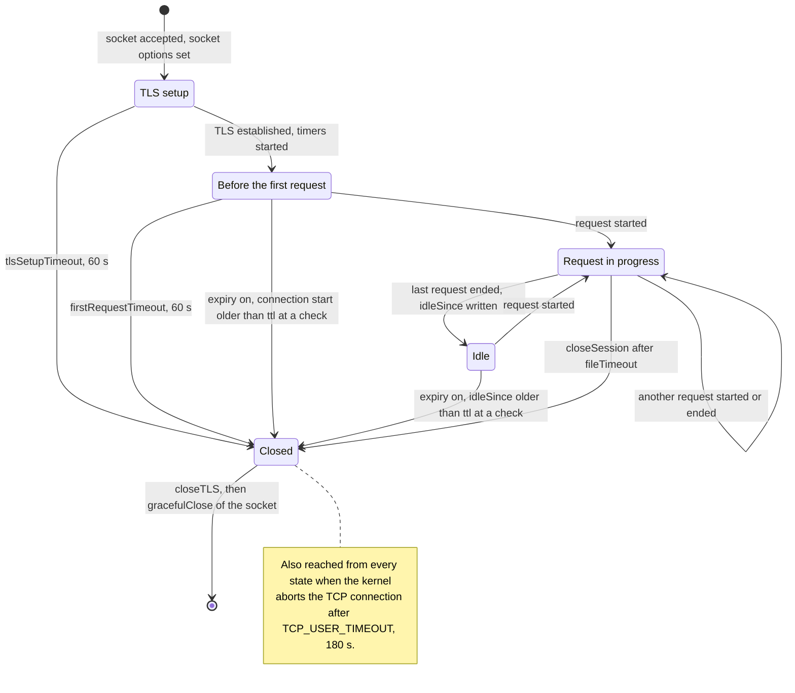

## Socket options

```
setServerSocketOptions TransportServerConfig {tcpKeepAlive, tcpUserTimeout} socket:
  tcpKeepAlive is Just opts -> setSocketKeepAlive socket opts; error -> logged
  UserTimeout supported and tcpUserTimeout is Just ms -> UserTimeout := ms; error -> logged
```

`setServerSocketOptions` is called in `setupTLS` of `runTransportServerSocket` and of `runTransportServerSocketState`, on each accepted socket, before the TLS handshake.

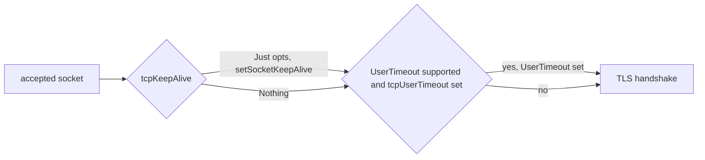

## Requests

```
xftpServer handler sniUsed closeSession sessionId sessionALPN request sendResponse:
  OPTIONS, with CORS -> preflight response
  GET, with SNI -> static page
  other -> timeout fileTimeout (getHTTP2Body request xftpBlockSize)
    Nothing -> log "request receiving timeout, closing connection"; closeSession
    Just reqBody -> handshake or processRequest, as before

FPUT, chunk committed -> timeout fileTimeout (drain size)
  Nothing -> FRErr TIMEOUT
FPUT, chunk new -> timeout fileTimeout (receiveFile getBody spec), as before
  Nothing -> FRErr TIMEOUT

sendXFTPResponse transmission serverFile_:
  encoding error -> sendResponse (responseBuilder "padding error")
  serverFile_ == Nothing -> sendResponse (responseBuilder transmission)
  serverFile_ == Just file ->
    withAsync (wait fileTimeout; log "file sending timeout, closing connection"; closeSession)
      (sendResponse (responseStreaming: transmission, then the encrypted file))
```

Green: added. Blue: changed.

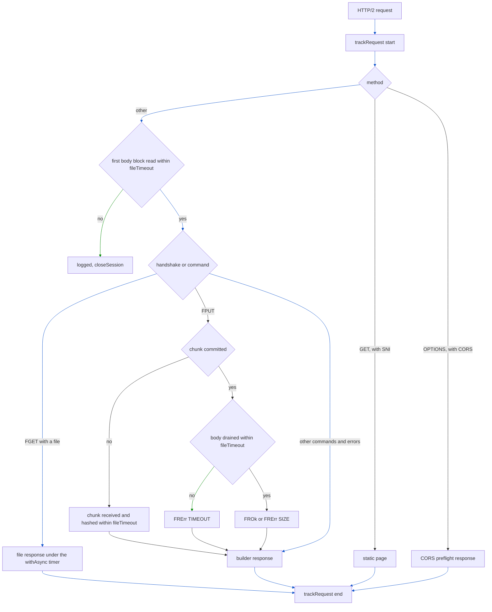

A download, with the order of steps and who takes them:

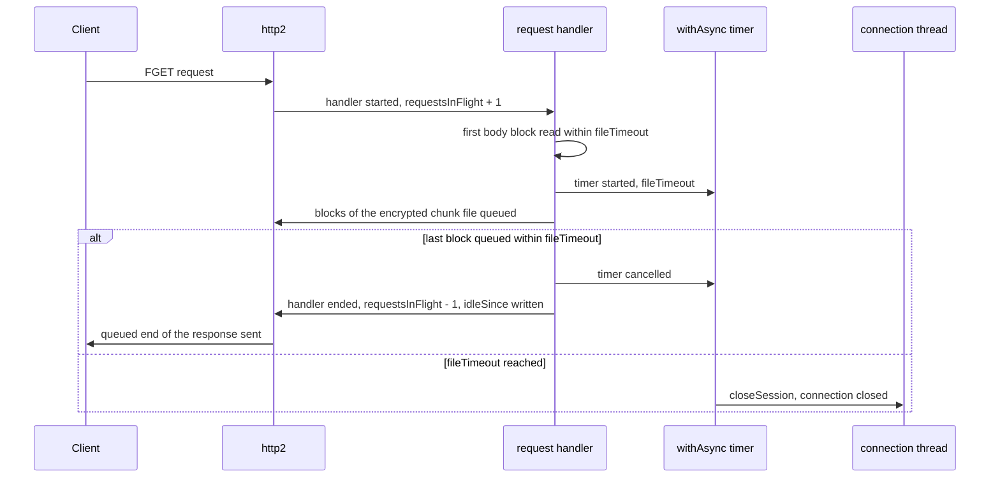

## Closing TLS

```
closeTLS ctx:
  byeDone <- new empty TMVar
  fork with unmask:
    timeout 1 s (bye ctx); errors ignored
    finally: put byeDone
  take byeDone
  finally: contextClose ctx; errors ignored
```

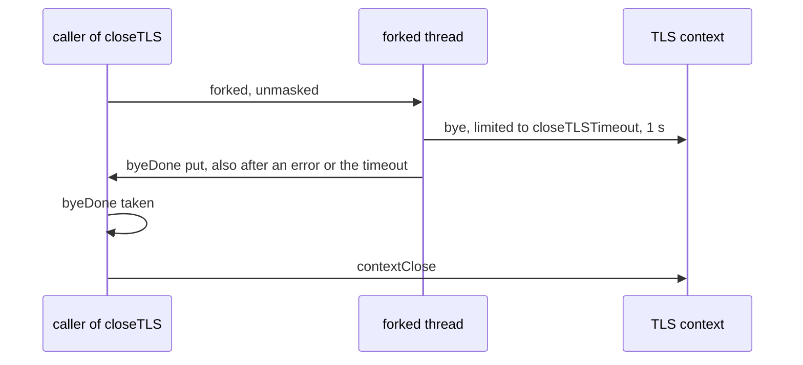

## Receiving a chunk

```
receiveFile_ receive XFTPRcvChunkSpec {filePath, chunkSize, chunkDigest}:
  hashCtx <- IORef (hashInit :: Context SHA256)
  write h block = hPut h block; hashCtx := hashUpdate hashCtx block
  withFile filePath WriteMode: receive (write h) chunkSize
  hashFinalize hashCtx /= chunkDigest -> DIGEST
```

`receive` is `receiveFileBlocks` (`receiveFile`) or `receiveSbBlocks` (`receiveEncFile`). `hReceiveFile` is renamed `receiveFileBlocks`, with a write function as its parameter in place of the handle.

Green: added. Red: removed.

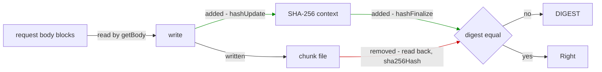

## Recipients

```
retryAdd n newIds add:
  n == 0 -> Left INTERNAL
  ids <- newIds
  add ids
    Left DUPLICATE_ -> retryAdd (n - 1) newIds add
    result -> result

addFileRetry: newIds = one random file id; add = addFile
addRecipientsRetry: newIds = one random recipient id per key; add = addRecipients
n = 3 in FNEW and FADD
```

```
addRecipients, memory store (one STM transaction):
  file missing -> Left AUTH
  an id repeated in the call -> Left DUPLICATE_
  an id among the recipients of the file -> Left DUPLICATE_
  an id in the recipients map -> Left DUPLICATE_
  otherwise -> every id added to the recipients of the file and to the recipients map; Right ()

addRecipients, PostgreSQL (one transaction):
  INSERT INTO recipients, executeMany for every recipient
    unique violation -> Left DUPLICATE_
    foreign key violation -> Left AUTH
  inserted, db_store_log on -> one AddRecipients record with every recipient
```

- In FNEW, the file is added by `addFileRetry`, then its recipients by `addRecipientsRetry`.
- One `AddRecipients` record per FNEW or FADD is written to the store log of the memory store, as before.
- In `readFileStore`, an `AddRecipients` record is replayed by `addRecipients` of the memory store.

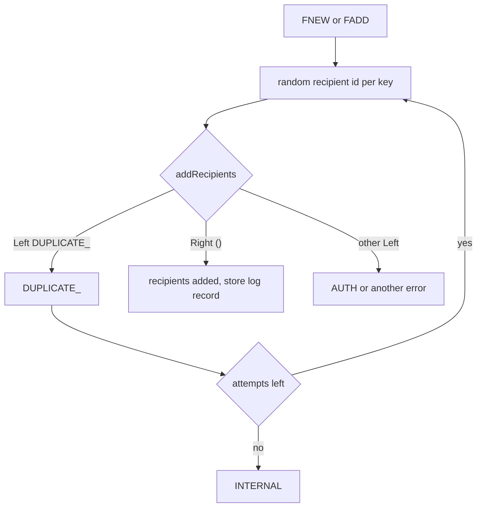

## File expiry

```
expireServerFiles itemDelay expCfg:
  loop:
    expired <- expiredFiles store now old 10000
    for each expired file with a path that exists on disk:
      removeFile path; then wait itemDelay
      error -> logged
    expired == [] -> end
    DeleteFile records written; deleteFiles; used storage and stats updated
    loop

itemDelay:
  at the start of xftp-server -> Nothing
  every checkInterval -> Just 0.1 s
```

At most `limit` rows in total are returned by the PostgreSQL query of `expiredFiles`:

```sql
SELECT sender_id, file_path, file_size FROM (
  (SELECT ... FROM files WHERE expires_at < ? LIMIT ?)
  UNION ALL
  (SELECT ... FROM files WHERE expires_at IS NULL AND created_at < ? LIMIT ?)
) expired LIMIT ?
```

All expired files are returned by the memory store, as before.

Blue: changed.

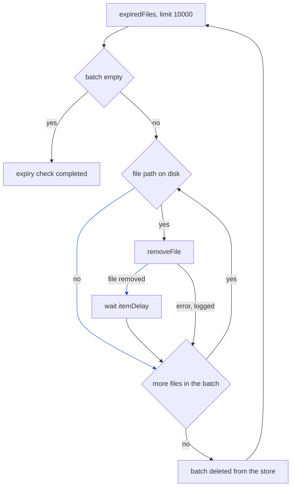

## Period stats

```
serverStatsThread_:
  logStatsInterval == Just interval -> logServerStats logStatsStartTime interval, as before
  logStatsInterval == Nothing -> resetPeriodStats logStatsStartTime

resetPeriodStats startAt:
  delayUntilDayTime startAt
  forever:
    periodStatCounts filesDownloaded now
    wait periodStatsInterval, 86400 s

delayUntilDayTime startAt:
  d = startAt - seconds since 00:00 UTC
  wait d seconds, or d + 86400 seconds when d < 0
```

In `periodStatCounts`, these sets are reset:

- day: at every call;
- week: at a call on a Monday;
- month: at a call on the first day of a month.

Green: added. Blue: changed.

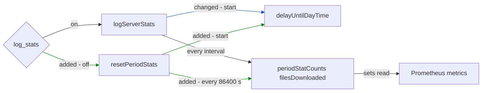

## Maintenance

```
xftp-server start --maintenance (-m):
  checkSavedFingerprint
  readFileStoreType
  checkFileStoreMode
  runWithStoreConfig, with --confirm-migrations:
    migrateFileStore storeCfg:
      memory store -> pure ()
      PostgreSQL -> newFileStore (migrations applied), then closeFileStore
    print "Server started in 'maintenance' mode, exiting"
    exitSuccess
```

Green: added.

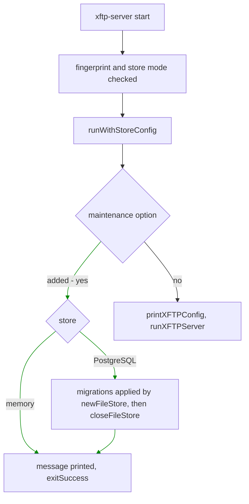

## Socket metrics

Gauges, each with the label `port` equal to `xftpPort`, read from `sockets` of `XFTPEnv` by `getSocketStats`:

- `simplex_xftp_sockets_accepted`;
- `simplex_xftp_sockets_closed`;
- `simplex_xftp_sockets_active`;
- `simplex_xftp_sockets_leaked`: accepted, less closed, less active.

## RTS defaults

`ghc-options` of the `xftp-server` executable contain `"-with-rtsopts=..."` with these flags:

- `-N`;
- `-F1.2`;
- `-A16m`;
- `-I0.01`;
- `-Iw15`;
- `-T`;
- `-ki2k`;
- `--disable-delayed-os-memory-return`.

Of the compiled defaults, only the ones matched by flags given at run time are overridden.

## init

`xftp-server init` writes:

```
[INACTIVE_CLIENTS]
# TTL and interval to check inactive clients
disconnect = on
ttl = 21600
check_interval = 3600
```

## Composition

Green: added. Blue: changed. Red: removed.

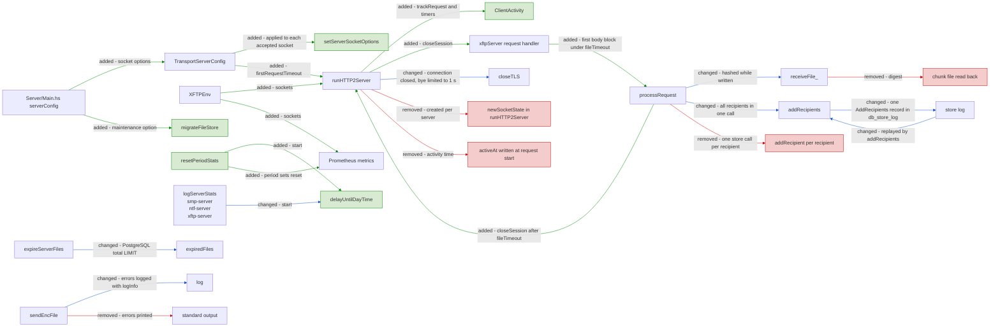

## Tests

- XFTP server (`XFTPServerTests.hs`), with the memory store and, in the PostgreSQL build, with the PostgreSQL store:
  - `testExpireNotUploadedFiles`: 50 files without chunks, added through store log records with an expiry 2 s ahead, are expired within 6 s with `checkInterval = 1`, and `AUTH` is returned to an FADD of each; the memory store with a store log is used for both store types;
  - `testLongDownloadExpiration`: with `ttl = 1` and `checkInterval = 1`, the first 2 MB of a 4 MB download are read in 16 kB blocks 25 ms apart, the download is completed, PONG is returned to a PING after it, and the connection is closed by expiry after the PING;
  - `testPeriodStatsReset`: with `logStatsInterval = Nothing` and `logStatsStartTime` 10 s ahead, `simplex_xftp_files_count_daily` is 1 after a download and 0 after the reset time;
  - `testSocketMetrics`: the socket gauges are `accepted=1 closed=0 active=1 leaked=0` with one client connected, and `accepted=1 closed=1 active=0 leaked=0` after its disconnection;
  - `testStalledDownload`: with `fileTimeout` of 2 s and expiry off, a connection with an unread FGET response is closed, and the chunk file is closed by the server;
  - `testStalledDownloadEnd`: with `fileTimeout` of 2 s, `ttl = 1` and `checkInterval = 1`, a connection is closed when the last 1 MB + k kB of a 4 MB response are unread, for k from 0 to 320 in steps of 64;
  - `testStalledRequestBody`: with `fileTimeout` of 2 s and expiry off, a connection whose request body is stalled after 1 byte is closed;
  - `testStalledCommittedUpload`: with `fileTimeout` of 2 s, `TIMEOUT` is returned within 5 s to a repeated FPUT of a committed chunk with a stalled body;
  - `testNoRequestTimeout`: with `firstRequestTimeout` of 1 s, with expiry off and on, a TLS connection without a request is closed within 5 s, and a client after its handshake stays connected for 2 s and receives PONG;
  - `testInactiveClientExpiration`: as before, with the client helper `connectXFTPClient`.
- Chunk receiving (`XFTPServerTests.hs`): with the chunk written to `/dev/null`, `Right ()` is returned by `receiveFile` and by `receiveEncFile` for the correct digest, and `DIGEST` for another one.
- Transport (`CoreTests/TransportTests.hs`, with its own credentials and fingerprint loading):
  - `testCloseBlockedTLS`: while the client is not reading and the server sender thread is blocked, `closeConnection` of the server returns within 5 s, and the sender thread is ended by an exception within 5 s;
  - `testServerKeepAlive`: `SO_KEEPALIVE` of the accepted socket is set with `tcpKeepAlive = Just defaultKeepAliveOpts` and unset with `Nothing`;
  - `testServerUserTimeout`: `TCP_USER_TIMEOUT` of the accepted socket is 180000 with `tcpUserTimeout = Just 180000` and 0 with `Nothing`.
- Stores (`CoreTests/XFTPStoreTests.hs`, in the PostgreSQL build):
  - `testAddRecipientsAtomically`, for both stores: with an id already stored or repeated in the call, `DUPLICATE_` is returned and the new recipient is not added; all recipients of a call with new ids are added; `AUTH` is returned for a missing file;
  - `testExpiredFilesTotalLimit`: of 6 expired PostgreSQL files of both kinds, 4 are returned with `limit = 4` and 6 with `limit = 10`.
- CLI (`CLITests.hs`):
  - `xftpServerTest`: `init` writes `disconnect = on`, `ttl = 21600` and `check_interval = 3600`;
  - `xftpServerMaintenanceTest`: `start --maintenance` ends within 5 s, with the maintenance message in its output and without `Listening on port 443...`;
  - `xftpServerMaintenanceDBTest`: with PostgreSQL and `--confirm-migrations up`, migrations are applied to a new schema.
- Untested:
  - the XFTP CLI setting of keep-alive and the user timeout;
  - the logging of send errors;
  - `receiveSbFile`;
  - the PostgreSQL `db_store_log` record of added recipients;
  - the start of `logServerStats` of each server with the shared `delayUntilDayTime`, and the wait of `delayUntilDayTime` until the next day;
  - the retry of FNEW and FADD on duplicate ids;
  - the padding error response;
  - the wait after a file deletion;
  - the RTS defaults.

## Measurements

Builds of 46253a4b and of master 880d089e, made with GHC 9.6.3 and `-O2`, were measured. The server and the clients were run on t3.medium (2 vCPU) instances on AWS, and the servers were started with `+RTS -N -T -RTS` and `[INACTIVE_CLIENTS] disconnect = off`. "master + RTS defaults" is master started with the RTS defaults of this branch given at run time.

| Measurement | master | master + RTS defaults | this branch |
|---|---|---|---|
| Live heap per idle connection after the handshake (connections 301–600, 2 runs) | 223–226 kB | 100 kB | 103 kB |
| RSS per idle connection (connections 301–600, 2 runs) | 271–276 kB | 149–153 kB | 173–175 kB |
| CPU per GB uploaded and downloaded (40 clients, files of 1–10 MiB, 4.61 GB per run, 3 runs) | 23.8–24.5 s | 23.1–23.6 s | 23.1–23.3 s |
| GC share of CPU, same load | 6.4–6.6% | 5.1% | 4.9% |
| Peak RSS, same load | 170–173 MiB | 142–143 MiB | 143–144 MiB |

All 300 idle connections of a client host whose packets were dropped were closed 170–185 s after the drop.
