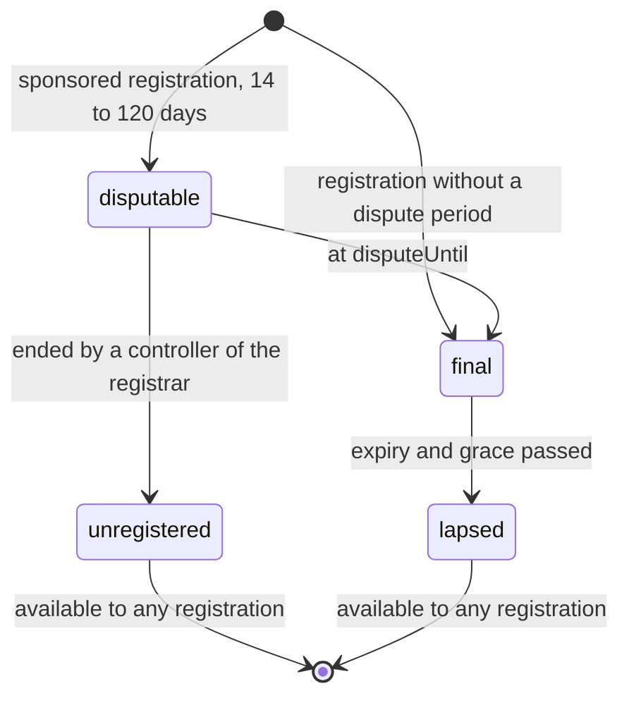

# Names: a registration in its dispute period

To be merged together with simplex-network/ens-contracts#51, the dispute period for sponsored registrations.

## Problems

1. After #51, a controller of the `.simplex` registrar, such as the controller contract on the request of its owner or guardian, can end a registration in its dispute period, and the registrar sets the name's expiry to 0. On its v1 route, the resolver answers every name with expiry 0 with the message "this name has never been registered". In the resolver's README, `unregistered` is described as never registered and `registered` as held until `expires`, and in the protocol a registered name is described as held until `expires`.
2. Clients do not learn until when a registration can be ended. Until then, the registration can be ended also after the name was moved to a recipient by a claim, and its renewal is refused. By decision D8 of the [contract plan](https://github.com/brenzi/simplex-namespace-contract/blob/main/docs/plans/dispute-period.md#L20), clients show the dispute end before a claim.

## Decisions

| # | Decision |
|---|---|
| 1 | `status` and `error` stay `unregistered` |
| 2 | message of a v1 404 `unregistered`: "this name is not registered" |
| 3 | price quotes of a name with expiry 0 unchanged |
| 4 | the registrar's `disputeUntil(uint256)` read for the 2LD's token, in the round of `nameExpires` |
| 5 | `disputeUntil`: the registrar's value while later than `lastBlockTs`, otherwise 0; unknown when the node answers the read with another error, or with an empty answer: null in v2 and v1, absent in RNAME |
| 6 | a revert of the `disputeUntil` call read as 0: a JSON-RPC error with code 3, or with code -32000 and the message "execution reverted", or a failed call in a multicall; another JSON-RPC error and an empty answer read as unknown; a failed request to the node answered 502 |
| 7 | a subname reported with its 2LD's `disputeUntil` |
| 8 | `NRRegistered.disputeUntil :: Maybe SystemSeconds`, after `graceUntil`, JSON derived as for the other fields; its Haddock states a date, 0 and absent |
| 9 | SMP version unchanged; a client does not read the absence of `disputeUntil` as 0 |

## What the resolver answers

```
name_status(name):
  token = labelhash of the 2LD
  expires = registrar.nameExpires(token)
  now = timestamp of the latest block
  disputeUntil = case registrar.disputeUntil(token) of
    a value > now                       -> the value
    another value                       -> 0
    a revert                            -> 0
    another JSON-RPC error, or empty    -> unknown
    a failed request to the node        -> the lookup answered 502
```



For a 2LD, with `disputeUntil` a field of `registered` alone (– in the other types):

| State | v2 `type` | v2 `disputeUntil` | RNAME `disputeUntil` | v1 `status` | v1 `disputeUntil` |
|---|---|---|---|---|---|
| disputable | `registered` | its end | its end | `registered` | its end |
| final | `registered` | 0 | 0 | `registered` or `grace` | 0 |
| lapsed | `available` or `reserved` | – | – | `expired` (410) | 0 |
| unregistered | `available` or `reserved` | – | – | `unregistered` (404), "this name is not registered" | 0 |

A `disputeUntil` read answered with another JSON-RPC error, or with an empty answer: null in v2 and v1, absent in RNAME.

```mermaid
sequenceDiagram
  participant C as Client
  participant P as Proxy
  participant R as Names router
  participant S as Resolver
  participant N as Node
  C->>P: PFWD with RSLV
  P->>R: RFWD
  R->>S: GET /v2/resolve/query
  S->>N: one multicall: nameExpires, disputeUntil (added), GRACE_PERIOD and the other reads of the round
  N-->>S: disputeUntil reverted by a registrar before #51
  S-->>R: registered, with disputeUntil: its end, or 0; null after another JSON-RPC error (added)
  R->>R: decoded into NRRegistered with disputeUntil, null decoded as Nothing (added)
  R-->>P: RRES with RNAME, encoded at the forwarded version, at most 23
  P-->>C: PRES
```

## Threat model

- A router or its resolver can omit `disputeUntil` or state a false one, as it can `expires`; a client verifies it only by reading the registrar.
- `disputeUntil` is public on chain ([contract plan, D9](https://github.com/brenzi/simplex-namespace-contract/blob/main/docs/plans/dispute-period.md#L21)), and with it the dispute days of the payment: 0, 14 or 120. In the answer, it is disclosed to the router and the client as on chain.
- After a JSON-RPC error of the `disputeUntil` call alone, other than a revert, the dispute end is unknown: null from the resolver, left out of RNAME.
- A revert answered by the node is read as 0, so the resolver relies on its node for 0 as for every other read.
- A label the registrar recorded stays recorded after the registration expired or was ended, so whoever runs the resolver matches a hashed query of such a name to its label.

## Changes

`scripts/resolver/service/snrc-resolve.py`:

- the message of decision 2
- the docstring of `read_oracle_prices`: a quote is safe for a name with expiry 0
- `dispute_until_call`, read in `lookup_reads`
- `CallReverted`: a JSON-RPC error with code 3, or with code -32000 and the message "execution reverted", and a call failed in a multicall
- `dispute_end`: the registrar's `disputeUntil` when later than the block, 0 otherwise and on a revert, None on another error or an empty answer
- `name_status`: `disputeUntil`, also in v1 answers
- `registration`: `disputeUntil` in `registered`, null when unknown
- the comment on the reads keyed on the labelhash: `disputeUntil`
- the docstring of `expiry_status`: any name with a zero expiry

`scripts/resolver/README.md`:

- `expires` and `registered`: unless the registration is ended in its dispute period
- `unregistered`: also an ended registration
- the zero-expiry paragraph, with the dispute period defined
- the error example
- what a hashed query hides
- the premium paragraph
- `disputeUntil` in the v1 example, in `registered` and in the definition of the dispute period
- a subname's dispute end in v2
- `disputeUntil` in the lists of status fields and of the registrar's reads
- the source of each status field, and when it is null or 0, also in the error example
- a name never registered looked up by its hash alone
- `lastBlockTs` in the v1 example, the price keys of the error example, and `disputeUntil` beside `nameRecord` in v2
- a lookup answered 502 when a request to the node fails

`protocol/simplex-messaging.md`:

- a hashed query of a name nobody holds: `available` or `reserved`
- `registered`: unless ended before `disputeUntil`, and renewable not before it
- the dispute period, defined by a `disputeUntil` after `lastBlockTs`
- `disputeUntil` in the fields of `registered`: a date, 0, or absent when unknown
- `disputeUntil`, the one field left out when it could not be read, in the conditions of `ERR NAME RESOLVER`
- `disputeUntil` unverified by a client, as `expires`
- an answer below v22: no dispute end

`src/Simplex/Messaging/Names/Record.hs`: `NRRegistered.disputeUntil`, with the Haddock of decision 8.

`src/Simplex/Messaging/Protocol.hs`: `disputeUntil = Nothing` in the answer of a router before v22.

## Tests

Each test of changed behavior is committed before its change, and fails in CI on the commit before that change.

`scripts/resolver/service/test_snrc_resolve.py`:

- `ErrorCodeTests`: a name with expiry 0 answered 404 with "this name is not registered"
- three test names that equate expiry 0 with never registered
- `NameStatusTests`: a `disputeUntil` later than the block reported; one at the block, one before it and 0 reported as 0; a revert, the node's error with code 3 or with code -32000 and "execution reverted", read as 0; a subname read with its 2LD's token; `disputeUntil` in the keys of every branch
- `RegistrationV2Tests`: v2 `registered` with `disputeUntil`, with 0, and with null when the node answers the read with another error; 0 in the pinned keys of `registered`; v1 with it, with 0 and with null
- `BatchedReadsTests`: `disputeUntil` read in the round of `nameExpires`, in two round trips; a revert read as 0 in a multicall and in a batch
- the fakes of the registrar answer `disputeUntil`

Regression tests, passing in CI on the commit before their change as well:

- `RegistrationV2Tests`: a subname under a 2LD with expiry 0, whose node has no owner while the subnode keeps a former holder: v2 `available`, v1 404
- `NameStatusTests`: another JSON-RPC error and an empty answer read as unknown
- `tests/SMPNamesTests.hs`: a dispute end of 0, as the resolver serves it, decoded into `NRRegistered`, and its JSON round trip; a null dispute end decoded as `Nothing`, and left out of RNAME

`tests/SMPNamesTests.hs`: the router's answer to a registration with `disputeUntil`, as the resolver serves it, decoded into `NRRegistered`; the JSON round trip of that value.

`tests/RSLVTests.hs`: RNAME of that registration, direct and forwarded through a proxy.
