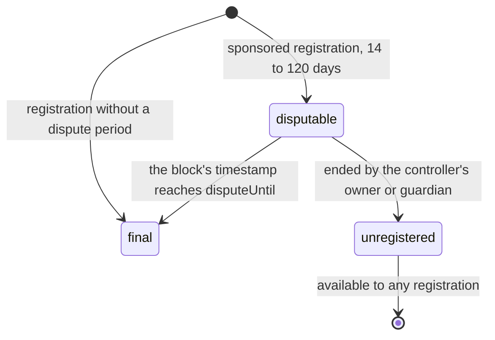
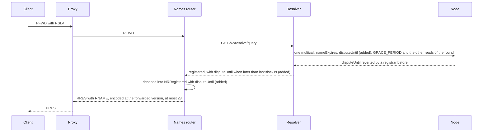

# Names: a registration in its dispute period

To be merged together with simplex-network/ens-contracts#51, the dispute period for sponsored registrations.

## Problems

1. After #51, the owner or the guardian of the `.simplex` controller can end a registration in its dispute period, and the registrar sets the name's expiry to 0. On its v1 route, the resolver answers every name with expiry 0 with the message "this name has never been registered". The resolver's README describes `unregistered` as never registered and `registered` as held until `expires`, and the protocol describes a registered name as held until `expires`.
2. Clients do not learn until when a registration can be ended. Until then, the registration can be ended also after a claim moved the name to a recipient, and its renewal is refused. In the contract plan, decision D8 has clients show the dispute end before a claim.

## Decisions

| # | Decision |
|---|---|
| 1 | `status` and `error` stay `unregistered` |
| 2 | message of a v1 404 `unregistered`: "this name is not registered" |
| 3 | price quotes of a name with expiry 0 unchanged |
| 4 | the registrar's `disputeUntil(uint256)` read for the 2LD's token, in the round of `nameExpires` |
| 5 | `disputeUntil` reported while later than `lastBlockTs`; otherwise null in v1, absent in v2 |
| 6 | a `disputeUntil` call that reverts or answers nothing read as no dispute period; `.testing`'s registrar predates #51 |
| 7 | a subname reported with its 2LD's `disputeUntil` |
| 8 | `NRRegistered.disputeUntil :: Maybe SystemSeconds`, after `graceUntil`, JSON derived as for the other fields |
| 9 | no SMP version, as section "Version" states |

## What the resolver answers

```
name_status(name):
  token = labelhash of the 2LD
  expires = registrar.nameExpires(token)
  now = timestamp of the latest block
  until = registrar.disputeUntil(token), 0 when the call reverts or answers nothing
  disputeUntil = until when until > now, else null
```



| State | v2 `type` | v2 `disputeUntil` | v1 `status` | v1 `disputeUntil` |
|---|---|---|---|---|
| disputable | `registered` | its end | `registered` | its end |
| final | `registered` | absent | `registered` or `grace` | null |
| unregistered | `available` or `reserved` | absent | `unregistered`, "this name is not registered" | null |



## Version

No SMP version is added for `disputeUntil`, because a version would not tell a client "no dispute period" from "not reported":

- forwarded RSLV, the path clients SHOULD prefer, is answered at the version the proxy negotiated, at most `proxiedSMPRelayVersion` (23, `proxyResp` in `Server.hs`); a field gated on v24 would be withheld on that path until proxies raise that version, and the session version would not show the names router's support;
- a router passes what its resolver answers, and the resolver's API is versioned apart from SMP; a v24 router with an older resolver would omit the field as well.

The field is optional, and receivers tolerate unknown fields, so routers and clients before it decode the answers unchanged, as for `NRAvailable.nameTerms`. A client MUST NOT conclude from the field's absence that the registration cannot be ended: it is absent when no dispute period is in effect at `lastBlockTs`, and from a router or resolver that predates it.

## Threat model

- A router or its resolver can omit `disputeUntil` or state a false one, as it can `expires`; a client verifies it only by reading the registrar.
- `disputeUntil` is public on chain (contract plan, D9), and with it the dispute days of the payment: 0, 14 or 120. The answer discloses to the router and the client what the chain discloses.
- A JSON-RPC error of the `disputeUntil` call alone is read as a revert, as for records and `namePolicy()`, and the name is answered without a dispute end.
- A label the registrar recorded stays recorded after the registration expired or was ended, so whoever runs the resolver matches a hashed query of such a name to its label.

## Changes

`scripts/resolver/service/snrc-resolve.py`:

- the message of decision 2
- the docstring of `read_oracle_prices`: a quote is safe for a name with expiry 0
- `dispute_until_call`, read in `lookup_reads`
- `dispute_end`: the registrar's `disputeUntil` when later than the block, else None
- `name_status`: `disputeUntil`, also in v1 answers
- `registration`: `disputeUntil` in `registered` when set

`scripts/resolver/README.md`:

- `expires` and `registered`: unless the registration is ended in its dispute period
- `unregistered`: also an ended registration
- the zero-expiry paragraph, with the dispute period defined
- the error example
- what a hashed query hides
- the premium paragraph
- `disputeUntil` in the v1 example, in `registered` and in the definition of the dispute period
- a subname's dispute end in v2

`protocol/simplex-messaging.md`:

- a hashed query of a name nobody holds
- the dispute period, after the registration types
- `disputeUntil` in the fields of `registered`

`src/Simplex/Messaging/Names/Record.hs`: `NRRegistered.disputeUntil`.

`src/Simplex/Messaging/Protocol.hs`: `disputeUntil = Nothing` in the answer of a router before v22.

## Tests

The tests of changed behavior are committed before the change, and fail on that commit in CI.

`scripts/resolver/service/test_snrc_resolve.py`:

- `ErrorCodeTests`: a name with expiry 0 answered 404 with "this name is not registered"
- three test names that equate expiry 0 with never registered
- `NameStatusTests`: a `disputeUntil` later than the block reported; one at the block, one before it and 0 not reported; a registrar that reverts or answers nothing read as none; a subname read with its 2LD's token; `disputeUntil` in the keys of every branch
- `RegistrationV2Tests`: v2 `registered` with `disputeUntil`; v1 with it and with null
- `BatchedReadsTests`: `disputeUntil` read in the round of `nameExpires`, in two round trips
- the fakes of the registrar answer `disputeUntil`

`tests/SMPNamesTests.hs`: the router's answer equal to the resolver's JSON of a registration with `disputeUntil`.

`tests/RSLVTests.hs`: RNAME, direct and forwarded through a proxy, equal to the resolver's JSON of a registration with `disputeUntil`.
