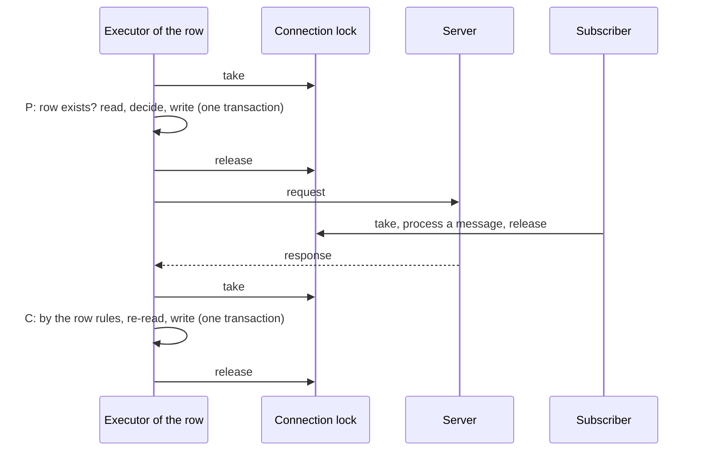
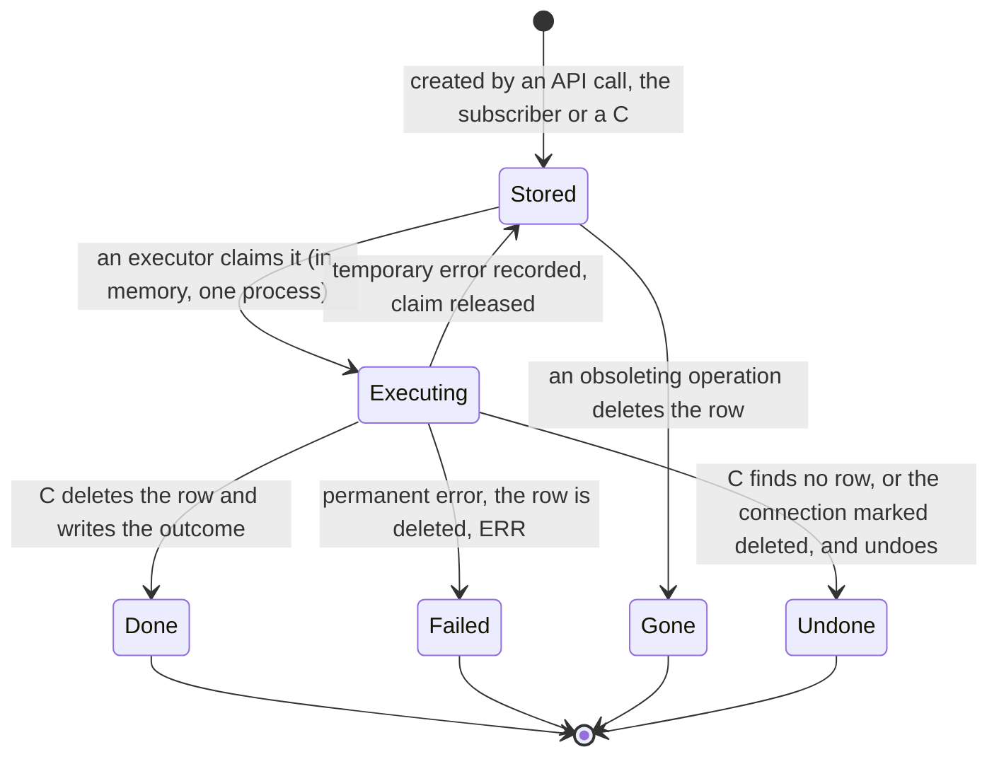

# Agent without network requests under contested locks

Line references are to master 3f57fcdc: A = src/Simplex/Messaging/Agent.hs, AC = Agent/Client.hs, AS = Agent/Store/AgentStore.hs, ST = Agent/Store.hs, C = Client.hs, schema = Agent/Store/SQLite/Migrations/agent_schema.sql, Subscriber.hs = simplex-chat src/Simplex/Chat/Library/Subscriber.hs.

## Problems

1. A server request is made while the connection lock is held: up to 75 s per direct request (45 s connect and 30 s response, C:434-435), and several requests in sequence at some sites (A:2392-2394, 4427-4430). The subscriber, the single thread that processes received messages of all connections (A:3698), waits for that lock when a message of the connection arrives, so messages of all connections stop.
2. An acknowledgement holds the connection lock while its thread waits for space in msgQ, which only the subscriber drains, after it takes the same lock: deadlock.
3. A rotation stays in progress forever after its QADD or QUSE is refused, and crashes between transactions of rotation handlers and of message storage leave a rotation half-done or a message missing on one queue.

## Scope

Unchanged from master:
- delivery of events to the app (subQ, its writers, event deferral);
- connection deletion: the fork per call, deleteLock across DEL batches, the cleanup pass;
- the multi-connection lock of sendMessagesB_ (A:2182);
- PostgreSQL row locking, except https://github.com/simplex-chat/simplexmq/pull/2104;
- joinConnection, which holds no connection lock on master; the invitation lock (A:964, 1627, 1644).

The order of link data is a separate change. LSET and LDEL are sent without the lock (change 1), so an LSET can reach the server after an LDEL of the same link and publish it again.

## Decisions

| Date | Decision |
|---|---|
| 2026-11-24 | An abort cancels the rotation step in progress and deletes its new queue. |
| 2026-11-24 | The old KEY handshake is removed; SMP client version 3, with sender-secured queues, is the minimum. |
| 2026-11-24 | The protocol client keeps timed-out requests until their response or disconnection. |
| 2026-11-25 | Old-handshake rows in progress end with a version error; joining an invitation without a sender-secured queue is refused. |
| 2026-11-25 | A rotation refused by the server with AUTH returns to its state before it started; an abort is refused once QADD is stored. |
| 2026-11-25 | Acknowledgements stay asynchronous and keep master's order: ACK, then receipt; the receipt is stored only when the ratchet allows sending. |
| 2026-11-26 | Downgrade is not supported. |

## Changes

### 1. The connection lock covers database work only

Each server request that master makes under the connection lock is moved out of it. A step that has a command row (change 2) becomes:
- P: under the lock, one transaction checks that the row exists (otherwise the step ends without a request), reads the state, decides the request, and writes what the request needs;
- the request, with no lock held;
- C: under the lock, one transaction that applies by the rules of change 2, re-reads the state it writes, and writes the outcome.

Events, worker wake-ups and notification commands of P and C follow their commit.



Sites with a row:

| Site | Request | P | C | When the state read in C differs |
|---|---|---|---|---|
| ACK command (A:2309, 2846-2881) and synchronous ackMessage (change 3) | ACK | row; message present (absent: the row ends without ACK, A:2864); user_ack set (A:2859; the asynchronous form set it when the row was stored, A:1022); queue read by id without the deleted filter; ACK skipped for a missing or marked queue | receipt (A:2869-2876) unless the ratchet does not allow sending; MROk deletion (A:2877-2880); message deletion (A:2867); drained-queue deletion (A:2975, 2987) | ratchet prohibits sending: receipt skipped |
| ICAck (A:2323-2324) | ACK | row; queue by (server, rcvId) with the deleted filter (AS:790); missing: no ACK (A:2437) | drained-queue deletion | |
| ICAckDel (A:2318-2322) | ACK | row; queue as ICAck | message deletion (A:2321); drained-queue deletion | |
| ICAllowSecure (A:2325-2348) | SKEY | row; sender key present, or a reply queue without sender-secure mode: ERR A_VERSION; RcvConnection: upgrade to duplex (A:4413-4415) and the confirmation stored (A:4466-4485), held (change 2, rule 9); DuplexConnection: the confirmation stored when the send queue has no delivery of a connection-info message | Secured (A:4449); messages.internal_ts of the confirmation set to now; a temporary error on another server moves the row to that server (CCMoved, A:2337-2344) | |
| ICDuplexSecure (A:2349-2351) | none | the row ends with ERR A_VERSION | | |
| ICReplyDel (A:2352-2355) | SKEY | row; SndConnection | Secured; the connection's deletion (A:1809) is requested once, after C or after the permanent-error exit, not after each attempt (master's allFinally runs inside the retried action) | |
| ICDeleteRcvQueue (A:2358-2365) | DEL | row; deleted queue (AS:793-796) | temporary error below the limit: delete_errors + 1, row kept; otherwise record removed (A:2362-2365) | |
| ICQSecure (A:2366-2384) | KEY | row; new queue by address, Confirmed (A:2371), with its replaced queue (A:2369-2370); ratchet prohibits sending: ERR, row ends | Secured, RSSendingQUSE, QUSE stored (A:2376-2377) | ratchet prohibits sending: ERR, row ends, no writes |
| ICQSndSecure (A:2385-2409) | SKEY, SEND confirmation | row; new send queue by address with its replaced queue; without a replaced queue and with a queue at SSSendingQEND: QEND stored, no request (A:2407-2409) | Active, primary, SSSendingQEND, QEND stored, deliveries counted and resumed (A:2395-2403) | ratchet prohibits sending: the status writes with ERR, as master (A:2395-2403, 2488) |
| ICQDelete (A:2410-2432) | DEL | row; queue by address at RSReceivedMessage (A:2417) | record removed; NSCCreate and SWITCH after commit (A:2425-2431) | |
| SWCH (A:2310-2315, 2905-2921) and switchConnection' (A:2893-2903, change 3) | NEW | row; head queue at RSSwitchStarted (A:2907); ratchet prohibits sending: status cleared, ERR, row ends | queue recorded (A:2916); QADD stored (A:2918); RSSendingQADD (A:2919) | ratchet prohibits sending: the new queue is deleted (rule 5), status cleared, ERR |
| LSET command (A:2268-2271) | LSET | row; credentials created when absent (A:1272-1293); data prepared | LINK | |
| acceptContact' (A:1745-1764, change 3) | SKEY, NEW, SEND | change 3 | change 3 | |
| JOIN service request (A:2295-2307, change 3) | NEW, SEND | change 3 | change 3 | |

Sites without a row: setConnShortLink' (A:1247-1279), deleteConnShortLink' (A:1314-1321) and suspendConnection' (A:2995-3003) read under the lock and send LSET, LDEL or OFF without it; nothing is written after the request.

For the three ACK sites, the GET lock is released and MSGNTF is written after OK or NO_MSG, as on master (A:2983-2986), whether or not C finds the row. After a permanent error, the GET lock is also released; the error is reported without MSGNTF.

The ACK of problem 2 is solved by this change together with the protocol client of this branch, in which the thread that receives a response writes its MSG to msgQ and the requester writes nothing to msgQ.

### 2. The command row records each split step



Rules:
1. Every P starts by checking that its row exists; a missing row ends the step without a request and without an event.
2. A C that ends the step (success, permanent error, obsolete state) starts with `DELETE FROM commands WHERE command_id = ? RETURNING 1` and writes its outcome only when a row is returned. A C that records a temporary failure (ICDeleteRcvQueue's delete_errors) writes only while the row exists and keeps it.
3. Operations that make a step obsolete delete its row in their own transaction:
   - the abort (A:2923-2945) deletes the connection's SWCH and ICQSecure rows;
   - the peer's repeated QADD deletes the ICQSndSecure rows of the earlier new send queues that it deletes (delSqs, A:4131, 4137);
   - the end of a synchronous call deletes its own row (change 3).
4. A C that finds its connection marked deleted (AS:2748-2762 with the deleted filter) writes no outcome, deletes its row and runs the undo.
5. Undo of NEW: the created queue is recorded with deleted = 1 and an ICDeleteRcvQueue row while the connection row exists; when the connection row is gone, DEL is sent once.
6. Within one process, an executor claims the row by command id for its attempt (an in-memory set). The worker's read returns no work while the oldest row of its key is claimed; the claimant wakes the key's worker when it releases the claim.
7. Across the app and the iOS extension, nothing is claimed in the store: the first C that deletes the row writes the outcome. KEY and SKEY with the same key, DEL (AUTH) and ACK (NO_MSG) are repeatable; NEW is undone.
8. C reads queues by address where the row names them, because queue ids are reused (AS:2370-2375).
9. Deliveries of a connection wait while it has an ALLOW_SECURE, REPLY_DEL or JOIN row:
   - the delivery work read (AS:1116-1132) returns no message for such a connection, by a `NOT EXISTS` join on commands (conn_id index);
   - every transaction that deletes such a row is followed by a wake of the delivery workers of the connection's send queues, in the process that ran it;
   - on resume, existing delivery workers are woken (A:2607 passes False), which also covers a row that the other process deleted.

### 3. Synchronous calls with their own rows

acceptContact', sendServiceRequest' and sendServiceRequestAsync', switchConnection', and the synchronous ackMessage:
1. The call stores, in its first transaction, the row that its asynchronous form stores, with a flag in the encoded command that marks a synchronous call, and claims it.
   - acceptContact': a JOIN row (JRInvitationDR or JRConnReq, as acceptContactAsync', A:993-995); the transaction is refused when the connection already has a JOIN row.
   - the service request: the JOIN JRServiceReq row (A:1853).
   - switchConnection': the SWCH row with RSSwitchStarted (A:1052-1053).
   - ackMessage: the ACK row with user_ack (A:1017-1023).
2. The call executes the row in its own thread, by change 1 for SWCH and ACK, and as below for JOIN rows, and returns the outcome.
3. On an error, the call returns the error to its caller, as master does, deletes its row, releases the claim and wakes the key's worker. State written before the error stays, as on master, and a repeated call continues from it (A:1757-1762).
4. After a crash, the worker deletes a flagged row in its P without a request. The chat ignores JOINED with an empty corrId (Subscriber.hs:533-535, 736-738), so the row is not resumed.
5. acceptContact' takes the connection lock only for its database steps (A:1746 holds it across the call):
   - P1: row; dispatch on the connection as A:1757-1762; the send queue recorded (A:1586-1588) or reused;
   - SKEY unless Secured; P2: Secured (A:4449);
   - NEW of the reply queue when P1 found none (A:4460-4462); P3: the reply queue recorded (AS:646-651) while the row exists, otherwise undone (change 2, rule 5);
   - SEND of the confirmation (A:4429-4430);
   - C: Confirmed (A:4431); the invitation deleted (A:1763); the row deleted.
6. The service request, both forms:
   - P1: row; P2 after NEW: the reply queue recorded while the row exists (AS:646-651);
   - SEND (A:1675), only after P2 found the row;
   - the asynchronous form repeats attempts after temporary errors and QUOTA, as A:2459-2471, while the next attempt starts before expiresAt (A:1859);
   - the call then waits for the reply (A:1866-1867), deletes its row and runs its cleanup (A:1868-1870) in the same thread, without the connection lock, so no attempt runs after its cleanup;
   - a row left by a crash has no waiter: the worker deletes it (A:2299-2300).

### 4. Late responses are committed like on-time responses

A late response reaches the subscriber as STResponse (A:3622-3636). Master reads the queue with getRcvConn, which filters deleted queues and deleted connections (AS:610, 2757), and emits ERR CONN NOT_FOUND with an empty connection id when it finds none (A:3647-3649).

| Late response | Master | Change |
|---|---|---|
| SUB: OK, SOK, MSG | processed (A:3624-3631) | unchanged |
| ACK: MSG | processed (A:3632-3633) | unchanged |
| ACK: OK, NO_MSG, error | ignored (A:3634), or ERR CONN NOT_FOUND for a deleted queue | the connection's ACK, ACK_DEL and client ACK rows are read (conn_id index) and decoded; the row whose server message id matches (ICAck and ICAckDel store it; the client ACK row stores the agent message id, mapped through rcv_messages.broker_id) runs its C; the GET lock and MSGNTF as for on-time responses |
| DEL: OK, AUTH, error | ignored (A:3635), or ERR CONN NOT_FOUND | the queue record is read including deleted queues; with a DELETE_RCV_QUEUE or QDELETE row, that row runs its C; for a queue of a connection marked deleted, the record is removed |
| NEW: IDS | ignored (A:3636) | the rows with a NEW request on the response's server (SWCH, NEW, JOIN; server index) are read and decoded; the row whose stored public key equals the request's key records the queue when its step has none recorded, and otherwise the queue is deleted |
| SEND | ignored (A:3636) | unchanged; the retry is sent; the peer drops a repeated message, except an invitation to an address without ratchet keys, which creates a second request (A:4235-4244), as on master |

A row with a NEW request stores the generated keys in its encoded command in the P before NEW: the NEW command (A:2263-2267), SWCH, and JOIN rows that create a reply queue. createConnection and prepared links have no row; their late IDS stays ignored, as on master.

```mermaid
sequenceDiagram
  participant W as Executor
  participant S as Server
  participant P as Protocol client
  participant Sub as Subscriber
  W->>S: request (row present)
  Note over W: timeout, temporary error, claim released
  S-->>P: response after the timeout
  P->>Sub: late response (STResponse)
  Sub->>Sub: find the row or the record; C by the row rules
  W->>W: next attempt: P finds no row, nothing sent
```

### 5. Rotation

1. AUTH of QADD or QUSE (A:2690, 2692) resets the receiving rotation, when the refusing send queue is the connection's only send queue and its delivery row exists, and the new receive queue named in the message still replaces a queue at RSSendingQADD or RSSendingQUSE. The reset is the abort's transaction (A:2935-2938), taken under the connection lock, together with the deletion of the refused delivery; ERR A_QUEUE is written as on master (A:2690, 2826).
2. Abort is allowed only at RSSwitchStarted: ST:210-222 loses the RSSendingQADD branch, so canAbortSwitch (A:3185) is False from RSSendingQADD for every peer version.
3. The writes of the first message on a new queue (A:3738-3747: status, primary, RSReceivedMessage, ICQDelete row) become one transaction, in master's position before decryption (A:3751).
4. QADD, QKEY, QUSE and QEND (A:4121-4221) write their effects in the transaction that stores the decrypted message (A:3833-3850). An error of a handler is returned as a value inside that transaction: the decryption and the message are stored as on master, and the handler's error is reported as on master.
5. A message is stored with all its deliveries in one transaction (A:2561-2579 with A:2591-2601).
6. switchConnectionAsync' (A:1052-1053), the abort (A:2935-2938) and deleteRcvQueueAsync (A:2991-2992) each write their state and their command row in one transaction.

### 6. Small fixes

1. A GET lock records the session of its GET; it is also released when that session ends (AC:813-818 releases only subscribed queues).
2. The ACK row's P reads the queue without the deleted filter (master's synchronous retry fails at AS:1235 after a QEND marked the queue, A:2865). C reads no queue. During ratchet synchronization the receipt is skipped without an error; master writes ERR INTERNAL after the ACK (A:2876, 2488). The peer gets no delivery receipt either way.
3. ackMessageAsync' (A:1001-1023) reads the message's queue by id without the deleted filter. For a removed queue, the ACK row is keyed by the primary queue's server, and its step deletes the message and stores the receipt without an ACK. A queue id reused by a newer queue (AS:2370-2375; rcv_messages.rcv_queue_id has no foreign key, schema:124) resolves to that queue, as on master.
4. Connection deletion also takes the receive queues already marked deleted (AS:2872-2875 filters deleted = 0) and deletes them with the others; a DEL for a queue the server already deleted returns AUTH, reported in DEL_RCVQS (A:3091-3099, 3083).
5. The old KEY handshake: no ICDuplexSecure rows are created (A:4035); a confirmation with a sender key is refused; joining an invitation whose queue has no sender-secure mode is refused with A_VERSION where the invitation is checked (compatibleInvitationUri, A:1598-1605, used by A:965 and A:1540); the minimum SMP client version of smpClientVRange becomes 3. Every supported relay, from version 15 (Transport.hs:222-226), returns the queue mode that the client requests (Server.hs:1738).
6. Client.hs: a batch block is sent after its callers' waits end, until the client disconnects; master's forked writer was not ended at disconnection.
7. Processing of a received message (A:3698) reads the connection and its queues after it takes the connection lock; before the lock, only the queue's connection id is read (A:3648). Subscription responses and event errors (A:3619-3631) are unchanged.
