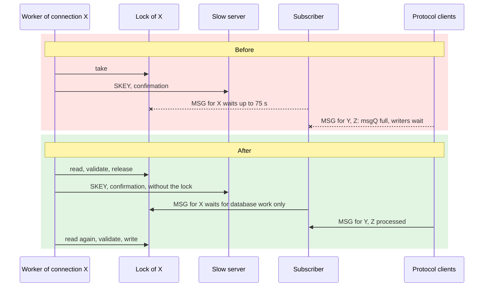

# Agent without waits on slow servers and full queues

## Problem

- One subscriber thread processes received messages, each under the lock of its connection.
- Worker and API threads held that lock across server requests, up to 75 seconds per attempt, so one slow server stopped the messages of all connections.
- An acknowledgement held the lock while it waited for space in msgQ, which only the subscriber drains, after it takes the same lock.
- API calls waited for space in subQ, which the app drains while it holds its own locks.

## Rules

1. A server request is never made under a connection lock; in builds with `conn_lock_checks`, used by the tests with the PostgreSQL agent store, such a request fails, and `disposeAgentClient` then throws.
2. The locked step after a server request reads again the state that its writes depend on; when that state changed, the step is dropped, postponed during ratchet synchronization, or undone.
3. A queue created on a server is recorded under the connection lock or deleted from the server; connection deletion takes the same locks.
4. API threads and lock holders never wait for space in subQ or msgQ; lock holders never wait for space in ntfSubQ.

## Helpers

- `requestAndCommit`: makes the request between two locked runs of the caller's check, which may write or end the step, and commits after the second run in its lock.
- `recordNewQueue`: records a queue created on a server under the lock, or deletes it from the server.

## Sequence

## Changes

- agent, connection locks:
  - `requestAndCommit` in ICDuplexSecure, ICQSecure, ICQSndSecure, ICQDelete and `ackMessage`;
  - `recordNewQueue` in `createRcvQueue`, `createReplyQueue` and `switchDuplexConnection`;
  - request outside the lock in ICAck, ICAckDel, ICAllowSecure, ICDeleteRcvQueue, ICReplyDel, JOIN of a service request, `setConnShortLink`, `deleteConnShortLink`, `suspendConnection`, `connectReplyQueues`;
  - `acceptContact` under the invitation lock; `serviceRequest_` without the connection lock;
  - deletion under the locks of its connections, where the connections are marked deleted in synchronous deletion too;
  - a connection whose deletion waits for delivery is not given new queues;
  - the record step of an acknowledgement reads the queue again;
  - a concurrent acknowledgement of a deleted message is dropped;
  - each switch start has an identifier; an abort removes it, a new start replaces it, and a switch whose identifier is no longer current is aborted after its queue is created, without an event from an asynchronous switch;
  - the receive queue status is set to Secured under the lock, only from Confirmed;
  - ICQSecure and ICQSndSecure are postponed while the ratchet is not synchronized, after the other commands of their server, and resumed after synchronization;
  - SWCH is refused while the ratchet is not synchronized.
- agent, events and notification commands written without waiting:
  - MSGNTF of `ackMessage`, DEL_CONNS, DEL_USER;
  - errors of `subscribeConnections`, `deleteConnections`, `subscribeAllConnections`, `deleteUser`, `xftpDeleteSndFilesRemote`;
  - the notification commands of connection deletion, ICQDelete and QEND.
- clients:
  - a message in the response to ACK, SUB or GET is written to msgQ by the receiving thread, in the order of reception;
  - a command waits for send-queue space only until its response timeout, and is not queued after it ends;
  - a command that ends without a response is removed, except in clients with msgQ, where it is kept until its late response or disconnection.
