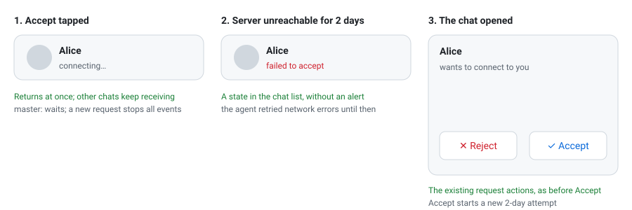
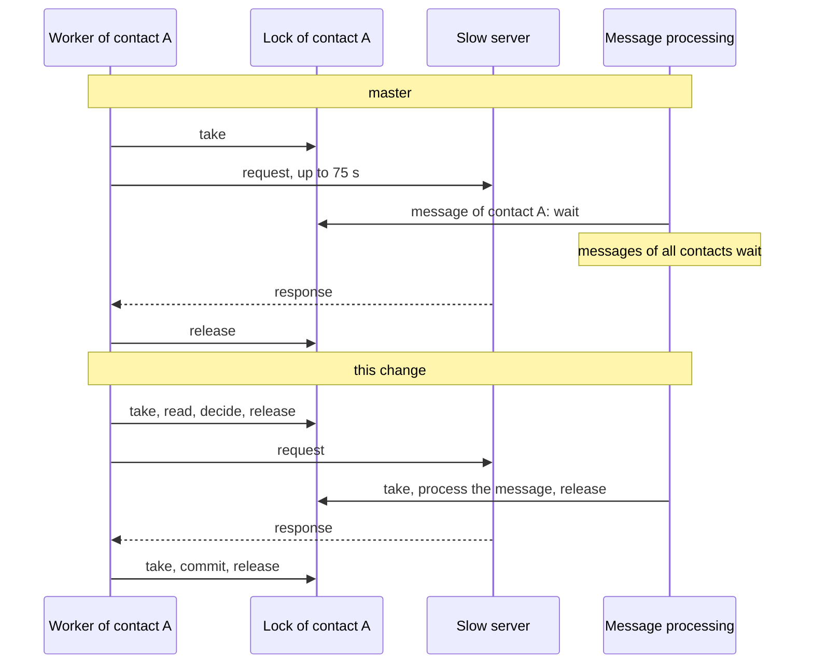
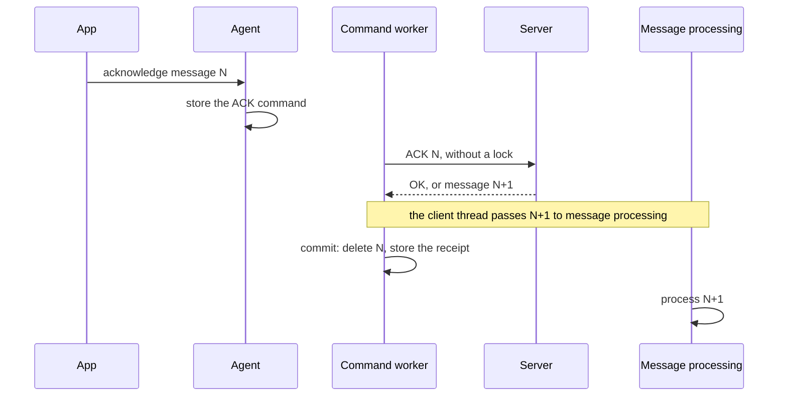
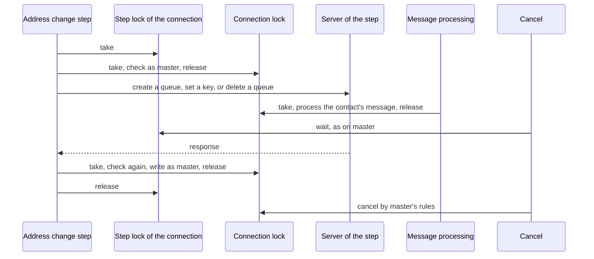
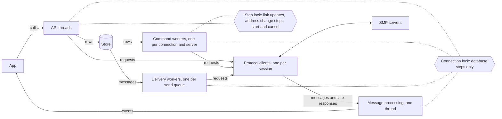
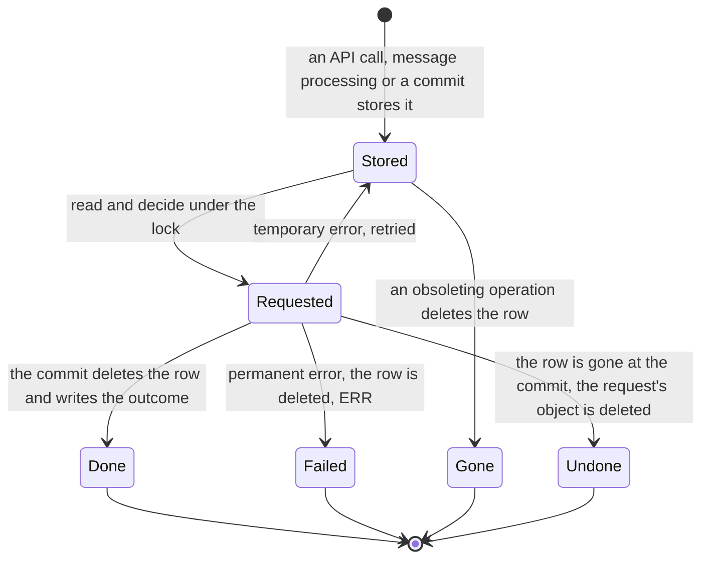

# Agent without waits on slow servers

## 1. Problem

Users need the messages of all contacts to keep arriving while any one server is slow or unreachable, without a restart. Accepting a contact request must not stop the chat, and a crash while a message is sent must lose none of its deliveries.

## 2. User stories

- U1. A user with many contacts, when the server of one contact is slow or unreachable, keeps receiving the messages of all other contacts without delay.
- U2. A user who receives many messages at once keeps receiving them, without a restart.
- U8. A user who adds a member, joins a group, creates a group link or adds relays while a server is slow keeps receiving the messages of all contacts meanwhile (D38).
- U3. A user who changes a contact's receiving address sees it work as today, and the messages of other contacts keep arriving while a server of the change is slow.
- U4. A user whose app crashes or is stopped while a message is sent loses none of its deliveries.
- U5. A contact receives the user's messages in the order they were sent, each once.
- U6. A server operator keeps no queues that the agent created and no longer uses, also after late server responses; queues whose creation responses never arrive stay as on master. Deleted connections and users leave no queues, also when a deletion repeats or waits for deliveries (D39).
- U9. A user whose app restarts while a server is unreachable sees the messages queued before the restart sent without waiting for that server (D39).
- U7. A user who accepts a contact request sees the contact connecting at once; a failed acceptance shows as a state of the contact, from which it can be accepted again. A user who rejects one sees the result as today. Other chats keep receiving meanwhile.

## 3. Product surface

The agent API and its events, and one place in the apps: accepting a contact request (D24, D33).



Accept returns at once and the contact shows "connecting…" until it can be messaged; auto-accepted contacts show the same, where they show "Open to accept" today. The agent retries network failures for 2 days; then the chat list shows "failed to accept", and the chat shows the request's Reject and Accept actions again, without an alert. Bots send to the contact after the ContactSndReady event, as the apps do.

Rejecting a contact request and changing an address work as today (D32, D36).

## 4. Flows

Messages of other contacts while a request is slow (U1):



Acknowledgement (U2, U5):



Acknowledgement order holds, also with late responses:
- the acknowledgements of one queue are stored commands, sent by one worker, one at a time, in their order;
- on each session, the server accepts an ACK only for the message it delivered last, and answers an ACK of any other message with NO_MSG without a change;
- so a stale ACK, an earlier attempt or one that arrives late, can neither remove nor skip another message, and delivery continues with the next ACK; an attempt and its retry name the same message, so the order in which the server processes them does not matter.

Address change step that waits for a server (U3, D36):



## 5. Principles and rules

- R1 (U1, U2). No server request is made while a lock is held that another kind of operation can wait for. A lock that, by design, only operations of the same kind take may be held across a request.
- R2 (U1). The connection lock covers database work only. A step with a request reads and decides under the lock, sends the request without it, and commits the outcome under the lock, only while its command row exists. Frequent received messages read their connection once, as on master; rare ones read it again after the lock and decide on that read (D31).
- R3 (U6). A step that this change splits around its request writes its outcome only while its command row exists; an operation that makes it obsolete deletes the row, and the step then undoes what its request created.
- R4 (U2, U5). The acknowledgements of one queue are sent through stored commands, one at a time, in their order. The receipt is stored after the server ACK, as on master; it is skipped when the next message starts ratchet synchronization first (D23).
- R5 (U5). Messages of a connection are encrypted in the order they are stored, and delivered on each send queue in that order. The messages of one receive queue are processed in the order the server delivers them.
- R6 (U3). Address changes behave as on master (D36). Their steps that wait for a server, their start and cancel take a step lock of the connection, which only they and link updates take; each step checks again, after its request, the state master checks before it, and a new queue created while ratchet synchronization started is deleted again.
- R7 (U4). A stored message and all its deliveries are committed together.
- R8 (U6, U1). Late responses are processed: a late ACK or DEL completes its command, and a queue created by a late NEW is deleted from its server with the recipient key stored before the request (D26, D34).
- R9 (U7). The agent API keeps only the synchronous functions that the chat uses (D13). Contact requests are accepted asynchronously, and an acceptance that fails for 2 days becomes a visible state (D24, D33); rejection stays synchronous (D32). A synchronous call holds no contested lock across its server requests (D28).
- R10 (U1, U2). Every added store read and transaction is counted, with its cost.
- R11 (U1 to U7). Released clients, servers and peers keep working: agent versions 6 to 8, SMP client versions 3 and 4, relays from version 15. Connections in the middle of the KEY handshake end with a version error. Downgrade is not a design case.
- R12 (U6). Connection deletion keeps master's structure. A queue already marked deleted is deleted with its connection.
- R13 (U5). The link updates of one connection are sent one at a time, as on master (D7, D9, D22). The order of link data across agents is a separate change (D3).

No regression from master (D22). Accepted by ep: a receipt skipped when ratchet synchronization starts (D23); a connection in the middle of the old KEY handshake ends with a version error (D20); two DELs for one queue, one with AUTH (D5); bots wait for ContactSndReady after a manual accept (D33); a manual accept whose confirmation expires after the acceptance ended never connects and shows no failure (D37). Left as on master: queues whose creation response never arrives (D25); address changes (D36).

## 6. System design



A command row and the connection state it changes, with the request between them:



## 7. Core types

```haskell
-- protocol client to agent: a response without a waiting caller (D15)
data ServerTransmission err msg
  = STEvent (Either (ProtocolClientError err) msg)
  | STResponse (ProtoCommand msg) (Either (ProtocolClientError err) msg)
  | STUnexpectedError (ProtocolClientError err)

-- a queue being created, stored before NEW (D34)
data RcvQueueCreation = RcvQueueCreation
  { server :: SMPServer,
    rcvPublicKey :: SMP.RcvPublicAuthKey,
    rcvPrivateKey :: SMP.RcvPrivateAuthKey,
    createdAt :: UTCTime
  }
```
