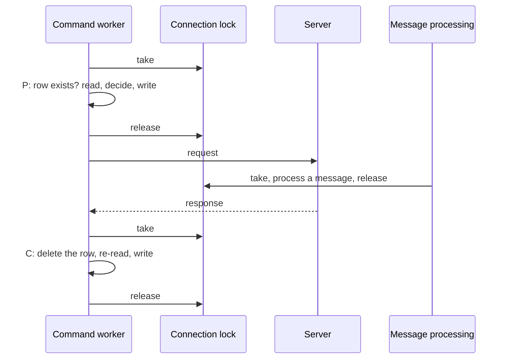
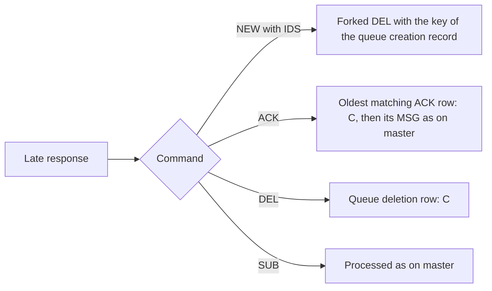
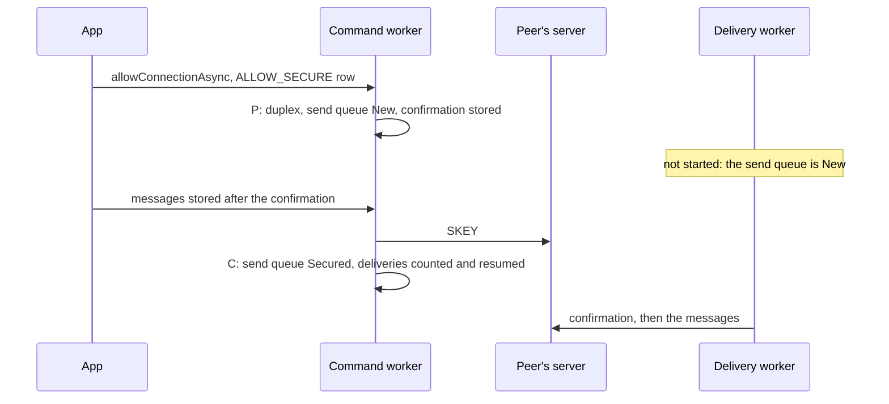
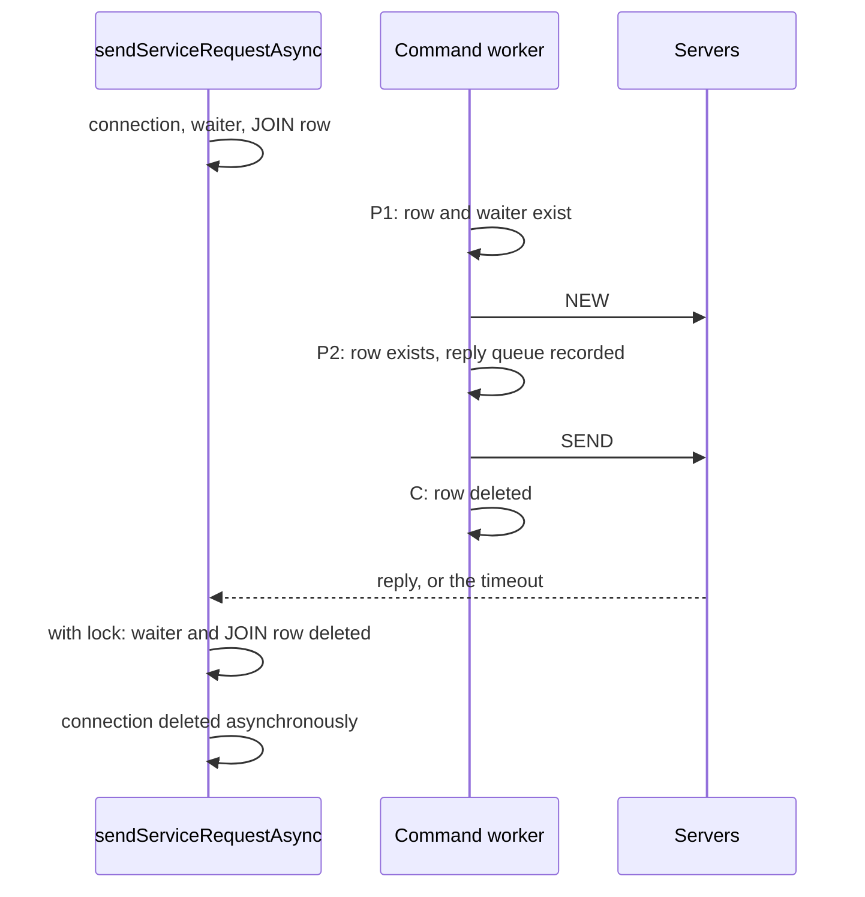
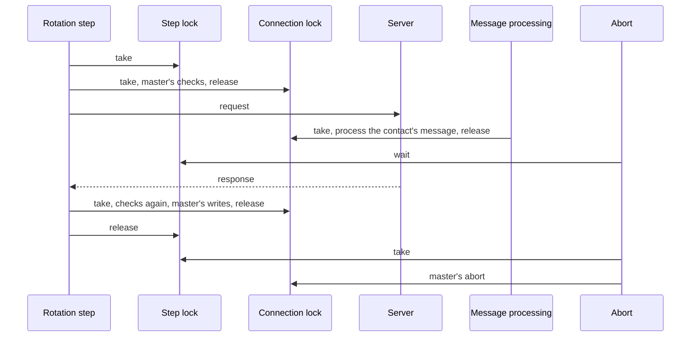

# Specification

Line references are to simplexmq master 3f57fcdc, except C, which is this branch:
- A = src/Simplex/Messaging/Agent.hs
- AC = src/Simplex/Messaging/Agent/Client.hs
- AS = src/Simplex/Messaging/Agent/Store/AgentStore.hs
- ST = src/Simplex/Messaging/Agent/Store.hs
- C = src/Simplex/Messaging/Client.hs
- schema = src/Simplex/Messaging/Agent/Store/SQLite/Migrations/agent_schema.sql

simplex-chat references are to 3fc82ff6:
- CMD = src/Simplex/Chat/Library/Commands.hs
- INT = src/Simplex/Chat/Library/Internal.hs
- SUB = src/Simplex/Chat/Library/Subscriber.hs

## 1. Types

Protocol client: Request and ServerTransmission are unchanged from this branch (C:275, 525-531).

Queue creation record (D34), stored before NEW:

```haskell
data RcvQueueCreation = RcvQueueCreation
  { server :: SMPServer,
    rcvPublicKey :: SMP.RcvPublicAuthKey,
    rcvPrivateKey :: SMP.RcvPrivateAuthKey,
    createdAt :: UTCTime
  }
```

Send queues (A:2502-2506, 2610-2612, 4445-4456):

```haskell
-- no delivery worker is started or woken for it
securingSndQueue :: SndQueue -> Bool
securingSndQueue SndQueue {status, queueMode} = status == New && senderCanSecure queueMode

-- returns the queue with its new status, for the callers' submitPendingMsg
agentSecureSndQueue :: AgentClient -> NetworkRequestMode -> ConnData -> SndQueue -> AM (SndQueueSecured, SndQueue)

isActiveSndQ :: ConnData -> SndQueue -> Bool
isActiveSndQ ConnData {connAgentVersion} SndQueue {status, sndSwchStatus, dbReplaceQueueId} =
  sndSwchStatus /= Just SSSendingQEND
    && (status == Secured || status == Active || (connAgentVersion >= rpcAddressSMPAgentVersion && status == New && isJust dbReplaceQueueId))
```

Step lock: one lock per connection, an entry of master's invitation lock map (AC:390, 1102-1108) with a key of its own per connection, taken only by link updates (section 6.1) and by the rotation steps, the start and the abort of a rotation (section 2.2). Link updates apply to contact and receive connections (A:1251-1254) and rotation to duplex connections (A:1048, 2313), so one lock serves both.

The JOIN client command of a manual acceptance carries its invitation id, as an optional last field, so that old rows parse (section 6.6). acceptContactAsync takes one more Bool parameter, True only from the chat's APIAcceptContact, that selects this form.

Unchanged: PendingCommand (ST:488-495); canAbortRcvSwitch (ST:210-222); the GET lock (AC:386). ICDuplexSecure and ICAllowSecure with a sender key are still parsed, so that old rows end (section 6.1).

## 2. State machines

### 2.1 A command row with a request

The commands table is unchanged (schema:249-263):
- command_id
- conn_id
- host
- port
- corr_id
- command_tag
- command
- agent_version
- server_key_hash
- created_at
- failed

```
step(row):
  with connection lock, one transaction:            -- P
    row exists, otherwise end
    read state; decide the request, or end with its outcome
    write what the request needs
  response <- request                               -- no lock
  with connection lock, one transaction:            -- C
    temporary error:
      row exists: write the retry state (ICDeleteRcvQueue only), keep the row; retried by master's loop
    otherwise:
      found <- DELETE FROM commands WHERE command_id = ? RETURNING 1
      found and (connection not deleted or the step deletes a queue):
        re-read the state it writes; write the outcome
      otherwise:
        undo the response
    events: after the commit, before the lock is released, without waiting (A:2483)
  after the lock: worker wake-ups, notification commands
```

These steps are the sites of section 6.1. Rotation steps follow section 2.2. The NEW and JOIN rows of connection creation and joining (A:2263-2294) keep master's code, which takes no connection lock; a connection deleted while their request is in flight has its created queue deleted when the queue is recorded (section 6.2 item 10).

A connection is deleted when connections.deleted = 1. A connection deleted with waitDelivery keeps its steps until its deliveries end, as on master (AS:614-638). The steps that delete a queue (DELETE_RCV_QUEUE) write their outcome on a deleted connection too.

| Row | Request | Written | State |
|---|---|---|---|
| present | not sent | nothing | Stored |
| present | in flight | P's writes | Requested |
| present | temporary error | retry state | Stored |
| absent, deleted by C | answered | outcome | Done |
| absent, deleted by C | permanent error | ERR | Failed |
| absent, deleted by another operation | any | undo | Undone |

Rules:
1. A permanent error ends the row with ERR as on master (A:2471, 2479), when C's DELETE finds the row; a step whose row is gone ends without an event.
2. The end of a service request deletes its JOIN row in its own transaction.
3. Undo of an IDS: the queue is recorded with deleted = 1 and a DELETE_RCV_QUEUE row while the connection exists and is not deleted; otherwise one DEL is sent from a forked thread with the queue's recipient key, which the step has from newRcvQueue_ (AC:1494), because the deletion of a connection removes its queues and commands without reading them again (AS:614-627).
4. SKEY with the same key, DEL (AUTH) and ACK (NO_MSG) are repeatable. The first C that deletes the row writes the outcome, also across the app and the iOS extension.
5. C reads queues by address where the row names them, because the ids of a connection's queues are reused (AS:2370-2375, insertRcvQueue_).
6. C reads ConnData and the send queues in its own transaction when it stores a message.



### 2.2 Rotation steps (D36)

Queue rotation keeps master's code, states and messages. The step lock of a connection (section 1) is taken, before the connection lock, by:
- the rotation steps with a request: SWCH (A:2310-2315, 2905-2921), ICQSecure (A:2366-2384), ICQSndSecure (A:2385-2409), ICQDelete (A:2410-2432);
- the abort (A:2923-2945) and the start of a rotation (A:1044-1056), which wait for a step in flight, as on master; on master the start waits for ICQDelete and is then accepted, so without the lock it would be refused while ICQDelete is in flight (A:1049).

Message processing, the delivery workers and connection deletion do not take it.

```
rotation step(row):
  with step lock:
    with connection lock: master's reads and checks before the request
    request                                   -- no connection lock
    with connection lock:
      the same reads and checks again, by the table below; the writes use the connection read here
      passed: master's writes after the request, in master's transactions; the row deleted as on master
      failed: the action of the table; the row deleted; no event unless the table names one
```

| Step | Checked again after the request | Changed by | When the check fails |
|---|---|---|---|
| SWCH (NEW) | connection present and not deleted; the queue at RSSwitchStarted (A:2907); the ratchet allows sending (A:2488) | connection deletion; a ratchet synchronization state written by message processing (A:3816-3823, 4320-4322, 4354) or by the API (A:2947-2964) | ratchet or status: the new queue recorded with deleted = 1 and a DELETE_RCV_QUEUE row (A:2935-2938), the status cleared, ERR; deleted connection: one DEL from a forked thread with the new queue's key |
| ICQSecure (KEY) | the new queue by address, Confirmed, with its replaced queue (A:2369-2371); the ratchet allows sending | connection deletion; ratchet synchronization | queue: nothing written; ratchet: ERR, nothing written, as master's error path (A:2479) |
| ICQSndSecure (SKEY, confirmation) | the new send queue by address, with its replaced queue (A:2387-2391) | a repeated QADD of the contact, which deletes that queue (A:4131, 4137); connection deletion; ratchet synchronization, which master's QEND enqueue checks after the writes (A:2395-2403, 2488) | queue: nothing written |
| ICQDelete (DEL) | the queue by address at RSReceivedMessage (A:2412-2417) | connection deletion | nothing written |

SWCH also checks the ratchet before NEW: when it does not allow sending, the status is cleared and the row ends with ERR, without a request, so that no queue is created and deleted again. Master checks it only when the switch is started (A:1051) and after NEW (A:2918, 2488).

The handlers of rotation messages (A:4121-4233) and the delivery worker's rotation branches (A:2690-2693, 2749-2795) are unchanged; they do not take the step lock.

### 2.3 A response without a waiting caller

```
late(response):
  NEW, IDS:
    the queue creation record of the batch's server and the NEW command's recipient public key (Protocol.hs:642-649)
    DEL of the IDS's rcvId signed with the record's private key, batched per received batch, from a forked thread:
    the client of the batch's transport session from getSMPServerClient (AC:693), which connects again when the session ended,
    and the protocol client's deleteSMPQueues (C:1135-1136); then the record deleted; the result is logged;
    the thread is forked as master forks its queue deletion (A:1039-1041)
    no record: logged
  ACK, any result:
    rows ACK and ACK_DEL of the queue's connection (conn_id index), decoded;
    the app's ACK rows matched through rcv_messages.broker_id (they store the agent message id, A:1023)
    the oldest row with the response's message id: C as on time
    then a MSG in the response: processed as on master (A:3632-3633)
  DEL, any result:
    queue record, deleted queues included
    DELETE_RCV_QUEUE row of that queue: C as on time
    queue of a deleted connection without such a row: record removed
  SUB OK, SOK, MSG:
    processed as on master (A:3624-3631)
  other:
    as on master (A:3634-3636)
```

A late permanent error ends its row as an on-time one; a late temporary error changes nothing. The retry that is in flight then finds no row and writes nothing.



### 2.4 Queue creation record (D34)

```
newRcvQueue_ (AC:1494-1540):
  one transaction: the record inserted (server, recipient public key, recipient private key, now)
  NEW
  IDS: the record deleted in the transaction that records the queue (section 6.2 item 10)
  an error response from the server: one transaction: the record deleted
  timeout or network error: the record kept for a late IDS (section 2.3)
cleanup manager (A:3507-3523): records older than 2 days deleted
```

A record left by a crash between the IDS and the deletion is deleted by the cleanup manager; such a queue stays on the server, as D25 records.

### 2.5 GET lock

As on master (AC:1972-1983, 2093-2101). Only the C that deletes an ACK row releases the lock and emits MSGNTF, on time or late, so one ACK row releases it once. broker_ts is read in P (AS:1298-1302). A GET whose response reached its caller has its message in msgQ already (section 6.5), so no fetch is left without its ACK.

## 3. Flows

### 3.1 Allowing a connection (ICAllowSecure)



### 3.2 Service request



An attempt whose P2 committed before the end of the call sends its request after it, once; on master an attempt also ran after the timeout until the cleanup took the lock (A:1866-1870, 2298).

### 3.3 Rotation step



## 4. Protocol and API

1. No protocol message changes.
2. smpClientVRange starts at version 3.
3. Removed from the agent API, with code that has no other user (D13):
   - acceptContact (A:80, 534-536, 1744-1764);
   - ackMessage (A:662-663); ackMessage' stays for the ACK command (A:2309);
   - deleteConnection, deleteConnections (A:691-697); deleteConnection' and deleteConnections' stay for old DEL rows (A:2316);
   - deleteConnShortLink (A:479-480, 1314-1321) and AC.deleteQueueLink;
   - subscribeConnection (A:593-595), subscribeConnections (A:598-600), resubscribeConnection (A:616-618), resubscribeConnections (A:620-622), with their implementations (A:1895-1898, 1906-1923, 2077-2094) and subscribeConnections_; toConnResult and QCmdResult (A:1899-1905) stay for deleteConnection' (A:3009) and deleteConnections_ (A:3105);
   - sendServiceReply (A:550-551) and sendServiceReply' (A:1792-1793); replyRequest_ and sendReplySync stay;
   - allowConnection (synchronous), which the chat does not call; allowConnection' stays for the LET command (A:2308);
   - sendServiceRequest (A:566-567, 1843-1848); joinConnSrv' stays;
   - subscribeClientServices (A:624-625, 2096-2103);
   - suspendConnection (A:686-687, 2995-3003) and AC.suspendQueue;
   - switchConnection (A:671-672, 2893-2903); switchDuplexConnection stays.
4. Code left without a user by item 3, removed with it:
   - resumeConnCmds (A:2229-2232);
   - getPendingCommandServers (AS:1671), getConnSubs (AS:2666, 2731), getRcvQueueSubsByConnIds_ (AS:2701), getRcvQueueSubsByConnId_ (AS:2919), getConnectionsForDelivery (AS:1103).
   The protocol client keeps deleteSMPQueueLink and suspendSMPQueue (D4). The agent then sends no LDEL.
5. simplex-chat accepts contact requests asynchronously (section 6.6); rejection is unchanged (D32).
6. The transport specification (https://github.com/simplex-chat/simplexmq/pull/2105) is changed to match, in that pull request:
   - 4.1 and 12.1: a synchronous join waits for another join of the same invitation or address, a synchronous link update waits for the link request of the same connection in flight, and the start and the abort of a rotation wait for its step in flight, as on master;
   - 5.4: a queue whose IDS arrives late is deleted from its server (section 2.3);
   - 7.2 and section 15, row 4: after QADD is stored, an abort is accepted for a peer below agent version 8 and refused at version 8 (ST:210-222); it waits for a step in flight and does not cancel it, as on master;
   - 7.3 and section 15, row 7: AUTH of a rotation message deletes the message with ERR and leaves the rotation in progress (A:2690-2693), as on master;
   - 7.6: with a peer below agent version 8, ICQDelete is created on the first message of the new queue (A:3739-3746) and deletes the old queue (A:2410-2432), as on master;
   - 7.7: a rotation step that meets ratchet synchronization ends with ERR (A:2488, 2479), as on master;
   - 7.8 and 13.1: the start and the abort of a rotation, and the rotation handlers, write in more than one transaction (A:1052-1053, 2935-2938, 4135-4147), as on master;
   - 11.3: a batch that waits for space in the send queue is dropped when its callers stop waiting (C:1397, D35);
   - 5.3 and section 15, row 3: a second join waits, as on master;
   - 6.12: a receipt is skipped when the next message of the queue starts ratchet synchronization before the receipt is stored (D23);
   - 9.3: connection deletion can send DEL for a queue whose DELETE_RCV_QUEUE row is in flight, and one of the two gets AUTH (section 5, query 3); D5 accepts it ("the problem is theoretic and causes zero user issues");
   - 10.3: a service request attempt that started before the end of the call can reach the service after it, once (section 3.2);
   - section 15, row 8: link updates of one connection are sent one at a time, as on master.

## 5. Database

One migration, on SQLite and PostgreSQL: the table of queue creation records (D34).

rcv_queue_creations, without a reference to servers, whose row is created after NEW (AS:662):
- rcv_queue_creation_id INTEGER PRIMARY KEY
- host TEXT NOT NULL
- port TEXT NOT NULL
- rcv_public_key BLOB NOT NULL
- rcv_private_key BLOB NOT NULL
- created_at TEXT NOT NULL

Indexes:
- unique on host, port, rcv_public_key
- on created_at

Added queries:
1. `DELETE FROM commands WHERE command_id = ? RETURNING 1`: primary key.
2. Marking a drained queue deleted: `UPDATE rcv_queues SET deleted = 1 WHERE ... AND deleted = 0 AND switch_status = ?`, by primary key; the DELETE_RCV_QUEUE row is created only when a row changed.
3. Connection deletion reads the receive queues of the deleted connections with a reader of its own, without the deleted filter, on SQLite and PostgreSQL; the shared readers (AS:2872-2875 and the PostgreSQL reader at AS:2692-2694) stay unchanged.
4. Queue creation records: insert; delete by primary key; select by host, port and rcv_public_key (the unique index); delete where created_at is older than the cutoff (the created_at index). SQLite's query plans for the last three use those indexes.

Store reads and transactions per path, against master (D14):

| Path | Master transactions / commits | Change |
|---|---|---|
| Received message, on every session | 2 / 1 | 2 / 1, as master |
| Received message on a queue of a duplex or receive connection that is not Active, has no e2e secret or has a replaced queue (a confirmation, the first messages on a new queue); full-queue notice | as master | one more read transaction of 3 queries, getConn (section 6.2 item 2) |
| Received contact request | as master | as master |
| Received AgentRatchetKey with a new key hash | as master | 2 more queries in getRatchetSyncState's transaction (A:4316) |
| Received QADD, QKEY, QUSE, QEND or EREADY | as master | 3 more queries in the decryption transaction; one transaction fewer when resetRatchetSync reads the state (A:3776) |
| Acknowledgement of a message | 7 / 2; the worker's user_ack update writes an unchanged value (A:2859) | 5 / 2 |
| Acknowledgement with a receipt | 9 / 3 | 5 / 2 |
| Send batch | 4 / 1 | 3 / 1 |
| Delivery of one message | 2 / 1 | 2 / 1 |
| Command attempt | 1 or 2 reads, then 1 to 4 writes | P 1, C 1 |
| Rotation step | as master | one more read of the connection after the request; the rotation lock is in memory |
| Queue creation | the queue stored | 2 more: the record inserted before NEW and deleted after the response |
| Late ACK or DEL response | 1 read | 1 read of the connection's pending ACK rows (usually one), then C 1 / 1 in message processing; the retry that follows writes nothing |
| Late IDS | 0 | 1 read of the record, one DEL request from a forked thread, 1 deletion of the record |
| Link update | as master | as master; the link lock is in memory |

On PostgreSQL clients each transaction costs round trips to the server, so the counts matter there also for reads.

## 6. Changes by module

### 6.1 Agent.hs: sites with a command row

| Site | Request | P | C | When the state read in C differs |
|---|---|---|---|---|
| ACK command (A:2309, 2846-2881) | ACK | row; message present (absent: the row ends without ACK, A:2864); user_ack set (A:1022); broker_ts read; queue read by id (AS:1235) | receipt (A:2869-2876), skipped while the ratchet does not allow sending (D23); MROk deletion (A:2877-2880); message deletion (A:2867); the drained queue marked (section 5, query 2), or the GET lock and MSGNTF (section 2.5); OK event (A:2309) | ratchet prohibits sending: receipt skipped |
| ICAck (A:2323-2324) | ACK | row; queue by (server, rcvId) with the deleted filter (AS:790); missing: no ACK (A:2437) | drained queue marked; GET lock and MSGNTF | |
| ICAckDel (A:2318-2322) | ACK | as ICAck | message deletion (A:2321); drained queue marked; GET lock and MSGNTF | |
| ICAllowSecure (A:2325-2348) | SKEY | row; a sender key or a reply queue without sender-secure mode: ERR A_VERSION; RcvConnection: upgraded to duplex (A:4413-4415) and the confirmation stored (A:4470-4484, without deleting the row); DuplexConnection: the confirmation stored when the send queue has no AM_CONN_INFO delivery | Secured (A:4449); the confirmation's internal_ts set to now; deliveries counted and resumed (A:2400-2402); a temporary error on another server moves the row (CCMoved, A:2337-2344); the permanent-error exit deletes the stored confirmation | |
| ICDuplexSecure (A:2349-2351) | none | the row ends with ERR A_VERSION | | |
| ICReplyDel (A:2352-2355) | SKEY | row; SndConnection | Secured; deliveries counted and resumed; the connection deleted with waitDelivery (A:1809) in the same transaction; the permanent-error exit deletes it in its transaction | |
| ICDeleteRcvQueue (A:2358-2365) | DEL | row; deleted queue (AS:793-796) | temporary error below the limit: delete_errors + 1, row kept; otherwise the record removed (A:2362-2365) | |
| LSET command (A:2268-2271) | LSET | row; credentials created when absent (A:1272-1293); data prepared | LINK | |
| JOIN service request (A:2295-2307) | NEW, SEND | P1: row and waiter (A:2299); P2: reply queue recorded (AS:551-559) | row deleted | waiter gone: IDS undone, or no SEND |

Rotation steps: section 2.2.

Site without a row: setConnShortLink' (A:1247-1279) reads and writes under the connection lock and sends LSET without it; nothing is written after the request.

Joins (D27): the invitation lock of master is kept (A:964, 1627, 1644), also in the JOIN service request, whose joinConnSrv' takes it (A:1644).

Delivery after SKEY: agentSecureSndQueue returns the queue with its new status (section 1), and its three callers that submit a stored message pass that queue to submitPendingMsg: sendReplySync (A:1806-1809), connectReplyQueues through enqueueConfirmation (A:4409-4411, 4465-4468) and secureConfirmQueueAsync (A:4419-4422). Otherwise the guard of section 1 skips these confirmations. secureConfirmQueue sends its confirmation itself (A:4427-4432).

Retry state: only ICDeleteRcvQueue stores its attempts (delete_errors); every other row keeps master's retry loop in memory (A:2459-2471).

Link updates of one connection (R13): setConnShortLink', for the synchronous call and for the LSET command, holds the step lock of the connection (section 1) from its read to the end of LSET (D9).

ACK details, as on master: a queue missing in P ends the row with ERR and keeps the message (AS:1235, A:2865); C either releases the GET lock and emits MSGNTF, or marks the drained, ended queue (A:2983-2987); a permanent ACK error keeps the GET lock (A:2977-2979).

ICReplyDel retries a temporary error until the reply is secured; on master the first temporary error deleted the connection (A:1809) and the retry ended with CONN NOT_FOUND, because a deleted connection is not read (AS:2748-2757).

### 6.2 Agent.hs: other changes

1. Late responses to NEW (A:3636): section 2.3.
2. Processing of a received message (A:3698) keeps master's read before the lock (A:3648). A rare message reads its connection again after the connection lock and decides on that read (D31). Steps that take the connection lock cannot change the connection between that read and the message's last write; the handlers keep master's transactions (D36). Steps that take no connection lock stay as on master, such as connection deletion (A:1033-1041, 3039-3051, 3068-3075), the cleanup manager's deletions (A:3535-3539), the delivery worker's status writes (A:2722-2728, 2802-2805), the user acknowledgement (A:1012-1023), the NEW row (A:2263-2267), the JOIN row (A:2276-2294), the synchronous invitation join (A:1626-1640), the contact join (A:1641-1676) and toggleConnectionNtfs' (A:3356-3372). One function reads the connection with its queues (getConn: AS:2753-2758, 2875, 2962), at three sites:

   | Site | Messages | Transaction | Then |
   |---|---|---|---|
   | after the lock, before the first database access | MSG on a queue of a duplex or receive connection that, by master's read, is not Active, has no e2e secret or has a replaced queue; a full-queue notice (A:3705) on a duplex connection | its own | processing continues with the read connection, its arrival queue found in it by address (rule 5 of section 2.1), and its ConnData, so every decision uses them, the choice of branch included |
   | the decryption transaction, between the parse (A:3837-3838) and updateRcvIds (A:3842) | on any other queue: QADD, QKEY, QUSE, QEND, EREADY | the decryption transaction | resetRatchetSync (A:3774-3783) and the handlers use the read connection; it replaces getRatchetSyncState at A:3776 |
   | newRatchetKey, in place of getRatchetSyncState (A:4316) | AgentRatchetKey with a new key hash and a compatible version (A:4297-4299) | getRatchetSyncState's | from the read on, newRatchetKey uses the read connection: pqSupport (A:4334, 4369), lastExternalSndId (A:4373), the connection data and send queues (A:4351, 4357, 4359) and the events (A:4337-4346) |

   Not read again:
   - A_MSG, A_RCVD, QTEST, HELLO (prohibited at A:4065) on any other queue, duplicates (A:3785-3808) and the other errors (A:3824-3826);
   - A_QCONT: it decides only whether the send queue it names exists (A:4083-4092), and on a duplex connection steps under the connection lock change which send queues exist only by deleting them (A:2774, 2786-2791), so master's read keeps QCONT for a queue deleted while the message waited;
   - messages to a contact connection: its mode, versions and pqSupport have no writer after creation (AS:2648; A:972, 1670, 2186 with 2200-2204, 2960, 3866, 4006, 4007), and its ratchet keys and duplicate hashes are read in their own transactions (A:4260, 4285-4288);
   - decryption errors: master reads the ratchet synchronization state again under the lock (A:3818); on a receive connection the queue stays New or Confirmed until an agent message sets it Active (A:3738), which the peer sends only after CON (A:4036-4038), so such an error is a message of the first site; ERR A_QUEUE (A:3816, 4293) remains only for an Active queue of a receive connection, which a peer creates by sending before CON, as on master; RSYNC events carry the connection statistics of master's read (A:3819-3822), as on master;
   - END, DELD and ERR (A:3877-3897), which decide nothing on the database.

   A failure of the second read is rethrown past handleNotifyAck (A:3875-3876) and past A:3824-3826, so the message is not acknowledged: when the connection is gone, ERR is emitted with an empty connection id and without ACK, as when master's read fails (A:3648-3649); another store error is handled as 6.2 item 12. When only the arrival queue is gone, processing continues with master's record of it, as on master: rcv_messages has no foreign key to rcv_queues (schema:113-129), the queue update in createRcvMsg matches no row (AS:1031-1032), and ICAckDel finds no queue and sends no ACK (A:2435-2437). Below agent version 8, a message the peer sent on the old queue before it processed QUSE is then processed after ICQDelete (A:2425); at version 8, a message sent on the old queue before QEND is processed after the ended queue is deleted (A:2987, 3595); both as on master.

   At the second site the arrival queue keeps master's record. The handlers read only its switch status (A:4168) and its address (A:4211), after they look the other queue up in the read connection (A:4165-4167, 4207); an abort (A:2936) or ICQSecure (A:2376) committed while the message waited fails that lookup or its status check first.

   The decisions made on master's read are safe, because the state they use is written only by message processing, which runs in one thread, one transmission at a time (A:3493-3497, 3609), or by these writers:
   - the e2e secret, which selects the path (A:3715), and the agreed client version (A:3714): setRcvQueueConfirmedE2E (AS:713-724), called only from message processing, on New or Confirmed queues (A:3957-3963, 4018, 4032, 4166-4171);
   - the queue status: besides setRcvQueueConfirmedE2E and the Active writes of message processing (A:3738, 4038), only Secured on a queue checked at Confirmed (A:2376, section 2.2) and in `secure` (A:2443), reached only from ICAllowSecure with a sender key and ICDuplexSecure, which end with A_VERSION (section 6.1); an Active queue does not leave Active;
   - the replaced queue: set when the queue is created (AS:2381) and only cleared afterwards (AS:750-755, from A:3741 and 3964);
   - the connection type: RcvConnection becomes duplex only at A:4415, under the lock, before the confirmation is stored (A:4411), which the peer needs before CON and any receipt (A:4036-4038);
   - the agent version: updateConnVersion writes it only upwards (A:3865-3866); its other writers run before the queue has its e2e secret (A:4006 with A:4018; updateNewConnJoin, A:972, AS:2796-2798);
   - the ratchet: read inside the decryption transaction, after lockConnForUpdate (A:3833-3836);
   - the ratchet synchronization state: resetRatchetSync reads it again when master's read shows RSAllowed, RSRequired or RSAgreed (A:3776); for RSOk and RSStarted master's read stays valid, because the only writer outside message processing, synchronizeRatchet', writes RSStarted (A:2961);
   - receipts: their rows are read in their own transaction (A:4107).
   A connection marked deleted (A:1038), or a queue removed or marked deleted (A:2365, 2425, 2987, 3092-3096, 3595), while an A_MSG or A_RCVD waits fails the app's acknowledgement (A:1003, AS:1235), as on master.
3. Rotation: the step lock and the checks after the request (section 2.2).
4. A message is stored with all its deliveries in one transaction: enqueueMessageB (A:2561-2579 with A:2591-2601), synchronizeRatchet' (A:2957-2964 with A:4487-4490) and recreateRatchet (A:4350-4362).
5. Connection deletion also deletes the receive queues already marked deleted (section 5, query 3); a DEL for a queue already deleted on the server returns AUTH and is reported in DEL_RCVQS (A:3091-3099, 3083).
6. The KEY handshake of connection establishment: no ICDuplexSecure rows are created (A:4035); a confirmation with a sender key is refused; joining an invitation whose queue has no sender-secure mode is refused with A_VERSION in compatibleInvitationUri (A:1598-1605, used by A:965, 1485, 1540 and 1592).
7. The cleanup manager (A:3507-3523) deletes queue creation records older than 2 days (section 2.4).
8. Start (D39, C2): subscribeAllConnections' resumes stored deliveries before the subscription loops, resumes the commands of each server when that server's loop ends, and the commands without a server at once (A:2006-2014). Commands of a server wait for its SUB, because an ACK before SUB on a new session gets NO_MSG (Server.hs:1983-1987).
9. Deferred events (D39, C3): once a handler has deferred one event because subQ is full, its later events are deferred too, in order (A:3904, 2483), and the deferred events are written also when the handler ends with an error (A:3686-3690, 2256-2259).
10. Recording a created queue (D39, C6): when the connection is gone at the record (AS:551-559, 646-651), one DEL is sent from a forked thread with the in-memory queue id and key (rule 3 of section 2.1, AC:2116-2119); the queue creation record is deleted in the transaction that records the queue (section 2.4).
11. Connection deletion (D39, C7): rows are deleted only of connections read live (A:3049-3058), and setUserDeleted returns live connections only (AS:394-399); a connection without receive queues deleted with waitDelivery is marked deleted_at_wait_delivery (AS:614-638, A:1037-1038); commands of a deleted connection are skipped, except queue deletions, by reading connections.deleted in getPendingServerCommand (AS:1733-1743), and deliveries of deleted connections are not selected (AS:1116-1132).
12. A message without a stored acknowledgement (D39, C8): when reading the connection (A:3646-3653), the second read of item 2 or storing the ACK row (A:3871-3876) fails with a store error other than SEConnNotFound, the queue's subscription is set pending, and the resubscription worker sends SUB again (AC:827-862).
13. Command order (D39, C10): pending commands are selected in command_id order instead of created_at (AS:1718, 1728).

### 6.3 Agent/Client.hs

1. newRcvQueue_ (AC:1494-1540) stores and deletes the queue creation record (section 2.4).
2. The test hook of this branch that refuses a server request while a connection lock is held stays behind its build flag.
3. A test hook behind the same build flag holds a received message between master's read (A:3648) and the connection lock (A:3698) until the test releases it (section 7, R2).

### 6.4 Agent/Store.hs and AgentStore.hs

1. The migration and the queries of section 5.

### 6.5 Client.hs

1. The receiving thread writes the message that a response carries to msgQ before it passes the response to its caller (C:709-733, D16), so a caller that has its response also has its message in msgQ:

   ```
   processMsgs batch:
     1. each response without a message whose caller waits: passed to the caller, as on master
     2. one transaction:
        each response with a message (SUB, ACK, GET): its caller's pending flag swapped;
          still waiting: its message written to the msgQ batch as STEvent, and the response passed to the caller
          stopped waiting: the response written to the msgQ batch as STResponse
        events, unexpected errors and the other late responses written to the msgQ batch, in the order of the batch
   ```
   The transaction commits the msgQ write and the response together: a caller that has its response has its message in msgQ, and every response reaches either its caller or msgQ. While msgQ is full, the transaction waits; a caller that stops waiting meanwhile gets its response as STResponse.
2. A batch that waits for space in the send queue is dropped when its callers' waits end, as in this branch (C:1397, D35).

### 6.6 simplex-chat

1. APIAcceptContact (CMD:1450-1488) accepts with acceptContactAsync:
   - every acceptance, manual and automatic (acceptContactRequestAsync, INT:1020-1039), stores its connection with ConnJoined, in the transaction that creates the chat command, where master stores ConnNew (Direct.hs:940); when acceptContactAsync fails at once, the connection is set back to ConnNew; the response is built from the connection read after the call, so a JOINED processed first returns ConnSndReady (SUB:175). A ConnNew connection then means a failed acceptance;
   - the contact created for a request without a contact (INT:996-1001) stores the request's id in contacts.contact_request_id, which createContactFromRequest leaves empty (Direct.hs:895-922), so that the request's actions show after a failure;
   - an accept of a contact whose connection is ConnNew, left by a failed acceptance, accepts again on the same agent connection (item 5), with a new chat command; an accept of a connection that is ConnJoined or later returns the contact without an agent call;
   - the welcome message is sent by the JOINED continuation (SUB:736-745), and sendWelcomeMsg (CMD:1481-1488) is removed;
   - the response is returned at once, with the contact at ConnJoined; ContactSndReady follows JOINED (SUB:740), as after an auto-accept, and both apps apply it (SimpleXAPI.swift:2608; SimpleXAPI.kt:2982) (D33).
2. The agent ends a manual acceptance after 2 days of temporary errors: the retry loop (A:2459-2471) ends a JOIN row that carries an invitation id (item 3) with ERR when its created_at is older than helloTimeout (Env/SQLite.hs, 2 days), as it ends QUOTA errors after quotaExceededTimeout (A:2463-2468). A permanent error ends it at once (A:2479). The other callers of acceptContactAsync (INT:1038, 1093, 1125, 1160, 1189, 1214; SUB:1685) keep master's unbounded retries.
   A manual acceptance whose confirmation expires after the JOIN row ended stays as it is: the contact never connects and the failed state does not show (D37). A TODO at the expiry of AM_CONN_INFO deliveries (A:2702-2712) marks it for the work that bounds unbounded cases in time.
3. The agent keeps the request of a manual acceptance until it succeeds: acceptContactAsync' does not delete it at enqueue for this form (A:999); the transaction that stores the confirmation and deletes the JOIN row (A:4483-4485) also deletes the request, and the row's ERR exit marks it not accepted (AS:935-937, unacceptInvitation), so it can be accepted again. Other callers delete it at enqueue, as on master.
4. A failed acceptance is a visible state. APIAcceptContact creates its command with a command function of its own, CFAcceptContactRequest, encoded "accept_contact_request", which expects JOINED as CFAcceptContact does (Types.hs:2171-2220, INT:3143); other acceptances keep CFAcceptContact and master's handling. On ERR of that command, whatever the error class (SUB:761-763, in withCompletedCommand), the chat sets the connection back to ConnNew, after master's status update (SUB:179), and emits CEvtContactUpdated (Controller.hs:996), which both apps apply (SimpleXAPI.swift:2643; SimpleXAPI.kt:3016). The contact keeps its request (CMD:1473-1479 change only contact_used). With a ConnNew connection, the apps already show the request's Reject and Accept actions (nextAcceptContactRequest, ChatTypes.swift:2513-2517, ChatModel.kt:1923; ContextContactRequestActionsView.swift:19-35; ComposeView.kt:1836-1845). The chat list shows "failed to accept" for a contact with a request and a ConnNew connection, where it shows "Open to accept" today (ChatPreviewView.swift:373-374; ChatPreviewView.kt:192-193); master leaves such a connection after a failed synchronous accept (INT:1013-1015). Accepted contacts that are still connecting show "connecting…" (ChatPreviewView.swift:375-378), where auto-accepted ones show "Open to accept" today. Reject deletes the agent's request, as today (A:1782), and leaves the agent connection of a failed acceptance, as master leaves it after a failed synchronous accept (D32).
5. acceptContactRequest (INT:988-1018) is removed. Its branches:
   - no contact (INT:996-1001): prepareAgentAccept first, then createContactFromRequest with the agent connection id (Store/Direct.hs:895-896);
   - a contact without a connection (INT:1005-1012): acceptContactRequestAsync (INT:1020-1039), with the address id optional for a deleted address; the auto-accept caller (SUB:1540) passes it;
   - a contact with a connection, left by an earlier failed accept (INT:1013-1015): acceptContactAsync on that agent connection, so that its stored queue and ratchet are used (A:1706-1713).
6. APIRejectContact (CMD:1489-1507) is unchanged (D32).
7. iOS opens the accepted chat without the sndReady condition (apps/ios/Shared/Model/SimpleXAPI.swift:1797-1804), as Android already does (ChatListNavLinkView.kt:741-752).
8. The bot API documentation of APIAcceptContact becomes UNBackground and states that the contact can be messaged after ContactSndReady, or after ContactConnected for a contact whose queue its app secures later (SUB:739-740, A:4456) (bots/src/API/Docs/Commands.hs:154, Events.hs); bots/api/COMMANDS.md and the generated TypeScript and Python command types (tests/APIDocs.hs:42, 47) are regenerated.
9. Tests:
   - the expectations of "accepting contact request, you can send messages to contact" become the two outputs that auto-accept prints; testRetryConnectingViaContactLink becomes a test of agent retries;
   - added: an acceptance whose server fails for longer than the bound shows the failed state, and Accept again completes after the server returns;
   - added: an auto-accepted request whose server fails for longer than 2 days connects after the server returns, as on master;
   - added: an auto-accepted contact shows ConnJoined until JOINED; an acceptance that fails at once leaves ConnNew; a request accepted without a prior contact shows its actions after a failure;
   - app tests on recorded core responses: CEvtContactUpdated with a ConnNew connection of a contact with a request shows "failed to accept" in the chat list and the Reject and Accept actions in the chat, on iOS and Android.
10. Chat commands with agent network calls under a group lock (D38): APIAddMember (CMD:2822, 2839), APIAddMemberViaGroup (CMD:2852, 2873), APIJoinGroup (CMD:2887, 2911), APICreateGroupLink (CMD:3359, 3368) and APIAddGroupRelays (CMD:2791, 2805, 4429):
    - under the group lock: the checks and reads the command makes before the agent call;
    - without the lock: the agent call;
    - under the group lock: the same checks again, then the writes; when a check fails, the new agent connection is deleted asynchronously and the command returns the error its checks return today when it runs after a concurrent command;
    - the join keeps its rollback of member statuses (CMD:2912-2916); the responses keep their form;
    - tests: each command while the server delays its responses, with messages of another contact arriving meanwhile; two concurrent adds of one contact and two joins of one group end as today.
11. A ready connection stays ready (D39, C3): the status update from an event (SUB:165-172) never lowers ConnReady, so an INFO or JOINED written after CON leaves it ready.
12. simplexmq is referenced at the commit of this branch.

## 7. Tests

| Rule | Test |
|---|---|
| R1 | the conn_lock_checks build of the CI entry "PostgreSQL agent store": a server request made under a connection lock fails, so every agent test that reaches one fails; "should prohibit server requests in connection lock"; "should acknowledge message when event and message queues are full" |
| R2 | "should receive messages while the server of the new queue does not respond"; added (D31), with the hook of section 6.3 item 3: a QKEY held after master's read while an abort below agent version 8 commits ends with "QKEY: queue address not found" (A:4176); an AgentRatchetKey held from before ICQSndSecure commits stores the key only for the new send queue, and ratchet synchronization completes without another message; below agent version 8, a full-queue notice held while AM_QTEST_ deletes the old send queue stores no delivery for the deleted queue; an A_QCONT held while AM_QEND_ deletes the send queue it names still produces QCONT; below agent version 8, an A_QCONT held on the old queue while ICQDelete commits still produces QCONT; a message held while its connection is deleted ends with ERR and leaves no ACK row |
| R3 | "should delete the new queue when the connection is deleted waiting for delivery while the queue is created"; added: a service request whose call ends while its NEW is in flight deletes the created queue |
| R4 | "should acknowledge message twice while the server does not respond"; added: an ACK row kept across a restart; an ACK retried across a server outage; an ACK with a receipt during ratchet synchronization; a late ACK response that arrives while its retry is in flight, followed by the next message's ACK, with the messages received in order and none received twice |
| R5 | the existing message tests, with ackMessageAsync; added: messages and receipts stored while ICAllowSecure waits for its server are delivered after the confirmation, in order; the confirmation of an asynchronous join and of acceptContactAsync is delivered without a restart; a session that ends while a response with a message is passed loses no message |
| R6 | the existing rotation tests, slow and fast, with abort, unchanged; "should refuse the switch when ratchet synchronization starts before the new queue is created"; added: an abort while SWCH waits for its server waits for the step and then follows master's rules; the contact's rotation messages are processed while a rotation step waits for its server; a repeated QADD of the contact during ICQSndSecure's request leaves nothing written by the step |
| R7 | added: a message stored for two send queues has both deliveries, or neither, when its transaction fails |
| R8 | added: a late IDS deletes the queue on the server, for a NEW row and for a synchronous createConnection; the queue creation record is deleted after a response, used for a late IDS, and deleted by the cleanup manager after 2 days; a late ACK OK completes its row; a late DEL completes the queue deletion |
| R9 | the tests of removed functions move to ackMessageAsync, subscribeAllConnections, sendServiceRequestAsync, sendServiceReplyAsync and deleteConnectionsAsync; acceptContact tests move to acceptContactAsync with JOINED; added: the NSE GET path with ackMessageAsync and MSGNTF; an acceptance ends with ERR after the bound and is accepted again (section 6.6 items 2, 3); simplex-chat and app tests of section 6.6 item 9 |
| R10 | agent_query_plans.txt regenerated by the simplex-chat schema test shows the index of every added query |
| R11 | added: an old-handshake row ends with A_VERSION; an invitation without a sender-secured queue is refused |
| R12 | added: a queue marked deleted by an abort is deleted with its connection |
| R13 | added: while the server delays its responses within the timeout, a synchronous link update waits for the LSET request of the same connection that is in flight |

Moved tests (R9):
- tests moved from subscribeConnection(s) to subscribeAllConnections wait for UP, which the moved form emits (AC:1744);
- the assertions that depend on removed results are dropped: the synchronous subscription error of testDeliveryAfterSubscriptionError (FunctionalAPITests.hs:2662-2663) and the per-connection deletion results of testBatchedSubscriptions (FunctionalAPITests.hs:3500-3511);
- each suspendConnection step goes with the send and the MERR AUTH that depend on it (FunctionalAPITests.hs:867-869, 1146-1148, 3765-3767);
- a test of acceptContact retried after a failure becomes a test of the agent's retries of acceptContactAsync across a server outage.

Removed:
- the branch's tests of a full event queue for deletion, user deletion and service startup, because event delivery is unchanged (D2);
- the branch's rotation tests of the replaced design (FunctionalAPITests.hs on this branch, lines 641, 643, 647 and 649): an abort while the queue is created, the asynchronous switch ending without an event when aborted, the switch completing after ratchet synchronization, and switch commands of both directions waiting for ratchet synchronization (D36).

## 8. Order of work

1. simplexmq https://github.com/simplex-chat/simplexmq/pull/2095, one commit per mechanism, each passing the tests on its own:
   1. the securing send queue guard and agentSecureSndQueue returning the updated queue to its three callers (sections 1, 6.1), which the confirmation stored in P of commit 2 needs;
   2. command rows and the connection lock around database work only (sections 2.1, 6.1), with the step lock for link updates; rotation steps keep master's lock until commit 3;
   3. the step lock for rotation and the checks after the request (section 2.2); from this commit the conn_lock_checks build of R1 passes;
   4. late responses (section 2.3) with the queue creation records (sections 2.4, 5), and the protocol client order (section 6.5);
   5. message storage in one transaction (6.2 item 4);
   6. removal of the KEY handshake;
   7. removal of the unused API functions, with the moved tests, and the acceptance changes of section 6.6 items 2 and 3;
   8. connection deletion of marked queues;
   9. a message without a stored acknowledgement (D39, 6.2 item 12);
   10. the second read of rare received messages (6.2 item 2), with the hook of 6.3 item 3; its store errors go to the handling of commit 9;
   11. the other races of D39, one commit each: start order (6.2 item 8), deferred events (6.2 item 9), a queue created while its connection is deleted (6.2 item 10), connection deletion (6.2 item 11), command order (6.2 item 13).
2. simplex-chat, a pull request titled "DO NOT MERGE" until the simplexmq one is merged: section 6.6.
